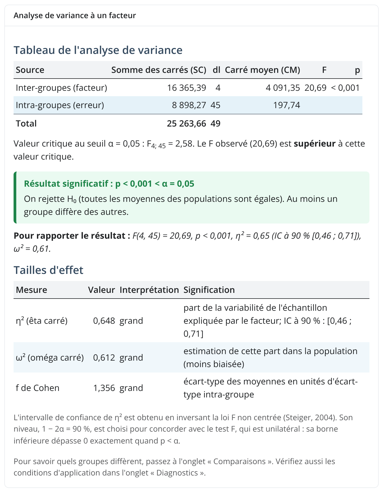
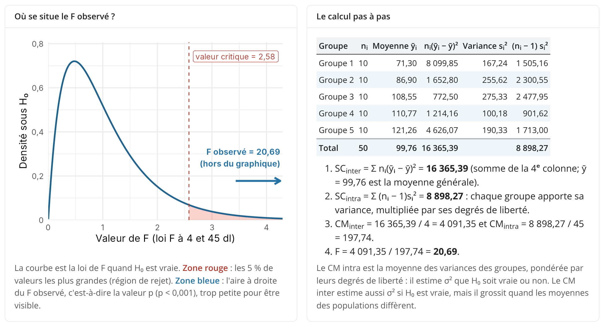
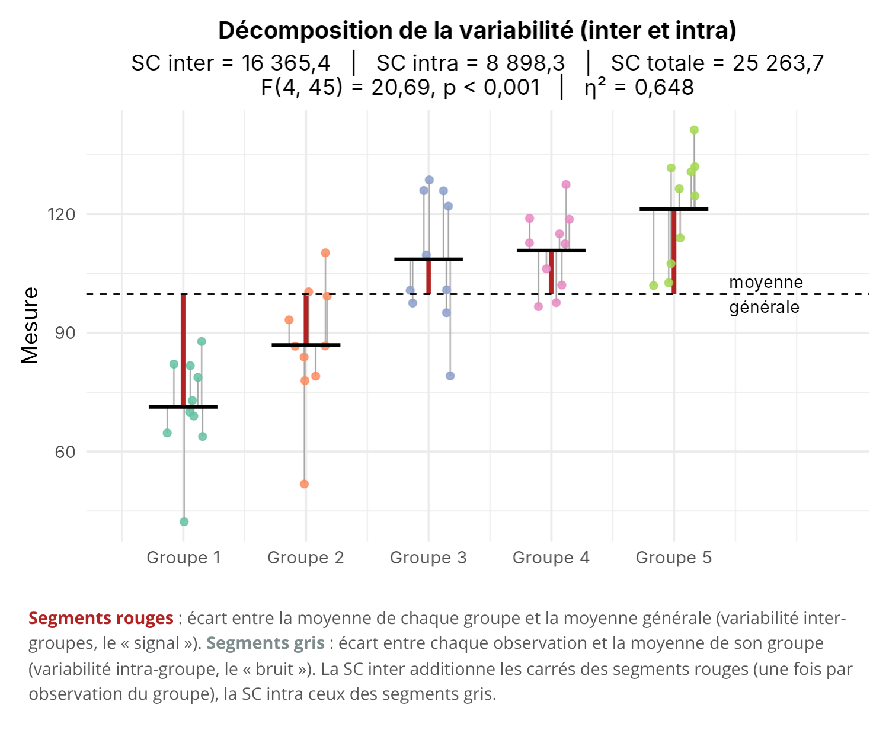
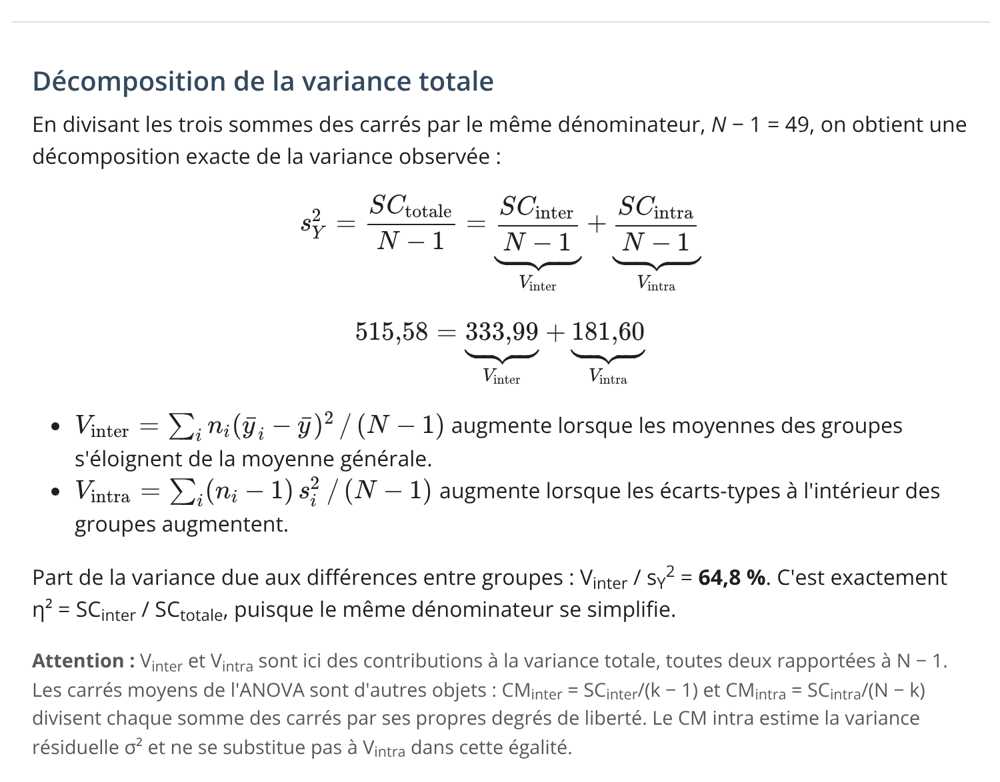

# L'ANOVA et l'application {#sec-intro}

```{r}
#| label: setup
#| include: false
#| cache: false
source("_common.R")
v_tot <- ref_a$sctot / (ref_a$N - 1)
v_int <- ref_a$scinter / (ref_a$N - 1)
v_res <- ref_a$scintra / (ref_a$N - 1)
```

::: {.callout-tip title="Objectifs d'apprentissage"}
À la fin de ce chapitre, vous serez en mesure de :

- expliquer pourquoi on n'enchaîne pas des tests $t$ pour comparer plus de deux moyennes;
- écrire le modèle de l'ANOVA à un facteur et formuler ses hypothèses $H_0$ et $H_1$;
- décomposer la variabilité totale en variabilité **inter-groupes** et **intra-groupes**, et calculer les sommes des carrés sur un petit exemple;
- expliquer d'où viennent les degrés de liberté et ce qu'estiment les deux carrés moyens, selon que $H_0$ est vraie ou non;
- interpréter la statistique $F$ et la valeur $p$ à l'aide de la loi $F$;
- simuler un échantillon dans l'application, lire son premier tableau d'ANOVA et en refaire le calcul.
:::

::: {.callout-important title="Idée centrale"}
L'ANOVA compare deux estimations de la variance. L'une repose sur les écarts **entre** les moyennes des groupes (le signal), l'autre sur les écarts **à l'intérieur** des groupes (le bruit). Si toutes les moyennes de population sont égales, les deux estiment la même quantité et leur rapport $F$ est voisin de 1. Un $F$ nettement supérieur à 1 indique que les groupes diffèrent plus entre eux que ne le permet le hasard.
:::

::: {.callout-warning title="Pièges classiques"}
- **Croire que l'ANOVA compare des variances de groupes.** Elle compare des **moyennes**; les variances ne sont que l'outil qui sert à le faire.
- **Conclure qu'un $F$ significatif dit quels groupes diffèrent.** Il dit seulement qu'au moins une moyenne diffère; le @sec-comparaisons cherche lesquelles.
- **Lire une valeur $p$ comme la probabilité que $H_0$ soit vraie.** C'est la probabilité d'obtenir un $F$ au moins aussi grand **si** $H_0$ était vraie.
- **Oublier de cliquer sur « Générer les données ».** Modifier un réglage de simulation ne change pas l'échantillon tant qu'on n'a pas cliqué.
:::

## Comparer plusieurs moyennes

Supposons trois méthodes pédagogiques, trois doses d'un médicament ou trois sols de culture. On mesure un résultat dans chaque groupe et l'on se demande : *les moyennes diffèrent-elles vraiment, ou les écarts observés ne sont-ils que le fruit du hasard d'échantillonnage ?*

Pour deux groupes, le test $t$ suffit. Avec trois groupes ou plus, on pourrait être tenté de faire un test $t$ pour chaque paire. Ce serait une erreur : chaque test comporte un risque $\alpha$ de conclure à tort à une différence, et ces risques s'accumulent. Avec trois groupes, il y a trois paires; si chaque test est fait au seuil de 5 %, la probabilité de commettre **au moins une** erreur avoisine 12 %. Avec cinq groupes (dix paires), elle atteint environ 28 %, plus de cinq fois le risque annoncé. (Ces chiffres, valables pour des groupes de 10 observations, viennent d'une simulation que l'application permet de refaire, au @sec-comparaisons; la formule simple $1 - 0{,}95^m$, qui suppose des tests indépendants, donne un peu plus : 14 % et 40 %.) L'**analyse de variance** (ANOVA), due à Fisher [@fisher1925], répond à la question en **un seul test**, pour l'ensemble des groupes, avec un risque d'erreur global égal à $\alpha$.

Le nom surprend : pourquoi parler de *variance* pour conclure sur des *moyennes* ? Parce que l'ANOVA compare deux sources de variation. Si les moyennes des groupes s'écartent nettement les unes des autres, bien plus que ne le laisse prévoir la dispersion à l'intérieur de chaque groupe, c'est le signe d'un effet réel.

## Le modèle et les hypothèses

On note $y_{ij}$ la mesure de l'individu $j$ du groupe $i$, avec $i = 1, \dots, k$ groupes et $n_i$ individus dans le groupe $i$; $N = \sum n_i$ est le nombre total d'observations. Le modèle à un facteur s'écrit

$$
y_{ij} = \mu + \tau_i + \varepsilon_{ij},
$$

où $\mu$ est la moyenne générale, $\tau_i$ l'effet propre du groupe $i$ (l'écart entre la moyenne de ce groupe et la moyenne générale) et $\varepsilon_{ij}$ l'erreur, c'est-à-dire ce qui distingue l'individu de la moyenne de son groupe. On suppose que les erreurs sont **indépendantes** et suivent une **loi normale** de moyenne nulle et de **variance $\sigma^2$ commune** à tous les groupes. Ces trois conditions sont examinées au @sec-diagnostics.

L'hypothèse nulle affirme l'absence d'effet :

$$
H_0 : \mu_1 = \mu_2 = \cdots = \mu_k \qquad \text{(tous les } \tau_i \text{ sont nuls)},
$$

contre l'hypothèse alternative $H_1$ : *au moins une moyenne diffère des autres*. Attention : $H_1$ ne dit pas que **toutes** les moyennes diffèrent. Rejeter $H_0$ ne dit pas non plus *lesquelles* diffèrent; c'est le rôle des comparaisons multiples (@sec-comparaisons).

## Décomposer la variabilité

Le cœur de l'ANOVA tient dans une identité. L'écart de chaque observation à la moyenne générale $\bar{y}$ se scinde en deux morceaux :

$$
\underbrace{(y_{ij} - \bar{y})}_{\text{écart total}} = \underbrace{(\bar{y}_i - \bar{y})}_{\text{écart inter}} + \underbrace{(y_{ij} - \bar{y}_i)}_{\text{écart intra}} .
$$

L'écart **inter** est celui de la moyenne du groupe à la moyenne générale; l'écart **intra** est celui de l'observation à la moyenne de son groupe. En élevant ces écarts au carré et en les additionnant sur toutes les observations, les doubles produits s'annulent (dans chaque groupe, les écarts intra totalisent zéro) et l'on obtient la décomposition des **sommes des carrés** (SC) :

$$
SC_{\text{totale}} = SC_{\text{inter}} + SC_{\text{intra}},
\qquad
SC_{\text{inter}} = \sum_{i=1}^{k} n_i\,(\bar{y}_i - \bar{y})^2,
\qquad
SC_{\text{intra}} = \sum_{i=1}^{k} \sum_{j=1}^{n_i} (y_{ij} - \bar{y}_i)^2 .
$$

La part **inter** mesure à quel point les moyennes des groupes s'éloignent de la moyenne générale : c'est le *signal*. La part **intra** mesure la dispersion à l'intérieur des groupes : c'est le *bruit*.

Une écriture équivalente de la $SC_{\text{intra}}$ est très utile en pratique. Dans le groupe $i$, la somme des carrés des écarts à la moyenne vaut $(n_i - 1)\,s_i^2$, où $s_i^2$ est la variance du groupe. Donc

$$
SC_{\text{intra}} = \sum_{i=1}^{k} (n_i - 1)\, s_i^2 .
$$

Le bruit n'est rien d'autre que la somme des variances des groupes, chacune pondérée par ses degrés de liberté. Il suffit donc de connaître les effectifs, les moyennes et les écarts-types des groupes pour calculer une ANOVA.

### Un calcul à la main

Rien ne vaut un petit exemple. Trois groupes de trois observations :

| Groupe | Observations | Moyenne $\bar{y}_i$ | Variance $s_i^2$ |
|:------:|:------------:|:-------------------:|:----------------:|
| A | 4, 5, 6 | 5 | 1 |
| B | 7, 8, 9 | 8 | 1 |
| C | 9, 11, 13 | 11 | 4 |

: Un petit jeu de données ($k = 3$, $n = 3$, $N = 9$). La moyenne générale vaut $\bar{y} = 8$. {#tbl-petit-exemple}

- $SC_{\text{inter}} = 3\,(5-8)^2 + 3\,(8-8)^2 + 3\,(11-8)^2 = 27 + 0 + 27 = 54$. Chaque moyenne compte autant de fois que son groupe a d'observations.
- $SC_{\text{intra}}$ : dans A, $(4-5)^2 + (5-5)^2 + (6-5)^2 = 2$; dans B, de même, 2; dans C, $(9-11)^2 + 0 + (13-11)^2 = 8$. Total : $SC_{\text{intra}} = 12$. Avec les variances : $2 \times 1 + 2 \times 1 + 2 \times 4 = 12$.
- $SC_{\text{totale}}$ : les écarts à 8 donnent $16 + 9 + 4 + 1 + 0 + 1 + 1 + 9 + 25 = 66$, soit bien $54 + 12$.

La @fig-petit-exemple dessine ce calcul. Chaque segment est un écart; chaque somme des carrés additionne les carrés d'une famille de segments.

```{r}
#| label: fig-petit-exemple
#| fig-cap: "Le petit exemple en image. Segments gris : écart de chaque observation à la moyenne de son groupe (leurs carrés totalisent $SC_{\\text{intra}} = 12$). Segments rouges : écart de chaque moyenne de groupe à la moyenne générale, 8 (leurs carrés, comptés trois fois chacun, totalisent $SC_{\\text{inter}} = 54$). Les groupes sont bien séparés par rapport à leur dispersion interne."
#| fig-alt: "Neuf points répartis en trois colonnes A, B et C, avec un trait noir horizontal à la moyenne de chaque groupe (5, 8, 11), une ligne pointillée à 8 et des segments rouges reliant les moyennes à 8. Les segments rouges de A et C mesurent 3; celui de B est nul."
#| fig-height: 3.6
#| fig-width: 6.5
pe <- data.frame(g = rep(c("A", "B", "C"), each = 3), y = c(4, 5, 6, 7, 8, 9, 9, 11, 13))
pe$x <- rep(1:3, each = 3) + rep(c(-0.12, 0, 0.12), 3)
pe$m <- ave(pe$y, pe$g)
mo <- data.frame(x = 1:3, m = c(5, 8, 11))
ggplot(pe) +
  geom_hline(yintercept = 8, linetype = "dashed", colour = "grey30") +
  geom_segment(aes(x = x, xend = x, y = y, yend = m), colour = "grey60", linewidth = 0.8) +
  geom_segment(data = mo, aes(x = x + 0.3, xend = x + 0.3, y = m, yend = 8), colour = pal$rouge, linewidth = 1.6) +
  geom_segment(data = mo, aes(x = x - 0.25, xend = x + 0.25, y = m, yend = m), linewidth = 1.1) +
  geom_point(aes(x, y), size = 3, colour = pal$bleu) +
  annotate("text", x = 3.55, y = 8, label = "moyenne\ngénérale = 8", hjust = 0, size = 3.4) +
  annotate("text", x = 1.38, y = 6.5, label = "5 − 8 = −3", colour = pal$rouge, hjust = 0, size = 3.4) +
  annotate("text", x = 3.38, y = 9.5, label = "11 − 8 = 3", colour = pal$rouge, hjust = 0, size = 3.4) +
  scale_x_continuous(breaks = 1:3, labels = c("A", "B", "C"), limits = c(0.6, 4.2)) +
  scale_y_continuous(breaks = seq(4, 13, 1)) +
  labs(x = "Groupe", y = "Mesure")
```

### Degrés de liberté et carrés moyens

Une somme des carrés grandit mécaniquement avec le nombre de termes additionnés. Pour comparer le signal et le bruit, on la divise par ses **degrés de liberté** (dl), le nombre d'écarts qui peuvent varier librement :

- **inter** : $k$ moyennes, mais leurs écarts pondérés à la moyenne générale totalisent zéro; il reste $k - 1$ degrés de liberté;
- **intra** : dans chaque groupe, les $n_i$ écarts à la moyenne du groupe totalisent zéro; il reste $n_i - 1$ par groupe, soit $N - k$ au total.

Le quotient d'une somme des carrés par ses degrés de liberté est un **carré moyen** (CM), une variance. Le rapport des deux carrés moyens définit la statistique de test :

$$
F = \frac{CM_{\text{inter}}}{CM_{\text{intra}}} = \frac{SC_{\text{inter}} / (k-1)}{SC_{\text{intra}} / (N-k)} .
$$

Dans le petit exemple : $CM_{\text{inter}} = 54/2 = 27$, $CM_{\text{intra}} = 12/6 = 2$, d'où $F = 27/2 = 13{,}5$.

### Ce qu'estiment les carrés moyens

Pourquoi ce rapport a-t-il un sens ? Parce que les deux carrés moyens estiment des quantités connues. Le **carré moyen intra** est la moyenne pondérée des variances des groupes : il estime la variance des erreurs, $\sigma^2$, **que $H_0$ soit vraie ou non**, puisqu'il ignore les écarts entre groupes. Le **carré moyen inter**, lui, estime $\sigma^2$ augmentée d'un terme qui mesure l'écart entre les moyennes de population. En termes d'espérance, c'est-à-dire de valeur moyenne sur un très grand nombre d'échantillons :

$$
E(CM_{\text{intra}}) = \sigma^2,
\qquad
E(CM_{\text{inter}}) = \sigma^2 + \frac{\sum_i n_i\,\tau_i^2}{k-1} .
$$

Si $H_0$ est vraie, tous les $\tau_i$ sont nuls : les deux carrés moyens estiment la même variance et $F$ fluctue autour de 1. Si $H_0$ est fausse, le second terme gonfle le carré moyen inter, et $F$ grandit d'autant plus que les moyennes sont écartées ($\tau_i$ grands) et que les groupes sont grands ($n_i$ grands). La @fig-esperances le montre sur des milliers d'échantillons simulés.

```{r}
#| label: fig-esperances
#| fig-cap: "Distribution des deux carrés moyens sur 5 000 échantillons simulés (3 groupes de 10, $\\sigma = 15$, donc $\\sigma^2 = 225$). À gauche, $H_0$ est vraie : les deux distributions sont centrées sur 225. À droite, les moyennes de population valent 90, 100 et 110 : le CM intra reste centré sur 225, mais le CM inter se déplace vers $225 + 10 \\times (10^2 + 0^2 + 10^2)/2 = 1\\,225$. Les traits verticaux marquent les espérances."
#| fig-alt: "Deux panneaux de courbes de densité. À gauche, les courbes du CM inter (rouge, très étalée) et du CM intra (grise, plus resserrée) sont centrées sur 225. À droite, la courbe grise est au même endroit, mais la rouge s'est déplacée vers 1 225."
#| fig-height: 3.6
#| cache: true
set.seed(11)
sim_cm <- function(mu, R = 5000, n = 10, s = 15) {
  k <- length(mu); g <- rep(1:k, each = n)
  t(replicate(R, {
    y <- rnorm(k * n, mu[g], s); mi <- tapply(y, g, mean)
    c(inter = sum(n * (mi - mean(y))^2) / (k - 1), intra = sum((y - mi[g])^2) / (k * (n - 1)))
  }))
}
h0 <- sim_cm(c(100, 100, 100)); h1 <- sim_cm(c(90, 100, 110))
nm <- c("H₀ vraie (moyennes égales)", "H₁ vraie (moyennes 90, 100, 110)")
dd <- rbind(data.frame(cm = c(h0[, 1], h0[, 2]), type = rep(c("CM inter", "CM intra"), each = 5000), cas = nm[1]),
            data.frame(cm = c(h1[, 1], h1[, 2]), type = rep(c("CM inter", "CM intra"), each = 5000), cas = nm[2]))
dd$cas <- factor(dd$cas, levels = nm)
esp <- data.frame(cas = factor(nm[c(1, 1, 2, 2)], levels = nm), type = c("CM inter", "CM intra", "CM inter", "CM intra"),
                  v = c(225, 225, 1225, 225))
ggplot(dd, aes(cm, colour = type, fill = type)) +
  geom_density(alpha = 0.15, adjust = 1.2) +
  geom_vline(data = esp, aes(xintercept = v, colour = type), linetype = "dashed") +
  facet_wrap(~cas, scales = "free") +
  scale_colour_manual(values = c(pal$rouge, "grey35")) + scale_fill_manual(values = c(pal$rouge, "grey50")) +
  scale_x_continuous(labels = axe_fr) + scale_y_continuous(labels = NULL) +
  coord_cartesian(xlim = c(0, NA)) +
  labs(x = "Valeur du carré moyen", y = "Densité", colour = NULL, fill = NULL)
```

La figure montre aussi pourquoi un seul échantillon peut tromper. Même sous $H_0$, le CM inter, calculé avec seulement $k - 1 = 2$ degrés de liberté, est très variable : il dépasse parfois largement 225, et $F$ avec lui. La loi $F$ décrit précisément cette variabilité.

### Le cas de deux groupes : $F = t^2$

Avec $k = 2$, l'ANOVA et le test $t$ de Student (à variances égales) sont un seul et même test. On montre que $F = t^2$, que le $CM_{\text{intra}}$ est la variance commune $s_p^2$ du test $t$, et que les deux valeurs $p$ sont identiques. L'ANOVA n'est donc pas une méthode concurrente du test $t$ : c'en est la généralisation à plus de deux groupes.

## La loi $F$ et la décision

Même quand $H_0$ est vraie, $F$ ne vaut pas exactement 1 : il fluctue d'un échantillon à l'autre. Si les conditions du modèle sont respectées, il suit une **loi de Fisher** à $k-1$ et $N-k$ degrés de liberté. Cette loi permet de répondre à la question : *un $F$ aussi grand que celui que j'observe serait-il courant si $H_0$ était vraie ?*

```{r}
#| label: fig-loi-f
#| fig-cap: "La loi $F$ à 4 et 45 degrés de liberté, celle du $F$ de l'exemple de référence quand $H_0$ est vraie. La zone rouge regroupe les 5 % de valeurs les plus grandes : elle commence à la valeur critique $F_{0,95} = 2{,}58$. Le $F$ observé dans l'exemple de référence, 20,69, se situe bien au-delà du graphique."
#| fig-alt: "Courbe asymétrique à droite, culminant vers 0,5 et s'aplatissant vers 4. Une zone rouge commence à 2,58. Une flèche à droite indique que le F observé, 20,69, est hors du graphique."
#| fig-height: 3.6
xs <- seq(0.001, 5, length.out = 500)
d <- data.frame(x = xs, y = df(xs, 4, 45))
fc <- qf(0.95, 4, 45)
ggplot(d, aes(x, y)) +
  geom_area(data = subset(d, x >= fc), fill = pal$rouge, alpha = 0.35) +
  geom_line(linewidth = 1, colour = pal$bleu) +
  geom_vline(xintercept = fc, linetype = "dashed", colour = pal$rouge) +
  annotate("label", x = fc + 0.05, y = 0.45, hjust = 0, size = 3.6, colour = pal$rouge,
           label = paste0("valeur critique = ", fr(fc), "\n5 % des F au-delà")) +
  annotate("segment", x = 4.1, xend = 4.95, y = 0.2, yend = 0.2, colour = "black",
           arrow = arrow(length = unit(0.25, "cm"))) +
  annotate("text", x = 4.05, y = 0.2, hjust = 1, size = 3.6,
           label = paste0("F observé = ", fr(ref_a$F), "\n(hors du graphique)")) +
  scale_x_continuous(labels = axe_fr, expand = c(0, 0)) +
  scale_y_continuous(labels = axe_fr, expand = expansion(mult = c(0, 0.05))) +
  labs(x = "Valeur de F", y = "Densité")
```

Deux façons équivalentes de décider, au seuil $\alpha$ :

- comparer le $F$ observé à la **valeur critique**, la valeur que $F$ ne dépasse que dans une proportion $\alpha$ des échantillons quand $H_0$ est vraie (@fig-loi-f). Si $F$ la dépasse, on rejette $H_0$;
- calculer la **valeur $p$**, la probabilité, sous $H_0$, d'obtenir un $F$ au moins aussi grand que celui observé (l'aire sous la courbe à droite du $F$ observé). Si $p < \alpha$, on rejette $H_0$.

Le test est **unilatéral à droite** : seul un $F$ *grand* contredit $H_0$. Un $F$ très petit (proche de 0) signifie que les moyennes sont plus semblables que le hasard ne le laisserait attendre; ce n'est pas un indice d'effet.

Dans le petit exemple, $F = 13{,}5$ dépasse largement la valeur critique de la loi $F$ à 2 et 6 dl (5,14) : $p \approx 0{,}006$. Avec seulement neuf observations, les trois groupes diffèrent clairement, parce que leur dispersion interne est très faible.

::: {.callout-tip title="À retenir"}
L'ANOVA ne compare pas des variances pour elles-mêmes : elle met en rapport la variabilité *entre* les groupes et la variabilité *au sein* des groupes. Un $F$ élevé signifie : « les groupes diffèrent davantage entre eux qu'ils ne varient à l'intérieur ». La valeur $p$ dit à quel point ce résultat serait surprenant si $H_0$ était vraie.
:::

## Préparer les données dans l'application

Tout commence dans l'onglet **Introduction**, à la carte **Configuration des données** (@fig-config). Le premier choix, **Source des données**, propose deux voies.

- **Importer** un fichier (CSV, Excel, SPSS, Stata ou R), avec une ligne par observation : une colonne pour le groupe, une colonne numérique pour la mesure. On désigne ensuite ces deux colonnes dans des menus. Les lignes incomplètes sont retirées automatiquement. Le @sec-exemple en donne un exemple complet.
- **Simuler** un échantillon dont on fixe soi-même les caractéristiques : le **nombre de groupes** $k$ (de 2 à 10), les **tailles d'échantillons** (la même pour tous les groupes ou une par groupe), les **écarts-types** (commun ou propres à chaque groupe), la **forme des distributions** et, dans le volet repliable **Moyennes des populations**, le profil des moyennes : toutes égales, croissance linéaire ou valeurs personnalisées (séparées par des points-virgules, par exemple `90; 100; 110`).

Le réglage **Nature de la variable indépendante** (nominale, ou quantitative / ordinale) concerne les deux voies. Il n'intervient que dans l'analyse de tendance (@sec-comparaisons), qui n'a de sens que pour des niveaux ordonnés.

{#fig-config fig-align="center" width="42%"}

La simulation offre un privilège impossible avec des données réelles : **connaître la vérité**. On fixe les moyennes et les écarts-types des populations, puis on observe ce que l'échantillon et les tests en retrouvent.

Deux réglages méritent attention. La **graine aléatoire** rend une simulation reproductible : avec la même graine et les mêmes réglages, on obtient exactement le même échantillon; laissée vide, elle change à chaque clic, et l'application affiche la graine utilisée. La **forme des distributions** permet de produire des données normales, asymétriques (log-normales), à queues lourdes ou à queues légères, pour étudier la robustesse des tests.

Aucun réglage ne prend effet tant qu'on n'a pas cliqué sur **Générer les données**. Le bouton **Télécharger**, au bas de la carte, sauvegarde l'échantillon simulé.

Une fois les données prêtes, les onglets se parcourent dans l'ordre du raisonnement : **Description des données** pour explorer, **ANOVA** pour tester, **Taille d'effet et puissance** pour mesurer l'ampleur de l'effet, **Comparaisons** pour localiser les différences, **Diagnostics** pour vérifier les conditions, **Expérimentation** pour éprouver les tests par simulation.

## Un premier tableau d'ANOVA

Au démarrage, l'application affiche l'exemple de référence (cinq groupes de dix observations, moyennes de population de 80 à 120, $\sigma = 15$, graine 2026). La @fig-premiere-anova montre le résultat de l'onglet **ANOVA ▸ ANOVA classique**.

{#fig-premiere-anova fig-align="center" width="75%"}

Le tableau se lit de gauche à droite. La SC inter (`r fr(ref_a$scinter)`) divisée par ses `r ref_a$dl1` degrés de liberté donne le CM inter (`r fr(ref_a$cminter)`); la SC intra (`r fr(ref_a$scintra)`) divisée par ses `r ref_a$dl2` degrés de liberté donne le CM intra (`r fr(ref_a$cmintra)`). Leur rapport est $F$ = `r fr(ref_a$F)` : le signal vaut une vingtaine de fois le bruit. Sous le tableau, l'application rappelle la valeur critique au seuil choisi ($F_{4;\,45} = 2{,}58$) et conclut : $p < 0{,}001$, on rejette $H_0$. La phrase **Pour rapporter le résultat** donne la formulation usuelle d'un compte rendu. Les tailles d'effet et leur intervalle de confiance, au bas de la carte, sont expliqués au @sec-anova.

Le seuil $\alpha$ se règle dans le panneau **Réglages communs**. Le changer modifie la valeur critique et, éventuellement, la conclusion, mais pas le $F$ ni la valeur $p$, qui ne dépendent que des données.

Sous cette carte, deux autres cartes rendent le test transparent (@fig-loi-calcul).

{#fig-loi-calcul fig-align="center" width="100%"}

- **Où se situe le F observé ?** dessine la loi $F$ du test, pour les degrés de liberté de vos données. La zone rouge est la région de rejet au seuil $\alpha$; la zone bleue, l'aire à droite du $F$ observé, est la valeur $p$. Ici, le $F$ observé est si loin dans la queue de la loi qu'une flèche le signale hors du graphique : la valeur $p$ est trop petite pour être visible.
- **Le calcul pas à pas** reprend l'ANOVA à partir des statistiques des groupes. La quatrième colonne, $n_i(\bar{y}_i - \bar{y})^2$, additionne la $SC_{\text{inter}}$; la dernière, $(n_i - 1)\,s_i^2$, additionne la $SC_{\text{intra}}$. Le groupe 1, le plus éloigné de la moyenne générale (`r fr(ref_s$moy[1])` contre `r fr(mean(ref$Mesure))`), fournit à lui seul près de la moitié de la $SC_{\text{inter}}$.

Comme les cinq groupes ont le même effectif, le CM intra (`r fr(ref_a$cmintra)`) est simplement la moyenne des cinq variances de groupe : (`r fr(ref_s$var[1])` + `r fr(ref_s$var[2])` + `r fr(ref_s$var[3])` + `r fr(ref_s$var[4])` + `r fr(ref_s$var[5])`) / 5. Il estime $\sigma^2 = 15^2 = 225$, et en est assez proche pour un échantillon de cinquante observations.

::: {.callout-note title="Labo 1.1 — Première ANOVA"}
**Objectif.** Générer des données et lire un tableau d'ANOVA.

**Manipulation.**

1. Dans l'onglet **Introduction**, gardez la source **Simuler**. Fixez **3 groupes**, laissez $n = 10$ et $\sigma = 15$.
2. Ouvrez le volet **Moyennes des populations**, choisissez **Personnalisé** et inscrivez `90; 100; 110`. Cliquez sur **Générer les données**.
3. Ouvrez **ANOVA ▸ ANOVA classique** et relevez les sommes des carrés, les degrés de liberté, les carrés moyens, $F$ et la valeur $p$. Vérifiez que $SC_{\text{inter}} + SC_{\text{intra}} = SC_{\text{totale}}$ et que les degrés de liberté valent $k - 1 = 2$ et $N - k = 27$.
4. Choisissez maintenant le profil **Toutes égales (H₀ vraie)** et générez de nouveaux échantillons à quelques reprises. Surveillez la carte **Où se situe le F observé ?**.

**Observez.** Avec des moyennes distinctes, le CM inter dépasse nettement le CM intra et $F$ est grand. Quand $H_0$ est vraie, $F$ retombe autour de 1, parfois un peu au-dessus, parfois en dessous; de temps à autre (environ une fois sur vingt au seuil de 5 %), il entre dans la zone rouge par pur hasard.

**Question.** Que représente concrètement le carré moyen intra, et pourquoi sert-il de référence pour juger le carré moyen inter ?
:::

::: {.callout-note title="Labo 1.2 — Refaire le calcul"}
**Objectif.** Retrouver le tableau d'ANOVA à partir des seules statistiques des groupes.

**Manipulation.**

1. Avec l'exemple de référence (graine 2026), ouvrez **Description des données ▸ Statistiques descriptives** et relevez l'effectif, la moyenne et l'écart-type de chaque groupe.
2. Calculez, pour chaque groupe, $(n_i - 1)\,s_i^2$ et $n_i(\bar{y}_i - \bar{y})^2$, avec $\bar{y}$ = `r fr(mean(ref$Mesure))`.
3. Comparez vos résultats à la carte **Le calcul pas à pas** de l'onglet **ANOVA ▸ ANOVA classique**, puis au tableau d'ANOVA.

**Observez.** Les deux sommes redonnent exactement $SC_{\text{intra}}$ et $SC_{\text{inter}}$. Aucune observation individuelle n'est nécessaire : les effectifs, les moyennes et les écarts-types suffisent.

**Question.** Un article rapporte seulement les effectifs, les moyennes et les écarts-types de trois groupes. Pouvez-vous refaire l'ANOVA ? Que vous manquerait-il pour vérifier ses conditions ?
:::

## Voir le signal et le bruit

Les formules deviennent tangibles dès qu'on les dessine. Dans l'onglet **Description des données ▸ Visualisation**, le type de graphique **Décomposition (inter/intra)** représente chaque observation reliée à la moyenne de son groupe (segments gris, la variabilité intra) et chaque moyenne de groupe reliée à la moyenne générale (segments rouges, la variabilité inter). Le sous-titre affiche les sommes des carrés, le $F$ et le $\eta^2$ (@fig-decomposition).

{#fig-decomposition fig-align="center" width="85%"}

La $SC_{\text{inter}}$ additionne les carrés des segments rouges (une fois par observation du groupe), la $SC_{\text{intra}}$ ceux des segments gris. Dans l'exemple de référence, les segments rouges des groupes 1 et 5 sont longs : leurs moyennes s'éloignent beaucoup de la moyenne générale. Les segments gris, eux, restent modestes. C'est cette disproportion que traduit $F$ = `r fr(ref_a$F)`.

### La variance totale, en deux parts

Sous le graphique, l'application traduit la décomposition en termes de **variance** (@fig-variance). Divisons les trois sommes des carrés par le même nombre, $N - 1$ : la première devient la variance ordinaire de toutes les observations, $s_Y^2$, et l'égalité est conservée.

$$
s_Y^2 = \frac{SC_{\text{totale}}}{N-1} = \underbrace{\frac{SC_{\text{inter}}}{N-1}}_{V_{\text{inter}}} + \underbrace{\frac{SC_{\text{intra}}}{N-1}}_{V_{\text{intra}}} .
$$

{#fig-variance fig-align="center" width="75%"}

Dans l'exemple de référence, `r fr(v_tot)` = `r fr(v_int)` + `r fr(v_res)` : la variance des cinquante observations (le carré de l'écart-type `r fr(sd(ref$Mesure))` de la ligne **Ensemble** des statistiques descriptives) se partage en une part due aux différences entre groupes et une part due à la dispersion dans les groupes. La première représente `r pc(v_int / v_tot)` du total : c'est exactement $\eta^2 = SC_{\text{inter}}/SC_{\text{totale}}$, puisque le dénominateur commun se simplifie. Cette lecture, « quelle part de la variance tient aux groupes ? », est celle des tailles d'effet du @sec-anova.

Il ne faut pas confondre $V_{\text{intra}}$ et $CM_{\text{intra}}$. Les deux partent de la même somme des carrés, mais $V_{\text{intra}}$ la divise par $N - 1$ = `r ref_a$N - 1` pour la comparer à la variance totale (`r fr(v_res)`), alors que $CM_{\text{intra}}$ la divise par ses propres degrés de liberté, $N - k$ = `r ref_a$dl2`, pour estimer $\sigma^2$ sans biais (`r fr(ref_a$cmintra)`). Le premier décrit, le second estime.

::: {.callout-note title="Labo 1.3 — Signal contre bruit"}
**Objectif.** Relier visuellement la décomposition de la variabilité à la statistique $F$.

**Manipulation.**

1. Reprenez trois groupes de moyennes `90; 100; 110` avec $\sigma = 15$ et une graine fixe (par exemple 1). Générez les données.
2. Ouvrez **Description des données ▸ Visualisation** et choisissez **Décomposition (inter/intra)**. Repérez les segments rouges et gris, notez $F$ dans le sous-titre et la part de la variance due aux groupes dans le panneau du bas.
3. Portez l'écart-type commun à **45**, gardez la même graine et générez de nouveau.

**Observez.** Les moyennes de population n'ont pas changé, mais les segments gris s'allongent nettement : le bruit croît, la $SC_{\text{intra}}$ grimpe, la part de variance due aux groupes s'effondre et $F$ aussi (avec la graine 1, il passe d'environ 3,4 à 0,3). Le signal n'a de valeur que rapporté au bruit.

**Question.** Deux échantillons peuvent-ils avoir exactement les mêmes moyennes de groupe et des $F$ très différents ? Pourquoi ?
:::

::: {.callout-note title="Pour aller plus loin : l'ANOVA est une régression"}
Le modèle $y_{ij} = \mu + \tau_i + \varepsilon_{ij}$ est un **modèle linéaire**. Si l'on code l'appartenance aux groupes par $k - 1$ variables indicatrices (0 ou 1), une régression multiple de la mesure sur ces indicatrices reproduit exactement l'ANOVA : son $R^2$ est le $\eta^2$, son test global est le test $F$, et ses valeurs prédites sont les moyennes des groupes. C'est pourquoi les logiciels traitent l'ANOVA et la régression dans un même cadre, et pourquoi les résidus de l'ANOVA (@sec-diagnostics) s'examinent comme ceux d'une régression.
:::

Ce vocabulaire (inter, intra, carré moyen, rapport $F$) revient dans tout le manuel. Le chapitre suivant apprend à décrire les données avant de les tester.

## Ce qu'il faut retenir

- Multiplier les tests $t$ gonfle le risque d'erreur; l'ANOVA teste l'égalité de toutes les moyennes en une seule fois.
- La variabilité totale se décompose exactement en une part inter-groupes (le signal) et une part intra-groupes (le bruit). La part intra est la somme des variances des groupes, pondérées par $n_i - 1$.
- Divisées par leurs degrés de liberté ($k - 1$ et $N - k$), ces sommes des carrés deviennent des carrés moyens; leur rapport est $F$.
- Le CM intra estime $\sigma^2$ dans tous les cas; le CM inter estime $\sigma^2$ si $H_0$ est vraie, davantage sinon. D'où $F \approx 1$ sous $H_0$.
- Sous $H_0$, $F$ suit une loi de Fisher. On rejette $H_0$ quand $F$ dépasse la valeur critique, c'est-à-dire quand $p < \alpha$.
- Un $F$ significatif indique qu'au moins une moyenne diffère, sans dire laquelle ni de combien.

## Erreurs fréquentes

| Erreur | Pourquoi c'est problématique | Bonne pratique |
|:-------|:-----------------------------|:---------------|
| Faire un test $t$ pour chaque paire de groupes | Le risque global d'erreur de type I dépasse largement $\alpha$ | Commencer par l'ANOVA, puis utiliser des comparaisons corrigées (@sec-comparaisons) |
| Écrire $H_1$ : « toutes les moyennes sont différentes » | $H_1$ est seulement la négation de $H_0$ : au moins une moyenne diffère | Formuler $H_1$ : « au moins une moyenne diffère des autres » |
| Lire $p = 0{,}03$ comme « 3 % de chances que $H_0$ soit vraie » | La valeur $p$ se calcule en supposant $H_0$ vraie; elle ne mesure pas sa probabilité | Dire : « si $H_0$ était vraie, un $F$ aussi grand surviendrait dans 3 % des échantillons » |
| Voir un effet dans un $F$ très inférieur à 1 | Seuls les grands $F$ contredisent $H_0$ : le test est unilatéral | Lire un petit $F$ comme l'absence d'indice d'effet |
| Confondre $V_{\text{intra}}$ et $CM_{\text{intra}}$ | Ils divisent la même SC par des nombres différents ($N - 1$ et $N - k$) | $V$ pour décrire la variance totale; $CM$ pour estimer $\sigma^2$ et calculer $F$ |
| Oublier les degrés de liberté en rapportant le résultat | Le lecteur ne peut ni situer le test ni vérifier le calcul | Rapporter $F(\text{dl}_1, \text{dl}_2)$, la valeur $p$ et une taille d'effet |
| Modifier les réglages de simulation sans cliquer sur **Générer les données** | L'échantillon analysé reste l'ancien | Cliquer sur **Générer les données** après chaque changement |

## Quiz

::: {.callout-note title="Question 1 — calcul"}
**Énoncé.** Une ANOVA porte sur 4 groupes de 12 observations. $SC_{\text{inter}} = 300$ et $SC_{\text{intra}} = 880$. Calculez les degrés de liberté, les carrés moyens et $F$.

::: {.callout-tip title="Réponse" collapse="true"}
dl inter $= k - 1 = 3$; dl intra $= N - k = 48 - 4 = 44$. $CM_{\text{inter}} = 300/3 = 100$; $CM_{\text{intra}} = 880/44 = 20$. $F = 100/20 = 5$. La valeur critique de $F(3, 44)$ au seuil de 5 % vaut environ 2,82 : on rejette $H_0$.
:::
:::

::: {.callout-note title="Question 2 — vrai ou faux"}
**Énoncé.** Si $H_0$ est vraie, le $F$ calculé sur un échantillon vaut exactement 1.

::: {.callout-tip title="Réponse" collapse="true"}
Faux. Sous $H_0$, $F$ fluctue d'un échantillon à l'autre autour de 1 en suivant une loi de Fisher. Il peut même dépasser la valeur critique par hasard : c'est l'erreur de type I, qui survient dans une proportion $\alpha$ des échantillons. Le Labo 1.1 permet de le constater, et le @sec-experimenter le mesure sur des milliers d'échantillons.
:::
:::

::: {.callout-note title="Question 3 — raisonnement"}
**Énoncé.** Deux études comparent les mêmes trois traitements et obtiennent exactement les mêmes moyennes de groupe. La première conclut à une différence significative, la seconde non. Comment est-ce possible ?

::: {.callout-tip title="Réponse" collapse="true"}
$F$ ne dépend pas seulement des moyennes, mais aussi du bruit et des effectifs. Si la seconde étude a des groupes plus dispersés (CM intra plus grand) ou plus petits (moins de degrés de liberté, et des moyennes pondérées par des $n_i$ plus faibles dans la $SC_{\text{inter}}$), le même écart de moyennes donne un $F$ plus petit. C'est ce que montre le Labo 1.3 en augmentant $\sigma$.
:::
:::

::: {.callout-note title="Question 4 — calcul à partir d'un résumé"}
**Énoncé.** Trois groupes de 8 observations ont pour moyennes 20, 24 et 28 et pour écarts-types 4, 5 et 6. Calculez $SC_{\text{inter}}$, $SC_{\text{intra}}$ et $F$. Que vaut $E(CM_{\text{inter}})$ si, dans la population, les moyennes sont exactement 20, 24 et 28 et $\sigma = 5$ ?

::: {.callout-tip title="Réponse" collapse="true"}
Moyenne générale : 24. $SC_{\text{inter}} = 8\,(16 + 0 + 16) = 256$. $SC_{\text{intra}} = 7\,(16 + 25 + 36) = 539$. $CM_{\text{inter}} = 256/2 = 128$, $CM_{\text{intra}} = 539/21 \approx 25{,}67$, d'où $F \approx 4{,}99$ (valeur critique à 2 et 21 dl : 3,47; on rejette $H_0$). Dans la population, $\tau = (-4, 0, 4)$ et $E(CM_{\text{inter}}) = 25 + 8\,(16 + 0 + 16)/2 = 25 + 128 = 153$.
:::
:::
