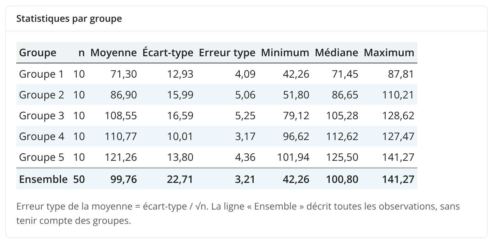
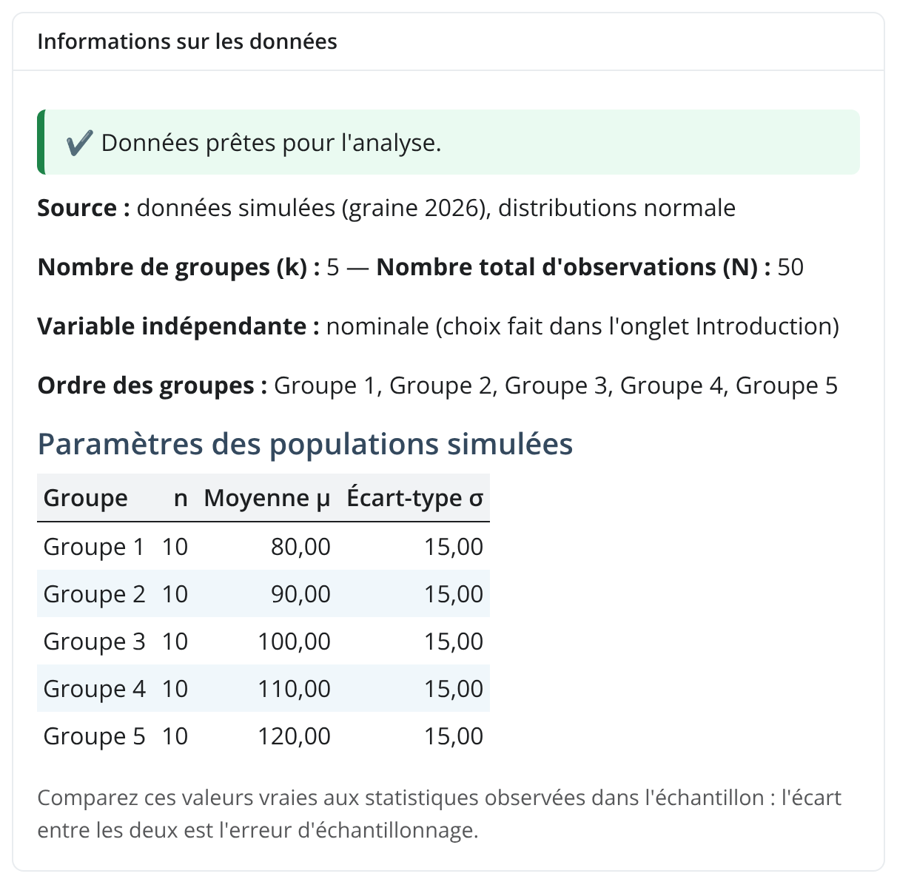
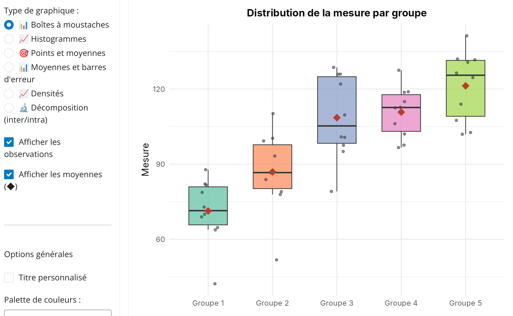
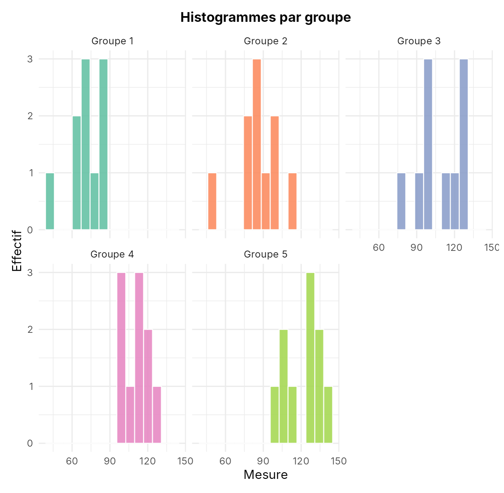
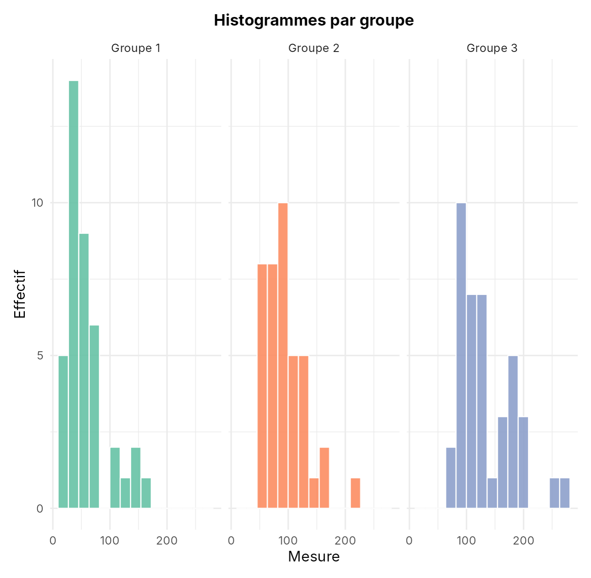
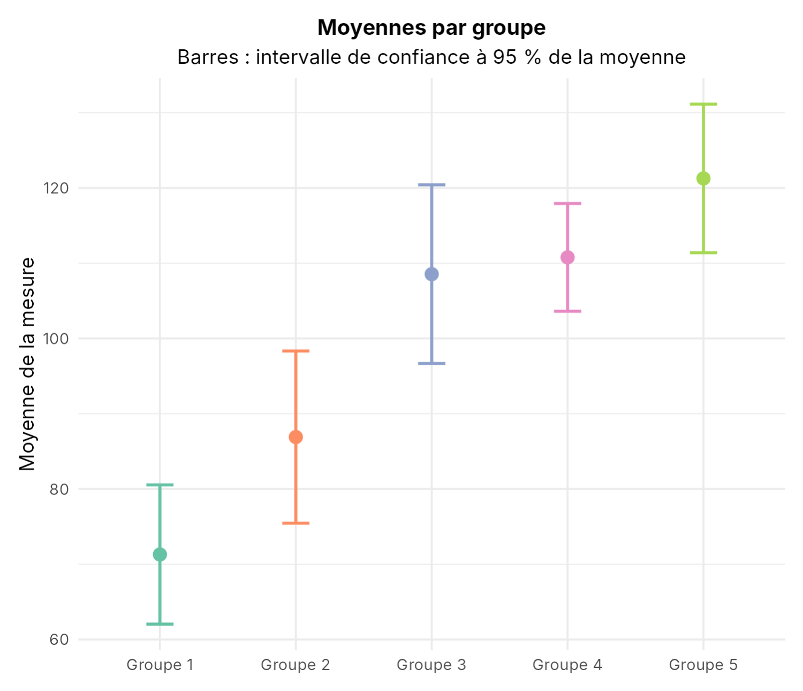

# Décrire les données {#sec-decrire}

```{r}
#| label: setup
#| include: false
#| cache: false
source("_common.R")
st <- data.frame(
  moy = tapply(ref$Mesure, ref$Facteur, mean),
  et  = tapply(ref$Mesure, ref$Facteur, sd)
)
st$se <- st$et / sqrt(10)
```

::: {.callout-tip title="Objectifs d'apprentissage"}
À la fin de ce chapitre, vous serez en mesure de :

- lire un tableau de statistiques par groupe et en tirer les deux informations qui orientent l'analyse : l'écart entre les moyennes et l'égalité des dispersions;
- distinguer les **paramètres** d'une population simulée des **statistiques** observées dans l'échantillon;
- distinguer l'écart-type, qui décrit les individus, de l'erreur type, qui décrit la précision d'une moyenne;
- lire une boîte à moustaches et repérer une asymétrie, une dispersion inhabituelle ou une valeur extrême;
- juger la forme d'une distribution à l'aide d'histogrammes et de densités, en tenant compte de la taille des groupes;
- interpréter correctement le chevauchement de barres d'erreur.
:::

::: {.callout-important title="Idée centrale"}
Un tableau d'ANOVA se résume à un $F$ et une valeur $p$; il ne dit rien de la forme des données, de leur dispersion ni des valeurs extrêmes qui peuvent fausser la conclusion. Décrire d'abord, c'est anticiper le résultat du test, repérer les conditions menacées et préparer l'interprétation.
:::

::: {.callout-warning title="Pièges classiques"}
- **Confondre écart-type et erreur type.** Le premier mesure la dispersion des individus; le second, l'incertitude sur la moyenne. Le second diminue quand $n$ augmente, pas le premier.
- **Juger la normalité sur un histogramme de 10 observations.** Avec si peu de données, l'allure d'un histogramme change beaucoup d'un échantillon à l'autre.
- **Conclure « pas de différence » parce que deux intervalles de confiance se chevauchent.** Deux intervalles à 95 % peuvent se chevaucher un peu alors que la différence est significative.
- **Ignorer les écarts-types en ne regardant que les moyennes.** Des dispersions très différentes annoncent un problème pour l'ANOVA classique.
:::

Avant de tester quoi que ce soit, on regarde. L'onglet **Description des données** sert précisément à cette exploration préalable. Il comporte deux sous-onglets : **Statistiques descriptives** et **Visualisation**.

## Les statistiques par groupe

Le sous-onglet **Statistiques descriptives** présente, pour chaque groupe, l'effectif $n$, la moyenne, l'écart-type, l'erreur type, le minimum, la médiane et le maximum (@fig-stats). La dernière ligne, **Ensemble**, décrit toutes les observations réunies, sans tenir compte des groupes.

{#fig-stats fig-align="center" width="85%"}

La **moyenne** de chaque groupe, $\bar{y}_i$, est la quantité que l'ANOVA compare. L'**écart-type**

$$
s_i = \sqrt{\frac{1}{n_i - 1} \sum_{j=1}^{n_i} (y_{ij} - \bar{y}_i)^2}
$$

mesure la dispersion des individus autour de la moyenne de leur groupe : c'est la matière première du bruit intra-groupe. L'**erreur type** de la moyenne, $s_i / \sqrt{n_i}$, mesure autre chose : la précision avec laquelle la moyenne de l'échantillon estime la moyenne de la population. Elle diminue quand $n_i$ augmente; l'écart-type, lui, ne diminue pas, car la dispersion des individus ne dépend pas de la taille de l'échantillon. La **médiane** coupe le groupe en deux moitiés; un écart marqué entre moyenne et médiane signale une asymétrie ou une valeur extrême. Le **minimum** et le **maximum**, enfin, permettent de repérer d'un coup d'œil une valeur suspecte, par exemple une erreur de saisie.

Deux lectures comptent particulièrement :

1. **Les moyennes s'écartent-elles nettement les unes des autres ?** Dans l'exemple de référence, elles vont de `r fr(min(st$moy))` à `r fr(max(st$moy))`, des écarts bien supérieurs aux erreurs types (de 3 à 5 environ) : l'ANOVA sera vraisemblablement significative.
2. **Les écarts-types sont-ils comparables ?** Ici, ils vont de `r fr(min(st$et))` à `r fr(max(st$et))` : des différences modestes, normales pour des groupes de 10 tirés d'une même population de $\sigma = 15$. L'ANOVA classique suppose des variances égales; un groupe deux ou trois fois plus dispersé qu'un autre annoncerait un recours au test de Welch (@sec-variantes).

L'écart-type de la ligne **Ensemble** (22,71) est nettement plus grand que ceux des groupes. Ce n'est pas un hasard : calculé sans tenir compte des groupes, il contient à la fois la variabilité intra et la variabilité inter. C'est la décomposition du @sec-intro, vue sous un autre angle : la variance de la ligne **Ensemble** (22,71² ≈ 515,6) est la somme d'une part inter et d'une part intra.

## Paramètres et statistiques

La carte **Informations sur les données** rappelle l'origine des données, le nombre de groupes, l'effectif total, la nature déclarée de la variable indépendante et l'ordre des groupes. En mode simulation, elle affiche en plus les **paramètres des populations** : les vraies moyennes $\mu_i$ et les vrais écarts-types $\sigma_i$ qui ont servi à produire l'échantillon (@fig-infos).

{#fig-infos fig-align="center" width="60%"}

Comparer les deux tableaux est instructif. Le groupe 1 provient d'une population de moyenne 80, mais sa moyenne observée vaut `r fr(st$moy[1])`. L'écart (environ 8,7) représente un peu plus de deux erreurs types : rien d'anormal pour un échantillon de dix observations. C'est l'**erreur d'échantillonnage**, la différence entre une statistique et le paramètre qu'elle estime. Avec des données réelles, on ne connaît jamais les paramètres; la simulation permet de voir à quel point les statistiques s'en écartent.

::: {.callout-note title="Labo 2.1 — Lire un tableau descriptif"}
**Objectif.** Extraire d'un tableau les deux informations qui décident de la suite : l'écart entre les moyennes et l'égalité des dispersions.

**Manipulation.**

1. Simulez **3 groupes** de 20 observations, de moyennes `100; 105; 110` (profil **Personnalisé**) et d'écart-type commun 15. Générez les données.
2. Ouvrez **Description des données ▸ Statistiques descriptives** et comparez moyennes et écarts-types observés aux paramètres affichés dans **Informations sur les données**.
3. Choisissez **Écart-type différent selon le groupe** et fixez σ = 10, 10 et 40. Générez de nouveau.

**Observez.** Les moyennes observées restent proches des vraies moyennes, mais le troisième groupe domine maintenant la dispersion : son écart-type est environ quatre fois celui des autres. C'est le signe avant-coureur d'une hétérogénéité des variances, que le @sec-diagnostics testera formellement.

**Question.** Entre deux groupes de même moyenne mais d'écarts-types très différents, lequel contribue le plus à la $SC_{\text{intra}}$ ? Pourquoi ?
:::

## Voir la dispersion : les boîtes à moustaches

Le sous-onglet **Visualisation** propose six graphiques, choisis dans le menu **Type de graphique**. Le premier, la **boîte à moustaches**, résume chaque groupe en cinq repères (@fig-boxplot) :

- la **boîte** s'étend du premier quartile ($Q_1$) au troisième ($Q_3$) : elle contient la moitié centrale des observations, et sa hauteur est l'écart interquartile;
- le **trait** dans la boîte est la **médiane**;
- les **moustaches** vont jusqu'aux observations les plus éloignées situées à moins de 1,5 écart interquartile de la boîte;
- les points au-delà des moustaches sont des **valeurs extrêmes** potentielles.

{#fig-boxplot fig-align="center" width="100%"}

Les options **Afficher les observations** et **Afficher les moyennes** superposent les données individuelles et la moyenne de chaque groupe. Une boîte décentrée (médiane près d'un bord, moustaches inégales) signale une asymétrie; une boîte haute, une forte dispersion. Dans l'exemple de référence, les boîtes ont des hauteurs du même ordre, et deux observations se détachent sous les moustaches des groupes 1 et 2 (vers 42 et 52). Avec dix observations par groupe tirées d'une loi normale, de tels points apparaissent régulièrement : une valeur extrême n'est pas forcément une erreur.

::: {.callout-note title="Labo 2.2 — La boîte révèle ce que la moyenne cache"}
**Objectif.** Distinguer visuellement moyenne, médiane, dispersion et valeurs extrêmes.

**Manipulation.**

1. Avec l'exemple de référence, choisissez **Boîtes à moustaches** et cochez **Afficher les observations** et **Afficher les moyennes**.
2. Dans chaque groupe, comparez la position de la moyenne (losange) à celle de la médiane (trait).
3. Dans l'onglet **Introduction**, choisissez la forme **Queues lourdes (Student, 3 dl)**, videz le champ **Graine aléatoire** et générez plusieurs échantillons. Surveillez les points au-delà des moustaches.

**Observez.** Avec des distributions normales, moyenne et médiane sont proches. Avec des queues lourdes, les valeurs extrêmes deviennent fréquentes et parfois spectaculaires; elles déplacent la moyenne, mais à peine la médiane.

**Question.** Pourquoi une valeur extrême déplace-t-elle la moyenne bien plus que la médiane ?
:::

## Voir la forme : histogrammes et densités

Pour juger de la **forme** des distributions, les **histogrammes** et les courbes de **densité** sont plus parlants que les boîtes. Le menu **Présentation** des histogrammes propose de les empiler, de les placer côte à côte, de les superposer ou d'afficher **un panneau par groupe** (@fig-histogrammes). Cette dernière présentation est la plus lisible : chaque forme se voit sans être masquée par les autres. Le **nombre de classes** se règle au besoin.

{#fig-histogrammes fig-align="center" width="85%"}

Avec dix observations par groupe, l'histogramme est grossier : quelques barres, irrégulières, dont l'allure change d'un échantillon à l'autre même quand la population est parfaitement normale. On ne peut guère y lire qu'une asymétrie marquée ou une valeur très isolée. Pour bien voir une forme, il faut des groupes plus grands.

L'application peut simuler quatre formes de distribution, de même moyenne et de même écart-type (@fig-formes). La **normale** sert de référence. La **log-normale** est étirée vers la droite, comme le sont souvent des durées, des revenus ou des concentrations; son asymétrie augmente avec le rapport $\sigma / \mu$. La **Student à 3 dl** a des queues lourdes : elle produit plus souvent des valeurs très éloignées. L'**uniforme**, à l'inverse, n'a pas de queues du tout.

```{r}
#| label: fig-formes
#| fig-cap: "Les quatre formes de distribution proposées par le simulateur, toutes de moyenne 100 et d'écart-type 40. La courbe grise reproduit la loi normale pour comparaison."
#| fig-alt: "Quatre panneaux de densités. Normale : cloche symétrique. Log-normale : pic à gauche vers 80 et longue queue vers la droite. Student à 3 dl : pic plus pointu et queues plus épaisses. Uniforme : rectangle de 31 à 169."
#| fig-height: 4.2
x <- seq(-60, 280, length.out = 800)
mu <- 100; s <- 40
sl <- sqrt(log(1 + (s / mu)^2)); ml <- log(mu) - sl^2 / 2
sc <- s / sqrt(3); a <- s * sqrt(3)
lois <- c("Normale", "Log-normale (asymétrique)", "Student à 3 dl (queues lourdes)", "Uniforme (queues légères)")
d <- rbind(
  data.frame(x = x, y = dnorm(x, mu, s), loi = lois[1]),
  data.frame(x = x, y = ifelse(x > 0, dlnorm(pmax(x, 1e-9), ml, sl), 0), loi = lois[2]),
  data.frame(x = x, y = dt((x - mu) / sc, 3) / sc, loi = lois[3]),
  data.frame(x = x, y = ifelse(abs(x - mu) <= a, 1 / (2 * a), 0), loi = lois[4])
)
d$loi <- factor(d$loi, levels = lois)
ref_n <- data.frame(x = x, y = dnorm(x, mu, s))
ggplot(d, aes(x, y)) +
  geom_line(data = ref_n, colour = "grey70", linewidth = 0.7) +
  geom_area(fill = pal$bleu, alpha = 0.25) +
  geom_line(colour = pal$bleu, linewidth = 1) +
  facet_wrap(~loi, nrow = 2) +
  scale_x_continuous(labels = axe_fr, breaks = seq(0, 250, 50)) +
  scale_y_continuous(labels = NULL) +
  labs(x = "Valeur de la mesure", y = "Densité")
```

La @fig-asymetrie montre ce que donne la forme log-normale dans l'application, avec trois groupes de 40 observations de moyennes 60, 100 et 140 et un écart-type commun de 40. L'asymétrie est très nette dans le groupe 1, où l'écart-type vaut les deux tiers de la moyenne, et s'atténue dans le groupe 3, où il n'en vaut plus que le tiers environ.

{#fig-asymetrie fig-align="center" width="70%"}

Ces observations préparent le travail de l'onglet **Diagnostics** (@sec-diagnostics) et le choix entre l'ANOVA classique, une transformation de la mesure et une approche non paramétrique (@sec-variantes).

::: {.callout-note title="Labo 2.3 — La forme des distributions"}
**Objectif.** Reconnaître une distribution asymétrique avant de la tester formellement, et mesurer l'effet de la taille des groupes sur ce jugement.

**Manipulation.**

1. Simulez 3 groupes de **40** observations, de moyennes `60; 100; 140`, d'écart-type commun 40, avec la forme **Asymétrique (log-normale)** et la graine 2026. Choisissez **Histogrammes**, présentation **Un panneau par groupe**. Vous devriez retrouver la @fig-asymetrie.
2. Passez au graphique **Densités** : les trois courbes superposées montrent les mêmes queues vers la droite.
3. Gardez la forme log-normale mais réduisez l'effectif à **8** par groupe, videz la graine et générez quelques échantillons.

**Observez.** Avec 40 observations, l'asymétrie saute aux yeux. Avec 8, un histogramme peut paraître presque symétrique ou au contraire très irrégulier, au gré du hasard.

**Question.** Sur de petits échantillons, peut-on juger de la normalité à l'œil ? Que risque-t-on à surinterpréter la forme d'un histogramme de huit observations ?
:::

## Voir l'incertitude : les barres d'erreur

Le type **Moyennes et barres d'erreur** représente chaque moyenne entourée d'une barre, au choix (@fig-barres) :

- **± 1 écart-type** : décrit la dispersion des **individus** autour de la moyenne;
- **± 1 erreur type** : décrit l'incertitude sur la **moyenne**;
- **intervalle de confiance à 95 %** : $\bar{y}_i \pm t_{0,975;\,n_i-1} \times s_i/\sqrt{n_i}$, l'intervalle qui, dans 95 % des échantillons, contient la vraie moyenne $\mu_i$. Avec $n = 10$, la valeur de $t$ vaut 2,26 : l'intervalle s'étend à un peu plus de deux erreurs types de part et d'autre de la moyenne.

{#fig-barres fig-align="center" width="80%"}

La @fig-trois-barres place côte à côte les trois choix, pour les mêmes données. Les barres d'écart-type sont de loin les plus longues : elles décrivent les individus, qui varient beaucoup plus que les moyennes. Les barres d'erreur type sont $\sqrt{10} \approx 3{,}2$ fois plus courtes, et l'intervalle de confiance environ 2,26 fois plus long que l'erreur type. Un même graphique peut donc donner trois impressions très différentes : il faut toujours dire ce que représentent les barres.

```{r}
#| label: fig-trois-barres
#| fig-cap: "Les mêmes moyennes (exemple de référence) avec les trois types de barres. De gauche à droite, chaque barre a une demi-longueur de $s_i$, de $s_i/\\sqrt{n_i}$ puis de $t_{0,975;\\,9} \\times s_i/\\sqrt{n_i}$. Seule la dernière dit où se trouve vraisemblablement la vraie moyenne."
#| fig-alt: "Trois panneaux avec cinq moyennes croissantes de 71 à 121. À gauche, barres longues qui se chevauchent toutes; au centre, barres courtes; à droite, barres intermédiaires."
#| fig-height: 3.4
b <- data.frame(g = factor(rep(levels(ref$Facteur), 3), levels = levels(ref$Facteur)),
                moy = rep(st$moy, 3),
                demi = c(st$et, st$se, qt(0.975, 9) * st$se),
                type = factor(rep(c("± 1 écart-type", "± 1 erreur type", "IC à 95 %"), each = 5),
                              levels = c("± 1 écart-type", "± 1 erreur type", "IC à 95 %")))
ggplot(b, aes(g, moy)) +
  geom_errorbar(aes(ymin = moy - demi, ymax = moy + demi), width = 0.25, colour = pal$bleu, linewidth = 0.9) +
  geom_point(size = 2.5, colour = pal$bleu) +
  facet_wrap(~type) +
  scale_x_discrete(labels = 1:5) +
  scale_y_continuous(labels = axe_fr) +
  labs(x = "Groupe", y = "Moyenne")
```

Le chevauchement des intervalles donne une **intuition** du test à venir, à condition de le lire correctement :

- deux intervalles à 95 % qui **ne se chevauchent pas** indiquent une différence significative entre ces deux groupes (la règle est même prudente);
- deux intervalles qui **se chevauchent un peu** peuvent pourtant correspondre à une différence significative : la différence entre deux moyennes est estimée plus précisément que chaque moyenne séparément;
- un **fort chevauchement**, une moyenne située à l'intérieur de l'intervalle de l'autre, indique en revanche qu'aucune différence n'est démontrée.

Dans l'exemple de référence, l'intervalle du groupe 1 ne chevauche pas ceux des groupes 3, 4 et 5 : ces différences seront significatives. Les intervalles des groupes 3 et 4 se superposent presque entièrement : leurs moyennes ne se distinguent pas. L'ANOVA formalise, pour l'ensemble des groupes, ce que l'œil pressent ici. Le graphique ne remplace toutefois pas les comparaisons corrigées du @sec-comparaisons.

::: {.callout-note title="Labo 2.4 — Quand les intervalles se chevauchent"}
**Objectif.** Relier la taille des intervalles de confiance à l'effectif et à la conclusion du test.

**Manipulation.**

1. Simulez trois groupes de moyennes très proches, `100; 102; 104`, avec σ = 15 et **10** observations par groupe. Choisissez **Moyennes et barres d'erreur**, avec l'**intervalle de confiance à 95 %**.
2. Notez le chevauchement des intervalles, puis lancez **ANOVA ▸ ANOVA classique**.
3. Portez l'effectif à **500** par groupe et générez de nouveau.

**Observez.** Avec 10 observations, les intervalles se chevauchent largement et le test ne conclut pas. Avec 500, ils se resserrent (leur demi-largeur passe d'environ 11 à 1,3), cessent de se chevaucher, et la même différence de 4 points devient significative.

**Question.** Une différence de 4 points sur un écart-type de 15, significative avec 500 observations par groupe, est-elle importante pour autant ? Que faut-il regarder en plus de la valeur $p$ ? (Le @sec-anova répond avec les tailles d'effet.)
:::

Deux autres graphiques complètent l'exploration : **Points et moyennes**, qui montre toutes les observations avec la moyenne de chaque groupe, et **Décomposition (inter/intra)**, présenté au @sec-intro. Le menu **Palette de couleurs** et l'option **Titre personnalisé** servent à préparer des figures pour un rapport.

## Ce qu'il faut retenir

- Le tableau par groupe livre deux informations décisives : l'écart entre les moyennes et la comparabilité des écarts-types.
- L'écart-type décrit les individus; l'erreur type, la précision de la moyenne. Seule la seconde diminue quand $n$ augmente.
- En simulation, l'écart entre les statistiques observées et les paramètres fixés est l'erreur d'échantillonnage.
- La boîte à moustaches révèle l'asymétrie, la dispersion et les valeurs extrêmes; les histogrammes et les densités révèlent la forme, à condition que les groupes soient assez grands.
- Des intervalles de confiance qui ne se chevauchent pas signalent une différence; un léger chevauchement ne prouve pas l'absence de différence.

## Erreurs fréquentes

| Erreur | Pourquoi c'est problématique | Bonne pratique |
|:-------|:-----------------------------|:---------------|
| Présenter des barres d'erreur sans dire ce qu'elles représentent | Un écart-type, une erreur type et un intervalle de confiance n'ont ni la même taille ni le même sens | Toujours préciser le type de barre dans la légende |
| Confondre écart-type et erreur type | L'erreur type est $\sqrt{n}$ fois plus petite et ne décrit pas la dispersion des individus | Écart-type pour décrire les données, erreur type ou intervalle pour l'incertitude sur la moyenne |
| Retirer une valeur extrême parce qu'elle « dérange » | Une valeur extrême peut être parfaitement légitime; la retirer biaise l'analyse | Vérifier d'abord s'il s'agit d'une erreur; sinon la conserver, ou choisir un test robuste |
| Juger la normalité sur un histogramme de quelques observations | La forme d'un petit échantillon varie énormément d'un tirage à l'autre | Combiner les graphiques et les diagnostics du @sec-diagnostics, avec prudence |
| Conclure « pas de différence » dès que deux intervalles se chevauchent | Un léger chevauchement est compatible avec une différence significative | Confirmer par un test (ANOVA, puis comparaisons) |

## Quiz

::: {.callout-note title="Question 1 — calcul"}
**Énoncé.** Un groupe de 25 observations a un écart-type de 20. Que vaut l'erreur type de sa moyenne ? Que deviendrait-elle avec 100 observations et le même écart-type ?

::: {.callout-tip title="Réponse" collapse="true"}
$20 / \sqrt{25} = 4$. Avec 100 observations : $20 / \sqrt{100} = 2$. Quadrupler l'effectif divise l'erreur type par deux, alors que l'écart-type des individus reste 20.
:::
:::

::: {.callout-note title="Question 2 — vrai ou faux"}
**Énoncé.** Dans l'exemple de référence, la moyenne observée du groupe 1 (71,30) s'écarte de la vraie moyenne (80) : la simulation de l'application est donc imprécise.

::: {.callout-tip title="Réponse" collapse="true"}
Faux. Un échantillon de dix observations ne reproduit jamais exactement les paramètres de sa population. L'écart d'environ 8,7 points vaut un peu plus de deux erreurs types : c'est une erreur d'échantillonnage ordinaire. Avec une autre graine, la moyenne observée serait différente, parfois au-dessus de 80, parfois au-dessous.
:::
:::

::: {.callout-note title="Question 3 — lecture de graphique"}
**Énoncé.** Sur un graphique de barres d'erreur, les intervalles de confiance à 95 % de deux groupes se chevauchent légèrement. Un collègue conclut que les deux moyennes ne diffèrent pas. Que lui répondez-vous ?

::: {.callout-tip title="Réponse" collapse="true"}
Que la conclusion est hâtive. Un léger chevauchement de deux intervalles à 95 % reste compatible avec une différence significative, parce que la différence entre deux moyennes est estimée plus précisément que chacune séparément. Seule l'absence de chevauchement permet une conclusion directe (la différence est significative). Pour trancher, il faut un test : l'ANOVA, puis des comparaisons corrigées.
:::
:::
