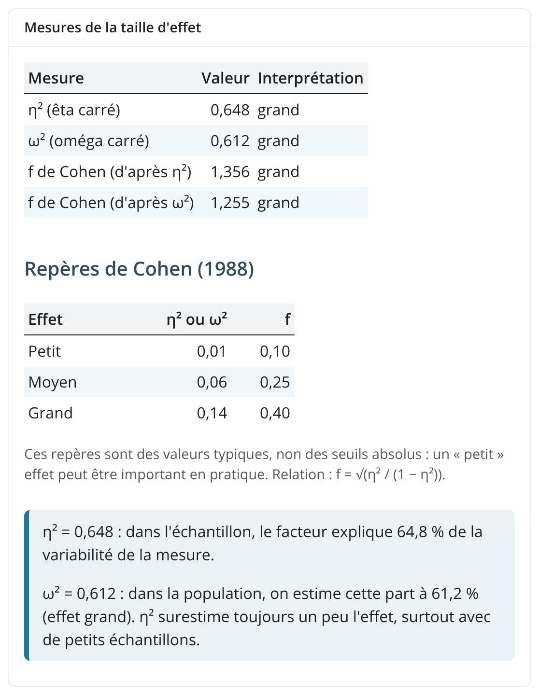
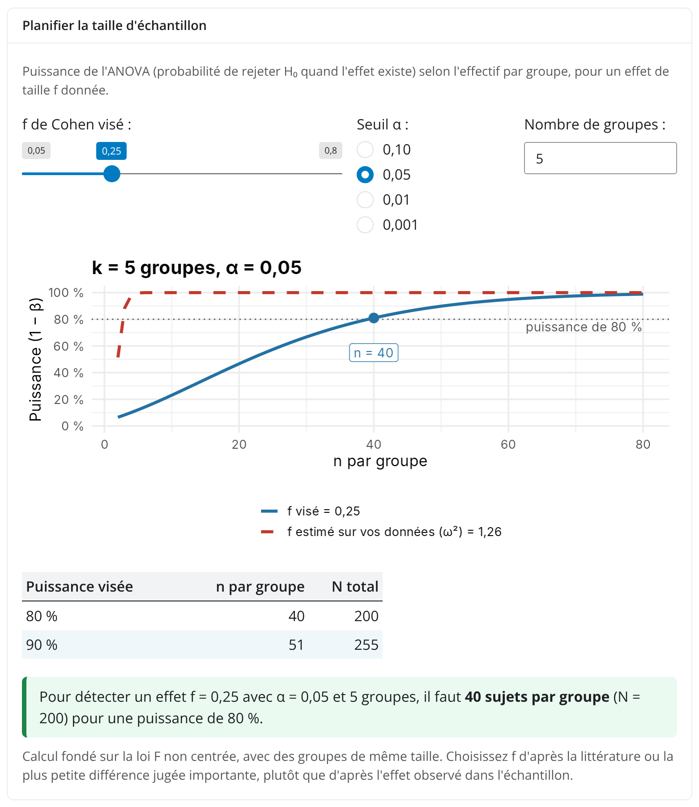

# Le test $F$ : décision, ampleur et puissance {#sec-anova}

```{r}
#| label: setup
#| include: false
#| cache: false
source("_common.R")
ic_ref <- ic_eta2(ref_a$F, ref_a$dl1, ref_a$dl2, 0.90)
lam_ic <- ic_ref * ref_a$N / (1 - ic_ref)
cap_fig_ic_eta <- paste0("Construction de l'intervalle de confiance de $\\eta^2$ pour l'exemple de référence ($F$ observé = ", fr(ref_a$F), "). Courbe de gauche : la loi de $F$ pour le plus petit effet compatible ($\\lambda = ", fr(lam_ic[1], 1), "$, soit $\\eta^2 = ", fr(ic_ref[1], 2), "$); le $F$ observé laisse 5 % de cette loi à sa droite. Courbe de droite : le plus grand effet compatible ($\\lambda = ", fr(lam_ic[2], 1), "$, soit $\\eta^2 = ", fr(ic_ref[2], 2), "$); le $F$ observé laisse 5 % de cette loi à sa gauche.")
```

::: {.callout-tip title="Objectifs d'apprentissage"}
À la fin de ce chapitre, vous serez en mesure de :

- lire le résultat complet du test $F$ : tableau, valeur critique, décision et compte rendu;
- calculer et interpréter les tailles d'effet $\eta^2$, $\omega^2$ et $f$ de Cohen, et expliquer pourquoi $\eta^2$ surestime l'effet;
- interpréter l'intervalle de confiance de $\eta^2$ et ce qu'il ajoute à la valeur $p$;
- rédiger le compte rendu d'une ANOVA selon les usages;
- expliquer ce qu'est la puissance d'un test et déterminer la taille d'échantillon nécessaire pour détecter un effet donné.
:::

::: {.callout-important title="Idée centrale"}
Le test $F$ répond à une seule question : « les moyennes diffèrent-elles ? ». Une analyse complète y ajoute l'**ampleur** de l'effet (taille d'effet), qui ne dépend pas de la taille d'échantillon comme la valeur $p$, et la **précision** de cette ampleur (intervalle de confiance). Avant l'étude, la même logique, retournée, sert à **planifier** : combien d'observations faut-il pour détecter l'effet qui compte ?
:::

::: {.callout-warning title="Pièges classiques"}
- **Confondre significatif et important.** Avec de très grands échantillons, un effet négligeable devient significatif.
- **Rapporter $\eta^2$ comme l'effet dans la population.** Il surestime l'effet, surtout avec de petits groupes; $\omega^2$ corrige ce biais.
- **Oublier l'incertitude sur l'effet.** Un $\eta^2$ estimé sur 30 observations peut être compatible avec un effet nul comme avec un effet très grand.
- **Planifier la taille d'échantillon à partir de l'effet observé dans l'étude elle-même.** On choisit l'effet visé d'après la littérature ou la plus petite différence jugée importante.
:::

C'est le cœur de l'application. L'onglet **ANOVA** propose le test $F$ classique, puis une famille de variantes conçues pour les situations où ses conditions ne tiennent pas (@sec-variantes). L'onglet voisin, **Taille d'effet et puissance**, mesure l'ampleur de l'effet et aide à planifier une étude. Ce chapitre suit le fil d'une analyse : lire le test, mesurer l'effet, en dire la précision, rapporter, puis planifier la suivante.

## Le test $F$ classique

Le sous-onglet **ANOVA classique** a été présenté au @sec-intro (@fig-premiere-anova). Sa carte principale affiche quatre éléments :

1. le **tableau de l'analyse de variance** : pour les sources inter-groupes et intra-groupes, la somme des carrés, les degrés de liberté et le carré moyen, puis $F$ et sa valeur $p$; la ligne **Total** rappelle que $SC_{\text{totale}} = SC_{\text{inter}} + SC_{\text{intra}}$ et que les degrés de liberté s'additionnent aussi ($N - 1 = (k-1) + (N-k)$);
2. la **valeur critique** de la loi $F$ au seuil $\alpha$ choisi dans les réglages communs, et la position du $F$ observé par rapport à elle;
3. la **conclusion**, en vert si $p < \alpha$, en rouge sinon, et une phrase **Pour rapporter le résultat**;
4. trois **tailles d'effet**, présentées dans la section suivante.

Sous cette carte, **Où se situe le F observé ?** dessine la loi $F$ du test et **Le calcul pas à pas** refait le calcul groupe par groupe (@fig-loi-calcul). Une valeur $p$ inférieure au seuil $\alpha$ conduit à rejeter $H_0$ : au moins une moyenne diffère. Mais le tableau ne dit ni *lesquelles* (@sec-comparaisons), ni *de combien*. C'est là qu'interviennent les tailles d'effet.

::: {.callout-warning title="Une ANOVA non significative ne prouve pas l'égalité des moyennes"}
Ne pas rejeter $H_0$ signifie seulement que les données ne permettent pas de conclure à une différence. Avec de petits groupes, même une différence réelle et importante passe souvent inaperçue. Avant d'écrire « les groupes ne diffèrent pas », examinez l'intervalle de confiance de l'effet et la puissance de l'étude (@sec-puissance).
:::

## Mesurer l'ampleur : $\eta^2$, $\omega^2$ et $f$ de Cohen

Une valeur $p$ répond à « l'effet est-il détectable avec ces données ? », pas à « l'effet est-il important ? ». Elle dépend à la fois de l'ampleur de l'effet et de la taille de l'échantillon. Les tailles d'effet, elles, mesurent l'ampleur seule.

L'**êta carré** est la proportion de la variabilité totale expliquée par le facteur :

$$
\eta^2 = \frac{SC_{\text{inter}}}{SC_{\text{totale}}} .
$$

C'est la part de la variance totale due aux groupes, déjà rencontrée dans le panneau de décomposition (@fig-variance). Il est intuitif, mais optimiste. Même quand le facteur n'a aucun effet dans la population, les moyennes de l'échantillon diffèrent un peu par hasard, si bien que $SC_{\text{inter}}$ n'est jamais nulle : $\eta^2$ décrit l'échantillon et surestime l'effet dans la population, d'autant plus que les groupes sont petits. Sous $H_0$, sa valeur moyenne vaut à peu près $(k-1)/(N-1)$ : 0,14 pour trois groupes de cinq observations, alors que l'effet réel est nul.

L'**oméga carré** corrige ce biais en retirant de $SC_{\text{inter}}$ ce que le hasard seul y mettrait, soit $k - 1$ fois le carré moyen intra (on a vu au @sec-intro que, sous $H_0$, le CM inter estime $\sigma^2$) :

$$
\omega^2 = \frac{SC_{\text{inter}} - (k-1)\, CM_{\text{intra}}}{SC_{\text{totale}} + CM_{\text{intra}}} .
$$

Quand l'effet est faible et l'échantillon petit, le numérateur peut devenir négatif; une proportion de variance ne pouvant pas être négative, l'application affiche alors 0.

```{r}
#| label: fig-biais-eta
#| fig-cap: "Valeur moyenne de $\\eta^2$ et de $\\omega^2$ sur 4 000 échantillons simulés par point, selon l'effectif par groupe (3 groupes, effet moyen $f = 0{,}25$, soit un vrai $\\eta^2$ de 0,059 dans la population, ligne pointillée). $\\eta^2$ surestime nettement l'effet avec de petits groupes; $\\omega^2$ reste près de la vérité. Les deux convergent quand $n$ grandit."
#| fig-alt: "Deux courbes décroissantes selon n de 5 à 100. La courbe rouge (η²) part de 0,19 à n = 5 et descend vers 0,07. La courbe bleue (ω²) reste entre 0,06 et 0,08. Une ligne pointillée marque 0,059."
#| fig-height: 3.5
#| cache: true
set.seed(5)
ns <- c(5, 10, 20, 30, 50, 100)
mu <- moyennes_pour_f(3, 0.25)
bias <- do.call(rbind, lapply(ns, function(n) {
  g <- factor(rep(1:3, each = n))
  r <- t(replicate(4000, { a <- anova_1f(rnorm(3 * n, rep(mu, each = n), 15), g); e <- tailles_effet(a); c(e$eta2, e$omega2) }))
  data.frame(n = n, mesure = c("η² (échantillon)", "ω² (estimation corrigée)"), moy = colMeans(r))
}))
vrai <- 0.25^2 / (1 + 0.25^2)
ggplot(bias, aes(n, moy, colour = mesure)) +
  geom_hline(yintercept = vrai, linetype = "dashed", colour = "grey30") +
  annotate("text", x = 100, y = vrai - 0.008, label = "vrai η² = 0,059", hjust = 1, size = 3.4, colour = "grey30") +
  geom_line(linewidth = 1) + geom_point(size = 2.5) +
  scale_colour_manual(values = c(pal$rouge, pal$bleu)) +
  scale_x_continuous(breaks = ns) + scale_y_continuous(labels = axe_fr, limits = c(0, NA)) +
  labs(x = "n par groupe", y = "Valeur moyenne de l'estimation", colour = NULL)
```

Enfin, le **$f$ de Cohen** [@cohen1988] réexprime l'effet comme l'écart-type des moyennes de population mesuré en unités d'écart-type intra-groupe :

$$
f = \frac{\sigma_{\mu}}{\sigma} = \sqrt{\frac{\eta^2}{1 - \eta^2}}, \qquad \text{où } \sigma_\mu = \sqrt{\tfrac{1}{k}\textstyle\sum_i (\mu_i - \mu)^2} .
$$

C'est l'échelle qu'utilisent les calculs de puissance. L'application le calcule à partir de $\eta^2$ et à partir de $\omega^2$; la seconde version, moins biaisée, convient mieux pour estimer l'effet dans la population.

| Effet | $\eta^2$ ou $\omega^2$ | $f$ |
|:------|:----------------------:|:---:|
| Petit | 0,01 | 0,10 |
| Moyen | 0,06 | 0,25 |
| Grand | 0,14 | 0,40 |

: Les repères de Cohen pour les tailles d'effet en ANOVA. {#tbl-reperes}

Ces repères (@tbl-reperes) sont des ordres de grandeur, non des seuils. Un « petit » effet peut avoir une grande importance pratique (un traitement qui réduit légèrement la mortalité, par exemple), et un « grand » effet peut être banal dans un domaine où les différences sont habituellement énormes.

Les tailles d'effet apparaissent sous le tableau d'ANOVA et, plus détaillées, dans l'onglet **Taille d'effet et puissance** (@fig-effet). Dans l'exemple de référence, $\eta^2 = `r fr(ref_e$eta2, 3)`$ : le facteur explique près des deux tiers de la variabilité de l'échantillon. L'estimation pour la population, $\omega^2 = `r fr(ref_e$omega2, 3)`$, est un peu plus faible, comme toujours. Un effet aussi grand est rare avec des données réelles; il vient ici de l'écart de 40 points entre les groupes extrêmes des populations, près de trois écarts-types. Le vrai $f$ de ces populations vaut d'ailleurs $\sigma_\mu/\sigma = 14{,}14/15 = 0{,}94$, et le vrai $\eta^2$, $0{,}94^2/(1 + 0{,}94^2) = 0{,}47$ : même $\omega^2$ surestime ici l'effet, ce qui rappelle qu'une estimation sur cinquante observations reste imprécise.

{#fig-effet fig-align="center" width="55%"}

::: {.callout-tip title="À retenir"}
La valeur $p$ et la taille d'effet répondent à deux questions distinctes. Un $F$ significatif accompagné d'un $\eta^2$ minuscule signale surtout un grand échantillon, pas un effet marquant. Rapportez toujours les deux.
:::

::: {.callout-note title="Labo 3.1 — Lire un résultat complet"}
**Objectif.** Lire ensemble la décision (valeur $p$) et l'ampleur (tailles d'effet).

**Manipulation.**

1. Simulez **3 groupes** de moyennes `95; 100; 105`, avec σ = 15 et $n = 30$ par groupe. Générez les données.
2. Ouvrez **ANOVA ▸ ANOVA classique**. Relevez $F$, la valeur $p$, puis $\eta^2$, $\omega^2$ et le $f$ de Cohen.
3. Ouvrez **Taille d'effet et puissance** et comparez les deux versions du $f$ de Cohen.

**Observez.** $\omega^2$ est toujours un peu inférieur à $\eta^2$ : c'est la correction du biais. Dans la population simulée, $f = 4{,}08 / 15 = 0{,}27$, un effet moyen; selon l'échantillon, l'estimation tombe au-dessus ou au-dessous.

**Question.** Pourquoi $\omega^2$ peut-il devenir négatif, alors qu'une proportion de variance ne le peut pas ? Que fait alors l'application ?
:::

::: {.callout-note title="Labo 3.2 — Significatif n'est pas important"}
**Objectif.** Dissocier la significativité statistique de l'ampleur de l'effet.

**Manipulation.**

1. Simulez trois groupes de moyennes `100; 102; 104`, des écarts minimes au regard de σ = 15, avec **10** observations par groupe. Lancez l'ANOVA classique et notez la valeur $p$ et $\eta^2$. Générez quelques échantillons (graine vide).
2. Portez l'effectif à **500** par groupe et recommencez.

**Observez.** Avec 10 observations, le test est presque toujours non significatif, et pourtant $\eta^2$ varie beaucoup et dépasse souvent 0,05 : avec si peu de données, il est très gonflé par le hasard. Avec 500 observations, le test devient significatif presque à tout coup, mais $\eta^2$ se stabilise autour de 0,01, la vraie valeur de cette population. La significativité a suivi la taille de l'échantillon, pas l'importance de l'effet.

**Question.** Un résultat significatif avec $\eta^2 = 0{,}01$ mérite-t-il d'être présenté comme une « découverte » ? Qu'ajouteriez-vous au compte rendu ?
:::

## La précision de l'effet : l'intervalle de confiance de $\eta^2$

Un $\eta^2$ est une estimation : avec un autre échantillon, on obtiendrait une autre valeur. L'application l'accompagne donc d'un **intervalle de confiance**, affiché dans la colonne **Signification** des tailles d'effet et dans la phrase de compte rendu. Pour l'exemple de référence : $\eta^2 = `r fr(ref_e$eta2, 2)`$, IC à 90 % [`r fr(ic_ref[1], 2)` ; `r fr(ic_ref[2], 2)`].

L'intervalle se construit en retournant la question de la puissance [@steiger2004]. Quand un effet existe, $F$ suit une loi $F$ **non centrée**, décalée vers la droite d'autant plus que le **paramètre de non-centralité** $\lambda$ est grand (on y reviendra avec la puissance); $\lambda$ et $\eta^2$ sont liés par $\eta^2 = \lambda/(\lambda + N)$. On cherche alors toutes les valeurs de $\lambda$ compatibles avec le $F$ observé :

- la **borne inférieure** est la valeur de $\lambda$ pour laquelle le $F$ observé tombe au 95ᵉ centile de la loi : un effet plus petit rendrait notre $F$ trop grand pour être plausible;
- la **borne supérieure** est la valeur de $\lambda$ pour laquelle le $F$ observé tombe au 5ᵉ centile : un effet plus grand rendrait notre $F$ trop petit.

```{r}
#| label: fig-ic-eta
#| fig-cap: !expr cap_fig_ic_eta
#| fig-alt: "Deux courbes en cloche asymétriques, l'une centrée vers 11, l'autre vers 32. Une ligne verticale à 20,69 coupe la queue droite de la première et la queue gauche de la seconde, dont 5 % sont ombrés."
#| fig-height: 3.5
xs <- seq(0.01, 60, length.out = 800)
cl <- data.frame(x = xs, y = df(xs, 4, 45, ncp = lam_ic[1]), loi = "plus petit effet compatible")
cu <- data.frame(x = xs, y = df(xs, 4, 45, ncp = lam_ic[2]), loi = "plus grand effet compatible")
ggplot() +
  geom_area(data = subset(cl, x >= ref_a$F), aes(x, y), fill = pal$bleu, alpha = 0.35) +
  geom_area(data = subset(cu, x <= ref_a$F), aes(x, y), fill = pal$rouge, alpha = 0.35) +
  geom_line(data = rbind(cl, cu), aes(x, y, colour = loi), linewidth = 1) +
  geom_vline(xintercept = ref_a$F, linewidth = 0.9) +
  annotate("label", x = ref_a$F, y = 0.105, label = paste0("F observé = ", fr(ref_a$F)), size = 3.5) +
  annotate("text", x = 24, y = 0.012, label = "5 %", colour = pal$bleu, size = 3.6, fontface = "bold") +
  annotate("text", x = 18, y = 0.006, label = "5 %", colour = pal$rouge, size = 3.6, fontface = "bold") +
  scale_colour_manual(values = c("plus petit effet compatible" = pal$bleu, "plus grand effet compatible" = pal$rouge),
                      labels = c(paste0("plus grand effet compatible : η² = ", fr(ic_ref[2], 2)),
                                 paste0("plus petit effet compatible : η² = ", fr(ic_ref[1], 2)))) +
  scale_x_continuous(labels = axe_fr) + scale_y_continuous(labels = axe_fr, expand = expansion(mult = c(0, 0.1))) +
  labs(x = "Valeur de F", y = "Densité", colour = NULL)
```

Pourquoi un intervalle à 90 % plutôt qu'à 95 % ? Parce que le test $F$ est unilatéral. Avec un intervalle de niveau $1 - 2\alpha$ (90 % quand $\alpha = 0{,}05$), la borne inférieure dépasse 0 **exactement** quand le test est significatif au seuil $\alpha$ : l'intervalle et le test racontent la même histoire. Quand le test n'est pas significatif, la borne inférieure vaut 0, et l'intervalle montre jusqu'où l'effet pourrait monter sans contredire les données.

Dans l'exemple de référence, l'intervalle est large (de 0,46 à 0,71) malgré un résultat très significatif : avec dix observations par groupe, on sait que l'effet est grand, mais pas s'il explique la moitié ou les trois quarts de la variabilité. La largeur de l'intervalle mesure ce qu'on ignore encore; elle diminue quand $N$ augmente.

::: {.callout-note title="Labo 3.3 — L'incertitude sur l'effet"}
**Objectif.** Voir l'intervalle de confiance de $\eta^2$ se resserrer quand l'effectif augmente.

**Manipulation.**

1. Simulez **3 groupes** de moyennes `95; 100; 105`, σ = 15, **10** observations par groupe, graine 7. Dans **ANOVA ▸ ANOVA classique**, relevez $F$, $p$, $\eta^2$ et son intervalle.
2. Gardez la graine et portez l'effectif à **100** par groupe.
3. Revenez à 10 par groupe et changez de graine à quelques reprises, en surveillant la borne inférieure de l'intervalle et la conclusion du test.

**Observez.** Avec 10 observations par groupe et la graine 7, le test n'est pas significatif ($p = 0{,}12$) et l'intervalle va de 0 à 0,31 : de l'absence d'effet à un effet très grand. Avec 100 observations par groupe, le test devient significatif et l'intervalle se resserre nettement (de 0,01 à 0,08); il contient le vrai $\eta^2$ de ces populations, 0,069. Au fil des graines, la borne inférieure vaut 0 chaque fois que le test n'est pas significatif, et seulement dans ce cas.

**Question.** Une étude rapporte $\eta^2 = 0{,}12$, IC à 90 % [0 ; 0,31]. Que peut-on dire de l'effet ? Que peut-on dire de l'étude ?
:::

## Rapporter le résultat

Un compte rendu d'ANOVA donne au lecteur de quoi juger la conclusion par lui-même. Il contient, dans l'ordre :

1. les **statistiques descriptives** des groupes (effectifs, moyennes, écarts-types), dans le texte ou dans un tableau;
2. le **test** : $F(\text{dl}_1, \text{dl}_2)$, la valeur $p$ (exacte, sauf si $p < 0{,}001$);
3. la **taille d'effet**, idéalement avec son intervalle de confiance;
4. la **suite** : quels groupes diffèrent (@sec-comparaisons), et le test choisi si les conditions l'ont exigé (@sec-variantes).

Pour l'exemple de référence, on pourrait écrire :

> Les moyennes des cinq groupes vont de `r fr(min(ref_s$moy), 1)` (groupe 1) à `r fr(max(ref_s$moy), 1)` (groupe 5), avec des écarts-types de `r fr(min(ref_s$et), 1)` à `r fr(max(ref_s$et), 1)`. Une ANOVA à un facteur indique que les moyennes diffèrent, $F(4, 45) = `r fr(ref_a$F)`$, $p < 0{,}001$, $\eta^2 = `r fr(ref_e$eta2, 2)`$, IC à 90 % [`r fr(ic_ref[1], 2)` ; `r fr(ic_ref[2], 2)`] ($\omega^2 = `r fr(ref_e$omega2, 2)`$) : le facteur explique près des deux tiers de la variabilité observée. Les conditions d'application sont satisfaites (normalité plausible dans chaque groupe; test de Brown-Forsythe des variances non significatif). Les comparaisons de Tukey montrent que…

La phrase **Pour rapporter le résultat** de l'application fournit la partie centrale; le reste est affaire de contexte. En français, on utilise la virgule décimale; les symboles statistiques ($F$, $p$) s'écrivent en italique.

## Planifier la puissance {#sec-puissance}

Les tailles d'effet ne servent pas qu'à interpréter un résultat : elles permettent de **planifier** une étude avant de recueillir les données. La carte **Planifier la taille d'échantillon** de l'onglet **Taille d'effet et puissance** répond à la question inverse de l'analyse : non plus « quel effet ai-je détecté ? », mais « combien d'observations me faut-il pour détecter l'effet qui m'intéresse ? ».

La **puissance** d'un test est la probabilité de rejeter $H_0$ quand $H_0$ est fausse, c'est-à-dire de détecter un effet qui existe vraiment. On la note $1 - \beta$, où $\beta$ est le risque d'erreur de type II (manquer un effet réel). Elle dépend de trois leviers : la taille de l'effet ($f$), le seuil $\alpha$ et l'effectif $n$ par groupe. Par convention, on vise une puissance d'au moins 80 %.

Le calcul repose sur la loi de $F$ quand $H_1$ est vraie. Le $F$ ne suit plus alors la loi de Fisher habituelle, mais une loi **non centrée**, décalée vers la droite d'autant plus que le paramètre de non-centralité $\lambda = f^2 N$ est grand, donc que l'effet ou l'effectif total est grand. Ce paramètre n'est autre que le terme qui gonfle le carré moyen inter (@sec-intro), rapporté à $\sigma^2$ : $\lambda = \sum_i n_i \tau_i^2/\sigma^2$. La puissance est la part de cette loi qui dépasse la valeur critique (@fig-puissance-loi).

```{r}
#| label: fig-puissance-loi
#| fig-cap: "Loi du $F$ sous $H_0$ (gris) et sous $H_1$ (bleu) pour 3 groupes de 20 et un effet moyen ($f = 0{,}25$, donc $\\lambda = 0{,}25^2 \\times 60 = 3{,}75$). La valeur critique au seuil de 5 % est fixée par la loi sous $H_0$. La zone bleue, à droite de cette valeur sous la courbe de $H_1$, est la puissance : environ 37 %. Une étude de cette taille manquerait donc l'effet presque deux fois sur trois."
#| fig-alt: "Deux courbes asymétriques. La grise (H0) culmine près de 0; la bleue (H1) est plus étalée vers la droite. Une ligne verticale à 3,16 marque la valeur critique; la portion de la courbe bleue au-delà est ombrée."
#| fig-height: 3.6
k <- 3; n <- 20; N <- k * n; f <- 0.25; lam <- f^2 * N
d1 <- k - 1; d2 <- N - k
xs <- seq(0.001, 9, length.out = 600)
fc <- qf(0.95, d1, d2)
d <- rbind(data.frame(x = xs, y = df(xs, d1, d2), loi = "Sous H₀ (aucun effet)"),
           data.frame(x = xs, y = df(xs, d1, d2, ncp = lam), loi = "Sous H₁ (f = 0,25)"))
pw <- pf(fc, d1, d2, ncp = lam, lower.tail = FALSE)
ggplot(d, aes(x, y, colour = loi)) +
  geom_area(data = subset(d, loi == "Sous H₁ (f = 0,25)" & x >= fc), aes(fill = loi),
            alpha = 0.3, colour = NA, show.legend = FALSE) +
  geom_line(linewidth = 1) +
  geom_vline(xintercept = fc, linetype = "dashed") +
  annotate("label", x = fc + 0.1, y = 0.55, hjust = 0, size = 3.5,
           label = paste0("valeur critique = ", fr(fc), "\npuissance = ", fr(100 * pw, 0), " %")) +
  scale_colour_manual(values = c("grey50", pal$bleu)) +
  scale_fill_manual(values = pal$bleu) +
  scale_x_continuous(labels = axe_fr, expand = c(0, 0)) +
  scale_y_continuous(labels = axe_fr, limits = c(0, 0.75), expand = c(0, 0)) +
  labs(x = "Valeur de F", y = "Densité", colour = NULL)
```

La carte trace la **courbe de puissance** en fonction de $n$ pour le $f$ visé, choisi au curseur **f de Cohen visé**, avec le **seuil α** et le **nombre de groupes** indiqués (@fig-puissance). Une seconde courbe, en pointillé, utilise l'effet estimé sur vos données (d'après $\omega^2$). Sous le graphique, un tableau donne l'effectif nécessaire pour atteindre 80 % et 90 % de puissance. Pour un effet moyen ($f = 0{,}25$) avec 5 groupes et $\alpha = 0{,}05$, il faut 40 sujets par groupe (200 au total) pour 80 % de puissance, et 51 pour 90 %. Le calcul suppose des groupes de même taille.

{#fig-puissance fig-align="center" width="80%"}

Pour fixer $f$ à partir de moyennes jugées importantes, on calcule $\sigma_\mu$, l'écart-type des moyennes visées, et on le divise par l'écart-type attendu. Par exemple, si l'on veut détecter des moyennes de 95, 100 et 105 avec $\sigma = 15$ : $\sigma_\mu = \sqrt{(25 + 0 + 25)/3} = 4{,}08$, d'où $f = 0{,}27$.

::: {.callout-tip title="À retenir"}
Puissance, effet et effectif sont liés : à effet fixé, seul l'effectif permet de gagner en puissance. Planifier, c'est choisir $n$ *avant* l'étude, à partir d'un effet visé justifié (littérature, plus petite différence jugée importante), pour se donner une chance raisonnable de détecter l'effet qui compte. Calculer la puissance après coup avec l'effet observé n'apporte rien : elle ne fait que reformuler la valeur $p$. Après l'étude, c'est l'intervalle de confiance de l'effet qui dit ce que les données ont pu établir.
:::

::: {.callout-note title="Labo 3.4 — Combien de sujets ?"}
**Objectif.** Déterminer l'effectif nécessaire pour atteindre 80 % de puissance.

**Manipulation.**

1. Ouvrez **Taille d'effet et puissance**. Réglez **f de Cohen visé** sur 0,25, le seuil α sur 0,05 et le nombre de groupes sur 5. Lisez l'effectif nécessaire et repérez, sur la courbe, où la puissance franchit 80 %.
2. Abaissez $f$ à 0,10 (petit effet), puis relevez-le à 0,40 (grand effet).
3. Revenez à $f = 0{,}25$ et passez le seuil à 0,01.

**Observez.** Il faut 40 sujets par groupe pour un effet moyen, 240 pour un petit effet et seulement 16 pour un grand. Un seuil plus sévère exige lui aussi davantage de sujets (55 par groupe pour $\alpha = 0{,}01$).

**Question.** Pourquoi est-il risqué de lancer une étude sans avoir estimé sa puissance au préalable ? Que peut-on conclure d'une ANOVA non significative réalisée avec une puissance de 30 % ?
:::

Le test $F$ classique, ses tailles d'effet et ses calculs de puissance reposent sur les conditions du modèle : indépendance, normalité, égalité des variances. Le chapitre suivant examine ce qui arrive quand elles faiblissent, et les solutions de rechange qu'offre l'application.

## Ce qu'il faut retenir

- Le résultat du test $F$ se rapporte avec ses degrés de liberté, sa valeur $p$ et une taille d'effet.
- $\eta^2$ décrit l'échantillon et surestime l'effet, surtout avec de petits groupes; $\omega^2$ l'estime pour la population; $f$ sert aux calculs de puissance.
- L'intervalle de confiance de $\eta^2$ (à $1 - 2\alpha$) mesure la précision de l'effet; sa borne inférieure dépasse 0 exactement quand le test est significatif.
- La puissance dépend de l'effet, du seuil et de l'effectif; on la calcule avant l'étude pour choisir $n$.
- Un résultat non significatif ne prouve pas l'absence d'effet : l'intervalle de confiance dit quels effets restent plausibles.

## Erreurs fréquentes

| Erreur | Pourquoi c'est problématique | Bonne pratique |
|:-------|:-----------------------------|:---------------|
| Conclure « les groupes ne diffèrent pas » après une ANOVA non significative | Avec une faible puissance, une différence réelle passe souvent inaperçue | Dire « aucune différence n'a été détectée » et rapporter l'intervalle de confiance de l'effet |
| Rapporter seulement la valeur $p$ | On ignore si l'effet est important ou négligeable | Ajouter $\eta^2$ ou $\omega^2$, avec son intervalle, et le décrire avec les repères |
| Présenter $\eta^2$ d'une petite étude comme l'effet réel | $\eta^2$ est biaisé vers le haut, surtout avec de petits groupes | Rapporter aussi $\omega^2$ et l'intervalle de confiance |
| Calculer la puissance avec l'effet observé, après l'étude | Cette « puissance observée » ne fait que reformuler la valeur $p$ | Planifier $n$ avant l'étude à partir d'un effet visé justifié |
| Traiter les repères de Cohen comme des seuils | Un « petit » effet peut compter beaucoup dans certains domaines | Juger l'ampleur dans le contexte de la discipline |

## Quiz

::: {.callout-note title="Question 1 — calcul"}
**Énoncé.** Une ANOVA à 4 groupes de 10 donne $SC_{\text{inter}} = 120$ et $SC_{\text{intra}} = 360$. Calculez $\eta^2$ et $\omega^2$.

::: {.callout-tip title="Réponse" collapse="true"}
$SC_{\text{totale}} = 480$, donc $\eta^2 = 120/480 = 0{,}25$. $CM_{\text{intra}} = 360/36 = 10$. $\omega^2 = (120 - 3 \times 10)/(480 + 10) = 90/490 \approx 0{,}18$. L'oméga carré est plus faible : il retire la part de $SC_{\text{inter}}$ que le hasard seul produirait.
:::
:::

::: {.callout-note title="Question 2 — intervalle"}
**Énoncé.** Deux études rapportent le même $\eta^2 = 0{,}10$. La première donne un IC à 90 % de [0,02 ; 0,19]; la seconde, de [0 ; 0,26]. Laquelle a obtenu un résultat significatif au seuil de 5 % ? Laquelle a le plus grand échantillon ?

::: {.callout-tip title="Réponse" collapse="true"}
La première : sa borne inférieure dépasse 0, ce qui, avec un intervalle à 90 %, équivaut à $p < 0{,}05$. La seconde n'est pas significative. La première a aussi le plus grand échantillon : son intervalle est plus étroit. Les deux études estiment le même effet, mais seule la première a la précision nécessaire pour l'établir.
:::
:::

::: {.callout-note title="Question 3 — planification"}
**Énoncé.** Une chercheuse prévoit de comparer 3 groupes et vise un effet moyen ($f = 0{,}25$) avec $\alpha = 0{,}05$. Elle dispose de 20 participants par groupe. Que lui dites-vous ?

::: {.callout-tip title="Réponse" collapse="true"}
Que sa puissance n'est que d'environ 37 % (@fig-puissance-loi) : elle manquerait l'effet presque deux fois sur trois. Pour atteindre 80 %, il lui faudrait 53 participants par groupe (à vérifier dans l'onglet **Taille d'effet et puissance**, avec 3 groupes). Si c'est impossible, elle peut viser un effet plus grand, s'il est justifié, ou présenter l'étude comme exploratoire.
:::
:::
