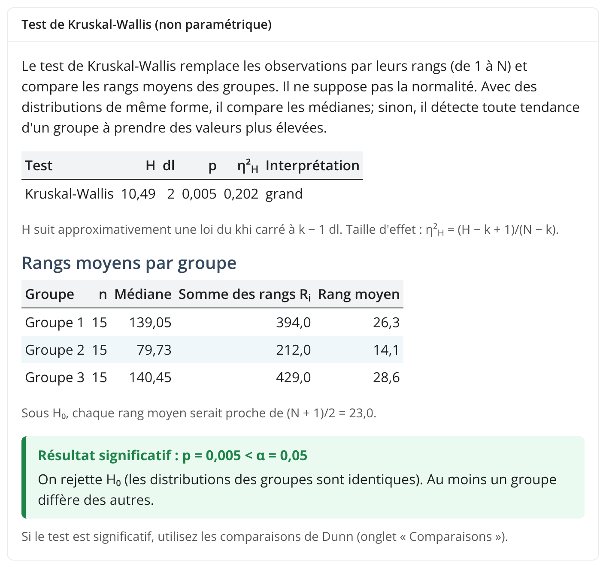

# Quand les conditions faiblissent {#sec-variantes}

```{r}
#| label: setup
#| include: false
#| cache: false
source("_common.R")
het_a <- anova_tab(het); het_w <- welch_1f(het$Mesure, het$Facteur); het_bf <- bf_moyennes(het$Mesure, het$Facteur)
het_s <- stats_groupes(het$Mesure, het$Facteur); het_wi <- het_s$n / het_s$var
asym_a <- anova_tab(asym); asym_kw <- kw_1f(asym$Mesure, asym$Facteur)
asym_log <- transform(asym, Mesure = log(Mesure))
asym_log_a <- anova_tab(asym_log)
cap_fig_rangs <- paste0("Le jeu asymétrique (3 groupes de 15, loi log-normale, graine 174) sur l'échelle des valeurs (à gauche) et sur celle des rangs (à droite). La valeur extrême du groupe 2 (", fr(max(asym$Mesure), 0), ") écrase l'échelle de gauche; à droite, elle devient simplement le rang 45, le plus grand. Les losanges marquent les moyennes : sur les rangs, le groupe 2 se détache nettement vers le bas.")
```

::: {.callout-tip title="Objectifs d'apprentissage"}
À la fin de ce chapitre, vous serez en mesure de :

- expliquer pourquoi le test $F$ classique se trompe quand des variances inégales se combinent à des effectifs inégaux;
- décrire comment le test de Welch et celui de Brown-Forsythe tiennent compte des variances des groupes;
- expliquer le principe des tests fondés sur les rangs (Kruskal-Wallis, médiane) et ce qu'ils testent au juste;
- expliquer comment le bootstrap reconstruit la loi de $F$ à partir des données;
- juger de l'intérêt d'une transformation de la mesure et en interpréter le résultat;
- choisir une variante selon la condition menacée.
:::

::: {.callout-important title="Idée centrale"}
Chaque variante répare une faiblesse précise du test classique. Welch et Brown-Forsythe remplacent la variance commune par les variances propres à chaque groupe; Kruskal-Wallis et le test de la médiane remplacent les valeurs par leur rang ou leur position; le bootstrap remplace la loi de Fisher par une loi reconstruite à partir des données; la transformation change l'échelle de la mesure pour que les conditions redeviennent plausibles. Le choix se fait d'après les données, jamais d'après le résultat.
:::

::: {.callout-warning title="Pièges classiques"}
- **Garder l'ANOVA classique quand les variances diffèrent et que les effectifs sont inégaux.** C'est la situation où elle se trompe le plus; le test de Welch règle le problème.
- **Croire que Kruskal-Wallis teste l'égalité des moyennes.** Il compare des rangs, donc des distributions.
- **Croire que le bootstrap règle tout.** Il remplace la loi de référence, pas la statistique : une valeur extrême continue de peser sur le $F$ observé.
- **Choisir la transformation qui donne $p < 0{,}05$.** La transformation se justifie par la nature des données, avant l'analyse.
:::

## Trois conditions, des menaces différentes

Le test $F$ classique repose sur trois conditions : l'**indépendance** des observations, la **normalité** des erreurs et l'**homogénéité des variances** entre groupes. L'indépendance relève du plan de collecte; les deux autres se vérifient dans l'onglet **Diagnostics** (@sec-diagnostics). Quand elles sont violées, le test classique peut devenir **libéral**, c'est-à-dire rejeter $H_0$ plus souvent que le seuil annoncé, ou **conservateur** (moins souvent), ou encore perdre de la puissance. L'onglet **ANOVA** offre plusieurs solutions de rechange, réunies dans les sous-onglets voisins de **ANOVA classique** et résumées dans le @tbl-routes en fin de chapitre. Le @sec-experimenter mesure, par simulation, l'ampleur de chacune de ces menaces.

## Variances inégales : Welch et Brown-Forsythe

Quand les groupes n'ont pas la même dispersion, le dénominateur du $F$ classique, un carré moyen intra *commun*, n'a plus de sens : il mélange des variances différentes. Rappelons que $CM_{\text{intra}} = \sum (n_i - 1)\,s_i^2/(N-k)$ (@sec-intro) : chaque variance y pèse selon l'effectif de son groupe. Si le groupe le plus dispersé est le plus petit, sa variance pèse peu dans $CM_{\text{intra}}$; le bruit est sous-estimé, $F$ est gonflé et le test rejette $H_0$ trop souvent. Dans le cas inverse, le bruit est surestimé et le test devient trop prudent. Avec des effectifs égaux, les deux erreurs se compensent en bonne partie.

Le **test de Welch** [@welch1951] contourne le problème : chaque groupe est pondéré par la précision de sa moyenne, $w_i = n_i / s_i^2$ (l'inverse du carré de son erreur type). Les moyennes sont comparées à une moyenne générale pondérée, $\bar{y}_w = \sum w_i \bar{y}_i / \sum w_i$, et la statistique s'écrit

$$
F_W = \frac{\dfrac{1}{k-1}\displaystyle\sum_i w_i (\bar{y}_i - \bar{y}_w)^2}{1 + \dfrac{2(k-2)}{k^2-1} \displaystyle\sum_i \frac{(1 - w_i/\sum w_j)^2}{n_i - 1}} .
$$

Le numérateur est l'analogue pondéré du carré moyen inter; le dénominateur, proche de 1, corrige l'incertitude due à l'estimation des variances. Les degrés de liberté du dénominateur sont estimés à partir des variances des groupes (d'où une valeur non entière). Le **test de Brown-Forsythe** [@brown1974] garde le numérateur de l'ANOVA, mais remplace le dénominateur par une combinaison des variances des groupes :

$$
F^{*} = \frac{\sum_i n_i(\bar{y}_i - \bar{y})^2}{\sum_i (1 - n_i/N)\, s_i^2} .
$$

Tous deux supposent encore la normalité : ils corrigent l'hétérogénéité des variances, pas la non-normalité. Le test de Welch est le plus utilisé; avec des effectifs égaux, $F^*$ est identique au $F$ classique, seuls ses degrés de liberté changent.

::: {.callout-warning title="Deux tests de Brown-Forsythe"}
Le sous-onglet **Brown-Forsythe** de l'onglet **ANOVA** compare des **moyennes**. Le test de Brown-Forsythe de l'onglet **Diagnostics** porte sur l'égalité des **variances** (c'est un test de Levene centré sur la médiane). Les deux procédures portent le nom des mêmes auteurs, mais répondent à des questions différentes.
:::

La @fig-welch montre l'enjeu sur le jeu hétérogène : un échantillon simulé **sans aucune différence de moyennes** (trois populations de moyenne 100), mais avec des écarts-types de 5, 12 et 25 et des effectifs de 30, 20 et 10. Le groupe le plus dispersé est le plus petit. L'ANOVA classique conclut à tort à une différence ($p = `r fr(het_a$p, 3)`$). Le test de Welch ($p = `r fr(het_w$p, 2)`$) et le test de Brown-Forsythe ($p = `r fr(het_bf$p, 2)`$) ne s'y laissent pas prendre.

{#fig-welch fig-align="center" width="75%"}

Le tableau **Le poids de chaque groupe** rend la pondération visible. Le groupe 1 (30 observations très peu dispersées) porte `r pc(het_wi[1] / sum(het_wi), 0)` du poids total; le groupe 3 (10 observations très dispersées), à peine `r pc(het_wi[3] / sum(het_wi), 1)`. Sa moyenne, mal estimée, ne peut donc plus « fabriquer » à elle seule une différence. Dans l'ANOVA classique, au contraire, c'est la petite taille du groupe 3 qui l'empêchait de peser dans le bruit : sa grande variance était diluée dans le $CM_{\text{intra}}$.

::: {.callout-note title="Labo 4.1 — Welch à la rescousse"}
**Objectif.** Voir quand le test classique et le test de Welch divergent.

**Manipulation.**

1. Simulez **3 groupes** de moyennes toutes égales (profil **Toutes égales (H₀ vraie)**, moyenne 100). Choisissez **n différent selon le groupe** (30, 20, 10) et **Écart-type différent selon le groupe** (5, 12, 25). Inscrivez la graine 51 et générez les données.
2. Comparez les résultats des sous-onglets **ANOVA classique**, **Test de Welch** et **Brown-Forsythe**. Examinez le tableau des poids.
3. Videz la graine et générez une dizaine d'échantillons. Comptez combien de fois chaque test rejette $H_0$.
4. Inversez les effectifs (10, 20, 30) et recommencez.

**Observez.** Avec la plus grande variance dans le plus petit groupe, l'ANOVA classique rejette $H_0$ bien plus souvent qu'une fois sur vingt, alors qu'aucune moyenne ne diffère; Welch reste près du seuil. Avec la plus grande variance dans le plus grand groupe, l'ANOVA devient au contraire trop prudente. Le @sec-experimenter mesurera ces taux sur des milliers d'échantillons.

**Question.** Pourquoi la combinaison « variances inégales *et* effectifs inégaux » est-elle la plus périlleuse pour le test classique ?
:::

## Non-normalité : Kruskal-Wallis et test de la médiane

Lorsque les distributions s'écartent nettement de la normale (forte asymétrie, valeurs extrêmes), on peut abandonner les valeurs elles-mêmes pour leurs **rangs**. Le test de **Kruskal-Wallis** [@kruskal1952] classe toutes les observations de 1 à $N$, puis compare la somme des rangs $R_i$ de chaque groupe au moyen de la statistique

$$
H = \frac{12}{N(N+1)} \sum_{i=1}^{k} \frac{R_i^2}{n_i} - 3(N+1),
$$

qui suit approximativement une loi du khi carré à $k-1$ degrés de liberté (l'application corrige $H$ pour les ex æquo). C'est, à une constante près, une ANOVA faite sur les rangs : sous $H_0$, chaque rang moyen $R_i/n_i$ devrait être proche de $(N+1)/2$, et $H$ mesure l'écart des rangs moyens à cette valeur. Comme il ne s'appuie que sur l'ordre des valeurs, une valeur extrême compte comme n'importe quel autre « plus grand rang » : il y est peu sensible (@fig-rangs). Sa taille d'effet, $\eta^2_H = (H - k + 1)/(N - k)$, s'interprète avec les repères de $\eta^2$.

```{r}
#| label: fig-rangs
#| fig-cap: !expr cap_fig_rangs
#| fig-alt: "Deux panneaux de points par groupe. À gauche, la plupart des valeurs sont entre 30 et 250, avec un point isolé vers 500 dans le groupe 2. À droite, les rangs de 1 à 45 sont répartis régulièrement; le groupe 2 occupe surtout les rangs bas, sauf un point au rang 45."
#| fig-height: 3.6
dr <- rbind(data.frame(g = asym$Facteur, v = asym$Mesure, ech = "Valeurs"),
            data.frame(g = asym$Facteur, v = rank(asym$Mesure), ech = "Rangs (1 à 45)"))
dr$ech <- factor(dr$ech, levels = c("Valeurs", "Rangs (1 à 45)"))
mr <- aggregate(v ~ g + ech, dr, mean)
set.seed(3)
ggplot(dr, aes(g, v)) +
  geom_jitter(width = 0.12, height = 0, colour = pal$bleu, alpha = 0.7, size = 1.8) +
  geom_point(data = mr, shape = 18, size = 5, colour = pal$rouge) +
  facet_wrap(~ech, scales = "free_y") +
  scale_y_continuous(labels = axe_fr) +
  labs(x = NULL, y = NULL)
```

Le **test de la médiane**, plus rustique encore, compte dans chaque groupe les observations situées au-dessus et au-dessous de la médiane globale, puis compare ces effectifs par un test du khi carré. Il est très robuste, mais moins puissant que Kruskal-Wallis, puisqu'il ne retient de chaque observation que sa position par rapport à la médiane.

Ces tests répondent à une question légèrement différente de celle de l'ANOVA : « les distributions sont-elles décalées les unes par rapport aux autres ? » plutôt que « les moyennes diffèrent-elles ? ». Si les distributions ont la même forme, Kruskal-Wallis compare en pratique les médianes.

La @fig-kw illustre leur intérêt sur le jeu asymétrique. Le groupe 2 contient une valeur extrême, près de 500. Elle gonfle à la fois sa moyenne et la variance intra-groupe : l'ANOVA classique ne détecte rien ($F$ = `r fr(asym_a$F)`, $p$ = `r fr(asym_a$p, 2)`). Kruskal-Wallis, insensible à l'ampleur de cette valeur, voit que le groupe 2 prend globalement des valeurs plus faibles et rejette $H_0$ ($p = `r fr(asym_kw$p, 3)`$). L'effet estimé par l'ANOVA est d'ailleurs nul : $\omega^2$ serait négatif ($-0{,}007$), et l'application affiche 0.

{#fig-kw fig-align="center" width="75%"}

::: {.callout-note title="Labo 4.2 — Les rangs contre la valeur extrême"}
**Objectif.** Comparer le test classique et les tests fondés sur les rangs face à une forte asymétrie.

**Manipulation.**

1. Simulez **3 groupes** de **15** observations, moyennes `100; 100; 130`, σ = 60, forme **Asymétrique (log-normale)**, graine **174**.
2. Ouvrez **Description des données ▸ Visualisation** (boîtes à moustaches) et repérez la valeur extrême du groupe 2.
3. Comparez les sous-onglets **ANOVA classique**, **Kruskal-Wallis** et **Test de la médiane**.
4. Videz la graine et générez quelques échantillons avec les mêmes réglages.

**Observez.** Avec cette graine, l'ANOVA et Kruskal-Wallis aboutissent à des conclusions opposées. Sur l'ensemble des échantillons, Kruskal-Wallis détecte plus souvent la différence que l'ANOVA quand les distributions sont très asymétriques.

**Question.** Kruskal-Wallis teste-t-il exactement la même hypothèse que l'ANOVA ? Que compare-t-il, au juste ?
:::

## Sans loi théorique : l'ANOVA bootstrap

Le sous-onglet **ANOVA bootstrap** propose une troisième voie [@efron1993]. Le test classique compare le $F$ observé à la loi de Fisher, qui n'est exacte que si les conditions sont remplies. Le bootstrap construit plutôt la **distribution de $F$ sous $H_0$ à partir des données elles-mêmes**, par rééchantillonnage :

1. on fabrique un jeu de données où $H_0$ est vraie, par exemple en regroupant toutes les observations dans un bassin commun;
2. on tire avec remise $N$ valeurs dans ce bassin, on les répartit entre les groupes avec leurs effectifs d'origine, et l'on calcule $F$;
3. on répète l'opération $B$ fois (2 000 par défaut).

On obtient ainsi $B$ valeurs de $F$ « sous $H_0$ », dont la forme reflète celle des données. La **valeur critique bootstrap** est le quantile $1 - \alpha$ de leur distribution. La **valeur $p$ bootstrap** compte les valeurs simulées qui atteignent ou dépassent le $F$ observé; l'application l'écrit $(b + 1)/(B + 1)$, où $b$ est ce nombre : le $F$ observé est lui-même l'un des $F$ possibles sous $H_0$, si bien qu'une valeur $p$ de Monte-Carlo ne vaut jamais exactement zéro [@davison1997].

L'application propose trois façons de fabriquer les données sous $H_0$, décrites dans l'encadré **Principe** : **non paramétrique** (bassin commun des observations), **paramétrique** (lois normales de même moyenne, avec l'écart-type observé de chaque groupe) et **résidus** (écarts de chaque observation à la moyenne de son groupe, tirés avec remise et ajoutés à la moyenne générale). La première est la plus générale; la paramétrique suppose la normalité, mais tolère des variances inégales.

{#fig-bootstrap fig-align="center" width="100%"}

Le graphique est l'élément le plus instructif (@fig-bootstrap). Si l'histogramme suit la courbe pointillée et que les deux valeurs critiques sont proches, la loi $F$ convient à vos données, et le test classique est fiable. Un écart net signale une violation des conditions. Les résultats varient légèrement d'un lancement à l'autre : c'est le hasard du rééchantillonnage, d'autant plus faible que $B$ est grand.

Le bootstrap n'est pas une solution miracle. Il hérite des défauts de l'échantillon : avec de petits groupes, la distribution reconstruite est grossière, et une valeur extrême continue de peser sur le $F$ observé lui-même. Dans l'exemple de la @fig-bootstrap, le bootstrap confirme la conclusion de l'ANOVA classique (aucune différence détectée), alors que Kruskal-Wallis en trouvait une : le problème ne vient pas de la loi de référence, mais de la statistique $F$, fondée sur des moyennes, que la valeur extrême perturbe.

::: {.callout-note title="Labo 4.3 — Rééchantillonner plutôt que supposer"}
**Objectif.** Confronter l'ANOVA bootstrap au test classique.

**Manipulation.**

1. Avec l'exemple de référence (graine 2026, réglages par défaut), ouvrez **ANOVA bootstrap**, gardez la méthode **non paramétrique** et $B = 2\,000$, puis cliquez sur **Lancer l'ANOVA bootstrap**. Comparez les deux valeurs critiques et la forme de l'histogramme à la courbe pointillée.
2. Recommencez avec le jeu asymétrique du Labo 4.2 (graine 174).
3. Essayez les méthodes **paramétrique** et **résidus** : les conclusions se rejoignent-elles ?

**Observez.** Avec des données normales, la distribution bootstrap épouse la loi $F$ et les deux valeurs critiques sont presque égales. Avec les données asymétriques, l'accord est moins parfait, mais la conclusion reste celle du $F$ classique.

**Question.** Le bootstrap règle-t-il le problème posé par une valeur extrême ? Pourquoi Kruskal-Wallis s'en sort-il mieux dans le Labo 4.2 ?
:::

## Transformer plutôt que renoncer

Face à des variances inégales ou à une forte asymétrie, changer de test n'est pas la seule option : on peut parfois **transformer** la mesure pour rétablir les conditions. Le menu **Transformer la mesure**, dans les réglages communs, applique en direct une fonction à la variable mesurée : racine carrée, logarithme naturel ou décimal, carré, inverse de la racine carrée, ou arcsinus de la racine. Toutes les analyses se recalculent aussitôt, et un encadré rappelle la variable analysée.

Chaque transformation a son domaine :

- la **racine carrée** stabilise la variance de données de comptage, dont la variance croît avec la moyenne (le @sec-exemple en donne un exemple réel);
- le **logarithme** convient aux mesures strictement positives, étirées vers la droite ou de nature multiplicative (durées, revenus, concentrations), dont l'écart-type croît en proportion de la moyenne;
- l'**inverse de la racine** comprime encore plus fortement les grandes valeurs;
- l'**arcsinus de la racine** s'applique aux proportions comprises entre 0 et 1;
- le **carré**, à l'inverse, étire les grandes valeurs; il sert surtout à constater l'effet contraire.

L'idée commune aux premières est de comprimer les grandes valeurs davantage que les petites, pour symétriser les distributions et égaliser les dispersions. L'application refuse une transformation impossible (un logarithme de valeurs négatives, un arcsinus de valeurs supérieures à 1) : un avertissement apparaît et les analyses restent sur la mesure brute.

```{r}
#| label: fig-transformation
#| fig-cap: "Le jeu asymétrique avant et après transformation logarithmique. Sur l'échelle brute, le groupe 2 contient une valeur extrême et les dispersions diffèrent; après transformation, les distributions sont plus symétriques et la valeur extrême rentre dans le rang."
#| fig-alt: "Deux panneaux de boîtes à moustaches pour trois groupes. À gauche, échelle brute de 0 à 500, avec un point isolé vers 500 dans le groupe 2. À droite, échelle logarithmique de 3,4 à 6,2, boîtes de hauteurs comparables."
#| fig-height: 3.6
dd <- rbind(transform(asym, Echelle = "Mesure brute"),
            transform(asym_log, Echelle = "Après transformation ln(Y)"))
dd$Echelle <- factor(dd$Echelle, levels = c("Mesure brute", "Après transformation ln(Y)"))
set.seed(1)
ggplot(dd, aes(Facteur, Mesure)) +
  geom_boxplot(fill = "#aed6f1", outlier.shape = NA, width = 0.55) +
  geom_jitter(width = 0.12, height = 0, alpha = 0.6, size = 1.4, colour = "grey25") +
  facet_wrap(~Echelle, scales = "free_y") +
  scale_y_continuous(labels = axe_fr) +
  labs(x = NULL, y = NULL)
```

Sur ces données, la transformation change la conclusion : l'ANOVA classique sur $\ln(Y)$ devient significative ($F$ = `r fr(asym_log_a$F)`, $p$ = `r fr(asym_log_a$p, 3)`), en accord avec Kruskal-Wallis, et les tests de normalité ne rejettent plus rien (@fig-transformation).

Une transformation n'est toutefois pas anodine : elle modifie l'échelle, donc l'interprétation. Une différence de moyennes de $\ln(Y)$ correspond à un **rapport** sur l'échelle d'origine (une différence de 0,4 entre deux moyennes de logarithmes signifie que les moyennes géométriques sont dans un rapport $e^{0,4} \approx 1{,}5$). Transformer est un compromis, à peser contre le recours à un test robuste; et la transformation doit être justifiée par la nature des données, non choisie parce qu'elle donne le résultat espéré.

::: {.callout-note title="Labo 4.4 — L'effet d'une transformation"}
**Objectif.** Observer comment une transformation agit sur les distributions et sur le test.

**Manipulation.**

1. Reprenez le jeu asymétrique (graine 174). Notez, dans **Diagnostics**, le test recommandé et les tests de normalité.
2. Dans les réglages communs, choisissez **Logarithme naturel ln(Y)**. Observez les boîtes à moustaches, les diagnostics et le tableau d'ANOVA.
3. Essayez **Racine carrée √Y**, puis **Arcsinus √Y**. Que se passe-t-il avec cette dernière ?

**Observez.** Le logarithme resserre la queue de droite : les distributions se rapprochent de la normale, la valeur extrême perd son influence et l'ANOVA devient significative. La racine carrée produit un effet intermédiaire. L'arcsinus est refusé, puisque les mesures ne sont pas des proportions.

**Question.** Après une transformation logarithmique, formuleriez-vous la conclusion en termes d'écarts ou de rapports ?
:::

## Choisir sa route

Le @tbl-routes résume les options. L'onglet **Diagnostics** automatise ce choix (@sec-diagnostics).

| Situation | Test recommandé | Sous-onglet | Comparaisons associées |
|:----------|:----------------|:------------|:-----------------------|
| Normalité et variances homogènes | ANOVA classique (la plus puissante) | **ANOVA classique** | Tukey HSD |
| Normalité, mais variances inégales | Welch (ou Brown-Forsythe) | **Test de Welch**, **Brown-Forsythe** | Games-Howell, Tamhane T2, Dunnett T3 |
| Variance qui croît avec la moyenne (comptages, durées) | Transformation (racine, logarithme), puis ANOVA | **ANOVA classique** sur la mesure transformée | Tukey HSD sur l'échelle transformée |
| Forte asymétrie, valeurs extrêmes | Kruskal-Wallis (ou transformation) | **Kruskal-Wallis** | Dunn |
| Valeurs extrêmes nombreuses, données ordinales | Test de la médiane | **Test de la médiane** | — |
| Doute sur la loi de référence | Bootstrap | **ANOVA bootstrap** | — |

: Choisir le test selon la situation. {#tbl-routes}

Le chapitre suivant suppose qu'un test global a conclu à une différence, et cherche à savoir *où* elle se loge.

## Ce qu'il faut retenir

- Variances inégales, surtout avec des effectifs inégaux : test de Welch, qui pondère chaque groupe par la précision de sa moyenne.
- Forte asymétrie ou valeurs extrêmes : Kruskal-Wallis, qui travaille sur les rangs, ou une transformation justifiée par la nature des données.
- Le bootstrap vérifie la loi de référence du test, mais ne protège pas la statistique $F$ contre une valeur extrême.
- Chaque variante répond à une question un peu différente (moyennes, distributions, médianes, échelle transformée); il faut l'interpréter en conséquence.

## Erreurs fréquentes

| Erreur | Pourquoi c'est problématique | Bonne pratique |
|:-------|:-----------------------------|:---------------|
| Utiliser l'ANOVA classique avec des variances et des effectifs très inégaux | Le taux d'erreur de type I peut être plusieurs fois supérieur à $\alpha$ | Utiliser le test de Welch, puis Games-Howell |
| Retenir le test qui donne le résultat significatif | Le choix du test devient une pêche aux résultats | Choisir d'après les diagnostics, avant de regarder les valeurs $p$ |
| Choisir la transformation qui donne $p < 0{,}05$ | C'est une autre forme de pêche aux résultats | Justifier la transformation par la nature des données, avant l'analyse |
| Interpréter Kruskal-Wallis comme un test de moyennes | Il compare des rangs, donc des distributions | Formuler la conclusion en termes de distributions ou de médianes |
| Conclure sur l'échelle d'origine après une transformation logarithmique | Une différence de logarithmes est un rapport, pas un écart | Rapporter des rapports de moyennes géométriques |

## Quiz

::: {.callout-note title="Question 1 — vrai ou faux"}
**Énoncé.** Si le test de Welch et l'ANOVA classique donnent des conclusions différentes, il faut retenir celle qui est significative, puisqu'elle montre qu'un effet existe.

::: {.callout-tip title="Réponse" collapse="true"}
Faux. Le choix du test se fait d'après les conditions, pas d'après le résultat. Si les variances sont inégales, l'ANOVA classique peut être significative à tort (comme dans la @fig-welch, où $H_0$ est vraie) : c'est le test de Welch qu'il faut retenir.
:::
:::

::: {.callout-note title="Question 2 — calcul"}
**Énoncé.** Deux groupes ont des moyennes estimées avec la même précision : $n_1 = 40$, $s_1 = 10$ et $n_2 = 10$, $s_2 = 5$. Calculez les poids de Welch. Que constatez-vous ?

::: {.callout-tip title="Réponse" collapse="true"}
$w_1 = 40/100 = 0{,}4$ et $w_2 = 10/25 = 0{,}4$ : les poids sont égaux. Le groupe 1 a quatre fois plus d'observations, mais aussi une variance quatre fois plus grande; les deux moyennes ont donc la même erreur type ($10/\sqrt{40} = 5/\sqrt{10} \approx 1{,}58$). Le poids de Welch ne récompense pas l'effectif en soi, mais la précision.
:::
:::

::: {.callout-note title="Question 3 — situation"}
**Énoncé.** On compare le temps (en secondes) mis par trois groupes pour résoudre un problème. Dans chaque groupe, l'écart-type est à peu près proportionnel à la moyenne, et les distributions sont étirées vers la droite. Que proposez-vous ?

::: {.callout-tip title="Réponse" collapse="true"}
Des durées positives, asymétriques, dont la dispersion croît avec la moyenne : c'est le cas typique d'une transformation logarithmique, qui rend l'écart-type constant et symétrise les distributions. On vérifie ensuite les diagnostics sur $\ln(Y)$, on fait l'ANOVA sur l'échelle transformée et l'on rapporte les différences comme des rapports de moyennes géométriques. Kruskal-Wallis, insensible à toute transformation croissante, est une bonne vérification.
:::
:::
