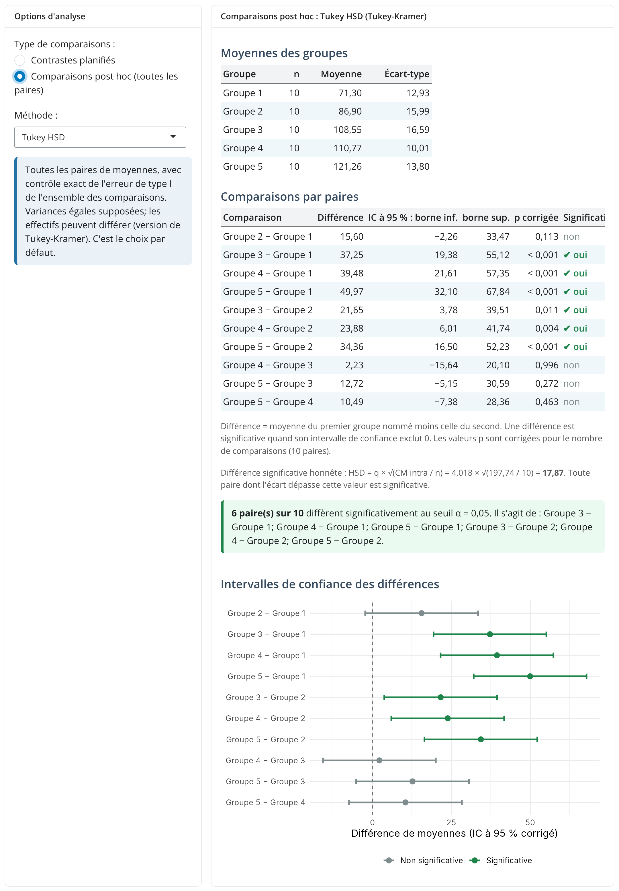
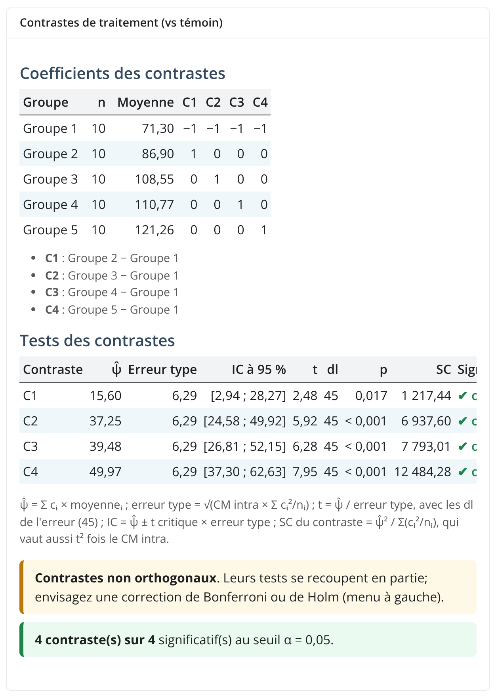
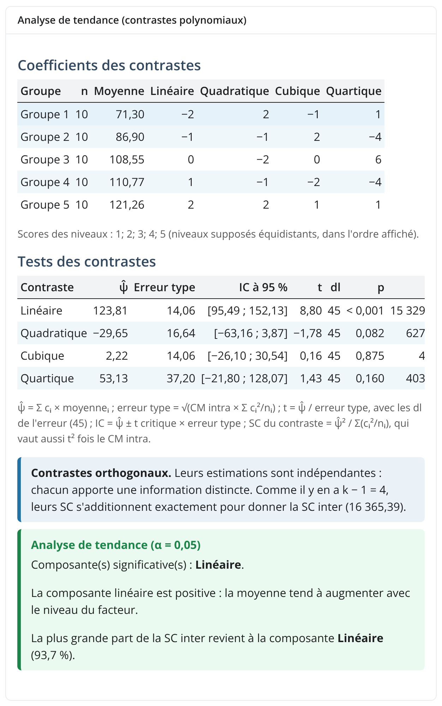

# Comparaisons multiples et contrastes {#sec-comparaisons}

```{r}
#| label: setup
#| include: false
#| cache: false
source("_common.R")
tk <- comparaisons_multiples(ref$Mesure, ref$Facteur, "tukey")
q_tk <- qtukey(0.95, 5, ref_a$dl2)
hsd <- q_tk * sqrt(ref_a$cmintra / 10)
```

::: {.callout-tip title="Objectifs d'apprentissage"}
À la fin de ce chapitre, vous serez en mesure de :

- expliquer pourquoi le risque d'erreur de type I gonfle quand on multiplie les comparaisons, et distinguer le risque par comparaison du risque pour l'ensemble des comparaisons;
- choisir entre contrastes planifiés et comparaisons post hoc selon la question de recherche;
- choisir une méthode post hoc selon l'égalité des variances, et lire son tableau et ses intervalles de confiance;
- construire un contraste, vérifier qu'il est valide et juger si deux contrastes sont orthogonaux;
- réaliser une analyse de tendance sur un facteur ordonné et interpréter ses composantes.
:::

::: {.callout-important title="Idée centrale"}
Chaque comparaison supplémentaire est une nouvelle occasion de se tromper. Les comparaisons post hoc examinent toutes les paires et paient ce balayage par une correction; les contrastes planifiés posent avant l'analyse quelques questions précises et conservent ainsi davantage de puissance. Le bon choix dépend de la question, et il se fait avant de regarder les résultats.
:::

::: {.callout-warning title="Pièges classiques"}
- **Enchaîner des tests $t$ sans correction.** Avec 10 paires, le risque de déclarer au moins une fausse différence approche 30 % au lieu de 5 %.
- **Choisir la méthode qui donne le plus de résultats significatifs.** La méthode se choisit selon le plan et les conditions, pas selon le résultat.
- **Utiliser Tukey quand les variances diffèrent fortement.** Games-Howell, Tamhane T2 ou Dunnett T3 sont faits pour cela.
- **Lire « non significatif » comme « identiques ».** L'intervalle de confiance d'une différence peut contenir des écarts importants.
- **Faire une analyse de tendance sur un facteur nominal.** La « pente » changerait si l'on permutait les groupes.
- **Écrire des coefficients dont la somme n'est pas nulle.** Ce n'est plus un contraste : l'application le refuse.
:::

Un test global significatif annonce qu'*au moins une* moyenne diffère, sans dire laquelle. L'onglet **Comparaisons** répond à cette seconde question. On ne peut toutefois pas multiplier librement les tests deux à deux : ce chapitre explique pourquoi, puis présente les deux stratégies qu'offre l'application.

## Le piège des comparaisons multiples

Avec $k$ groupes, il existe $m = k(k-1)/2$ paires : 3 paires pour 3 groupes, 10 pour 5 groupes, 45 pour 10 groupes. Chaque test fait au seuil $\alpha = 0{,}05$ comporte un risque de 5 % de déclarer une différence qui n'existe pas. Si les $m$ tests étaient indépendants, la probabilité de commettre **au moins une** erreur de type I dans l'ensemble, appelée **risque global** (ou taux d'erreur par famille), vaudrait

$$
\alpha_{\text{global}} = 1 - (1 - \alpha)^m .
$$

```{r}
#| label: fig-inflation
#| fig-cap: "Risque global d'erreur de type I selon le nombre de groupes, quand chaque paire est testée sans correction au seuil de 5 % (formule pour des tests indépendants). Les tests par paires partagent des groupes et ne sont pas indépendants : le risque réel est un peu plus faible (environ 28 % pour 5 groupes, @fig-risque-global), mais il reste bien loin de 5 %."
#| fig-alt: "Courbe croissante : 14 % pour 3 groupes, 26 % pour 4, 40 % pour 5, 54 % pour 6, jusqu'à 90 % pour 10 groupes. Une ligne pointillée marque 5 %."
#| fig-height: 3.4
k <- 2:10; m <- k * (k - 1) / 2
d <- data.frame(k = k, m = m, risque = 1 - 0.95^m)
ggplot(d, aes(k, risque)) +
  geom_hline(yintercept = 0.05, linetype = "dashed", colour = pal$gris) +
  geom_line(colour = pal$rouge, linewidth = 1) +
  geom_point(colour = pal$rouge, size = 2.5) +
  geom_text(aes(label = paste0(m, " paire", ifelse(m > 1, "s", ""))), vjust = -1, size = 3.2) +
  annotate("text", x = 9.6, y = 0.08, label = "5 %", colour = pal$gris, size = 3.5) +
  scale_x_continuous(breaks = k) +
  scale_y_continuous(labels = function(x) paste0(axe_fr(100 * x), " %"), limits = c(0, 1.05)) +
  labs(x = "Nombre de groupes k", y = "Risque global")
```

Pour cinq groupes, le risque global dépasse 40 % selon la formule (@fig-inflation). Autrement dit, en cherchant partout sans précaution, on finit presque toujours par « trouver » une différence illusoire. Toute la théorie des comparaisons multiples consiste à contrôler le risque à l'échelle de l'**ensemble** des comparaisons, et non de chaque comparaison isolée.

La formule suppose des tests indépendants, ce que ne sont pas les comparaisons par paires : la paire 1–2 et la paire 1–3 partagent le groupe 1, et toutes partagent le même $CM_{\text{intra}}$. Le scénario **Comparaisons multiples : le risque global** de l'onglet **Expérimentation** mesure le risque réel par simulation (@fig-risque-global). Il fabrique des milliers d'échantillons où $H_0$ est vraie et note, pour chaque méthode, la proportion des échantillons où au moins une paire est déclarée significative.

{#fig-risque-global fig-align="center" width="80%"}

::: {.callout-note title="Labo 5.1 — Le risque qui gonfle"}
**Objectif.** Constater l'inflation du risque d'erreur quand on multiplie les comparaisons sans correction.

**Manipulation.**

1. Simulez **5 groupes** de moyennes toutes égales (profil **Toutes égales (H₀ vraie)**), avec σ = 15 et $n = 10$. Laissez la graine vide.
2. Ouvrez **Comparaisons**, choisissez **Comparaisons post hoc (toutes les paires)** et la méthode **LSD de Fisher (sans correction)**. Notez si au moins une paire est déclarée significative. Passez à **Tukey HSD** sur les mêmes données et notez de nouveau.
3. Générez une dizaine d'échantillons et tenez le compte pour les deux méthodes.
4. Ouvrez enfin **Expérimentation**, choisissez le scénario **Comparaisons multiples : le risque global** et lancez-le avec 1 000 répétitions.

**Observez.** Aucune moyenne ne diffère, et pourtant le LSD déclare au moins une « différence » dans plus d'un échantillon sur quatre (environ 28 %). Tukey n'en déclare qu'environ une fois sur vingt : il maintient le risque global à 5 %. La simulation confirme ce que votre petit décompte laissait entrevoir, avec beaucoup plus de précision.

**Question.** Avec dix paires testées chacune à 5 %, pourquoi le risque de se tromper *au moins une fois* est-il si supérieur à 5 % ?
:::

## Deux stratégies

Le menu **Type de comparaisons** distingue deux démarches.

Les **comparaisons post hoc** sont *exploratoires* : on compare toutes les paires après coup, sans hypothèse préalable, et l'on paie ce balayage par une correction sévère. Les **contrastes planifiés** sont *confirmatoires* : on formule avant l'analyse un petit nombre de comparaisons ciblées, dictées par la théorie ou par le plan de l'étude (chaque traitement contre un témoin, une tendance selon la dose…). Moins nombreuses, elles demandent peu ou pas de correction et conservent plus de puissance.

Choisir sa stratégie *avant* de voir les données est une exigence méthodologique : un contraste « planifié » après avoir repéré les deux moyennes les plus éloignées est en réalité une comparaison post hoc déguisée.

## Les comparaisons post hoc

Le menu **Méthode** regroupe les procédures selon l'hypothèse qu'elles font sur les variances (@tbl-posthoc). Sous le menu, un encadré décrit la méthode choisie.

| Méthode | Variances | Intervalles de confiance | Contrôle du risque global |
|:--------|:---------:|:------------------------:|:--------------------------|
| **Tukey HSD** (Tukey-Kramer) | égales | oui | exact pour toutes les paires; le choix par défaut |
| **LSD de Fisher** | égales | oui | **aucun** : sert à constater le problème |
| **Bonferroni** | égales | oui | chaque test au seuil $\alpha/m$; sûr mais prudent |
| **Holm** | égales | non | version séquentielle de Bonferroni, plus puissante |
| **Scheffé** | égales | oui | protège tous les contrastes possibles; très prudent pour des paires |
| **Student-Newman-Keuls** | égales | non | insuffisant dès que $k > 3$ |
| **Duncan** | égales | non | libéral; à éviter |
| **Games-Howell** | inégales | oui | analogue de Tukey sans variance commune |
| **Tamhane T2** | inégales | oui | tests de Welch avec correction de Šidák; prudent |
| **Dunnett T3** | inégales | non | bon choix avec de petits effectifs |
| **Dunn** | rangs | non | après Kruskal-Wallis; correction de Holm |

: Les méthodes post hoc de l'application. {#tbl-posthoc}

Le **test de Tukey** [@tukey1949] est la référence pour comparer toutes les paires quand les variances sont homogènes. Son idée est simple : si l'on contrôle la *plus grande* des différences entre moyennes, on contrôle toutes les autres. Il s'appuie donc sur la loi de l'**étendue studentisée**, $q = (\bar{y}_{\max} - \bar{y}_{\min}) / \sqrt{CM_{\text{intra}}/n}$, c'est-à-dire la loi de l'écart entre la plus grande et la plus petite de $k$ moyennes quand $H_0$ est vraie. Avec des effectifs égaux, toute paire dont l'écart dépasse la **différence significative honnête**

$$
HSD = q_{1-\alpha;\,k;\,N-k} \sqrt{\frac{CM_{\text{intra}}}{n}}
$$

est déclarée significative, et le risque global vaut exactement $\alpha$. Avec des effectifs inégaux, l'application utilise la version de Tukey-Kramer, qui remplace $1/n$ par $\tfrac{1}{2}(1/n_i + 1/n_j)$. Les corrections de **Bonferroni** et de **Holm** [@holm1979] procèdent autrement, en rendant chaque test plus sévère. La méthode de **Scheffé** [@scheffe1953] protège non seulement les paires, mais tous les contrastes imaginables, ce qui la rend très prudente pour de simples paires. **Games-Howell** [@gameshowell1976] est l'équivalent de Tukey lorsque les variances sont *inégales* : il prolonge naturellement le test de Welch (@sec-variantes), en utilisant pour chaque paire l'erreur type et les degrés de liberté de Welch. **Tamhane T2** [@tamhane1979] et **Dunnett T3** [@dunnett1980] poursuivent le même but avec d'autres corrections. **SNK** et **Duncan** sont présentés à titre historique : leur risque global dépasse $\alpha$ dès que les groupes sont nombreux.

La @fig-tukey montre le résultat de Tukey pour l'exemple de référence. Le premier tableau rappelle les moyennes; le second donne, pour chaque paire, la **différence** (moyenne du premier groupe nommé moins celle du second), son **intervalle de confiance corrigé** et la **valeur $p$ corrigée**. Le graphique du bas présente les mêmes intervalles : une différence est significative quand son intervalle exclut 0. Ici, 6 paires sur 10 diffèrent. Les groupes 3, 4 et 5 ne se distinguent pas entre eux, ni les groupes 1 et 2. Comme les effectifs sont égaux, une note donne aussi la HSD : $q = `r fr(q_tk, 3)`$ et $HSD = `r fr(q_tk, 3)` \times \sqrt{`r fr(ref_a$cmintra)`/10} = `r fr(hsd)`$. Les six paires significatives sont exactement celles dont l'écart dépasse `r fr(hsd)` points.

{#fig-tukey fig-align="center" width="100%"}

L'intervalle de confiance est plus informatif que la seule mention « significatif ». La paire Groupe 2 − Groupe 1, par exemple, a une différence estimée de 15,6 points, non significative : son intervalle va d'environ −2 à 33. Les données sont compatibles aussi bien avec une absence de différence qu'avec une différence de plus de deux écarts-types. « Non significatif » ne veut donc pas dire « semblable ».

### Le prix de la protection : la largeur des intervalles

Toutes les méthodes construisent l'intervalle d'une différence de la même façon : différence observée $\pm$ un **multiplicateur** $\times$ l'erreur type de la différence. Avec des variances égales, l'erreur type est la même pour toutes, $\sqrt{CM_{\text{intra}}(1/n_i + 1/n_j)}$; seul le multiplicateur change, et il grandit avec la protection offerte (@fig-largeurs). Le LSD utilise la valeur $t$ ordinaire; Bonferroni, une valeur $t$ au seuil $\alpha/m$; Tukey, l'étendue studentisée divisée par $\sqrt{2}$; Scheffé, $\sqrt{(k-1)\,F_{1-\alpha;\,k-1;\,N-k}}$, qui couvre tous les contrastes imaginables.

```{r}
#| label: fig-largeurs
#| fig-cap: "La paire Groupe 2 − Groupe 1 de l'exemple de référence (différence de 15,6 points), avec l'intervalle à 95 % de quatre méthodes. Le multiplicateur de l'erreur type (6,29) est indiqué à droite. Seul le LSD, qui ne corrige rien, exclut 0 et déclare la différence significative; Tukey est la plus étroite des méthodes qui protègent le risque global pour toutes les paires."
#| fig-alt: "Quatre intervalles horizontaux centrés sur 15,6. LSD de 2,9 à 28,3 (n'inclut pas 0); Tukey de −2,3 à 33,5; Bonferroni de −3,0 à 34,2; Scheffé de −4,6 à 35,8. Une ligne pointillée marque 0."
#| fig-height: 3.2
dl <- ref_a$dl2; se <- sqrt(ref_a$cmintra * 2 / 10); dif <- tk$diff[1]
mult <- c("LSD (sans correction)" = qt(0.975, dl), "Tukey HSD" = q_tk / sqrt(2),
          "Bonferroni (m = 10)" = qt(1 - 0.05 / 20, dl), "Scheffé" = sqrt(4 * qf(0.95, 4, dl)))
w <- data.frame(m = factor(names(mult), levels = rev(names(mult))), mult = mult,
                lo = dif - mult * se, hi = dif + mult * se)
ggplot(w, aes(y = m)) +
  geom_vline(xintercept = 0, linetype = "dashed", colour = "grey40") +
  geom_errorbarh(aes(xmin = lo, xmax = hi, colour = lo > 0), height = 0.25, linewidth = 1) +
  geom_point(aes(x = dif), size = 2.5) +
  geom_text(aes(x = 41, label = paste0("× ", fr(mult, 2))), hjust = 0, size = 3.5) +
  scale_colour_manual(values = c("TRUE" = pal$vert, "FALSE" = "grey45"), guide = "none") +
  scale_x_continuous(labels = axe_fr, limits = c(-6, 46)) +
  labs(x = "Différence de moyennes (Groupe 2 − Groupe 1)", y = NULL)
```

Le choix n'est donc pas une affaire de goût. Pour toutes les paires, Tukey offre la protection voulue au moindre coût; Bonferroni convient à un petit nombre de comparaisons choisies d'avance; Scheffé se justifie quand on explore aussi des contrastes complexes, décidés après avoir vu les données.

::: {.callout-note title="Labo 5.2 — Quelles paires diffèrent ?"}
**Objectif.** Passer d'un test global significatif à l'identification des paires responsables.

**Manipulation.**

1. Simulez 3 groupes de 20 observations, de moyennes `100; 100; 115` (deux groupes semblables et un troisième détaché), avec σ = 15.
2. Vérifiez que l'ANOVA classique est significative, puis ouvrez **Comparaisons ▸ Comparaisons post hoc ▸ Tukey HSD**.
3. Lisez, pour chaque paire, la différence, son intervalle de confiance et la valeur $p$ corrigée. Comparez avec **Bonferroni** et **Scheffé**.

**Observez.** Les deux paires impliquant le troisième groupe ressortent habituellement, tandis que la paire des deux groupes semblables ne diffère pas. Les intervalles de Bonferroni sont un peu plus larges que ceux de Tukey, et ceux de Scheffé plus larges encore : le prix d'une protection plus étendue.

**Question.** Pourquoi l'intervalle de confiance d'une différence est-il plus informatif que la seule mention « significatif » ou « non significatif » ?
:::

::: {.callout-note title="Labo 5.3 — Games-Howell quand les variances diffèrent"}
**Objectif.** Choisir le bon post hoc lorsque l'homogénéité des variances est violée.

**Manipulation.**

1. Simulez 3 groupes de moyennes `100; 100; 108`, avec **n différent selon le groupe** (30, 30, 10) et **Écart-type différent selon le groupe** (5, 5, 25).
2. Comparez les résultats de **Tukey HSD** et de **Games-Howell** sur les mêmes données. Regardez surtout la largeur des intervalles des paires qui impliquent le groupe 3.
3. Générez quelques échantillons et repérez les paires où les deux méthodes divergent.

**Observez.** Tukey utilise une variance commune, la même pour toutes les paires : il sous-estime l'incertitude des paires qui impliquent le groupe 3, très dispersé, et surestime celle de la paire 1–2. Games-Howell utilise la dispersion propre à chaque paire : ses intervalles sont étroits pour la paire 1–2 et larges pour les autres.

**Question.** Après un test de Welch significatif, quelle méthode post hoc est cohérente, et pourquoi pas Tukey ?
:::

## Les contrastes planifiés

Un **contraste** est une comparaison ciblée entre moyennes, définie par des coefficients $c_i$ dont la somme est nulle :

$$
\psi = \sum_{i=1}^{k} c_i\, \mu_i, \qquad \sum_{i=1}^{k} c_i = 0 .
$$

On l'estime en remplaçant les $\mu_i$ par les moyennes observées : $\hat\psi = \sum c_i \bar{y}_i$. Par exemple, avec un groupe témoin et deux traitements, les coefficients $(-1, \tfrac12, \tfrac12)$ comparent le témoin à la moyenne des traitements, et $(0, 1, -1)$ compare les deux traitements entre eux. La condition $\sum c_i = 0$ garantit que $\psi = 0$ quand toutes les moyennes sont égales : un contraste mesure une *différence*, jamais un niveau.

Le test d'un contraste est un test $t$ qui utilise le carré moyen intra de l'ANOVA :

$$
t = \frac{\hat\psi}{\sqrt{CM_{\text{intra}} \sum_i c_i^2 / n_i}}, \qquad \text{avec } N - k \text{ degrés de liberté}.
$$

L'application donne aussi l'**intervalle de confiance** de $\psi$, $\hat\psi \pm t_{1-\alpha/2;\,N-k} \times$ erreur type (au seuil $\alpha/m$ si l'on choisit la correction de Bonferroni). On en tire enfin la **somme des carrés du contraste**, $SC_\psi = \hat\psi^2 / \sum_i (c_i^2/n_i)$, la part de la $SC_{\text{inter}}$ que ce contraste capture.

Deux contrastes de coefficients $c_i$ et $d_i$ sont **orthogonaux** si $\sum_i c_i d_i / n_i = 0$ (avec des effectifs égaux, il suffit que $\sum_i c_i d_i = 0$). Leurs estimations sont alors indépendantes : chacun apporte une information distincte. Un jeu de $k - 1$ contrastes orthogonaux décompose entièrement la $SC_{\text{inter}}$ : leurs sommes des carrés s'additionnent exactement. Avec les deux contrastes ci-dessus et des groupes de même taille, $(-1)(0) + (\tfrac12)(1) + (\tfrac12)(-1) = 0$ : ils sont orthogonaux.

### Les contrastes prédéfinis

Le menu **Source des contrastes** propose des jeux **prédéfinis** ou **personnalisés**. Les jeux prédéfinis sont :

- **Polynomiaux** : l'analyse de tendance, présentée plus bas;
- **Helmert** : chaque groupe comparé à la moyenne des groupes qui le précèdent (groupe 2 contre groupe 1, groupe 3 contre la moyenne des groupes 1 et 2, etc.); orthogonaux si les effectifs sont égaux;
- **Traitement** : chaque groupe comparé à un **groupe témoin**, choisi dans le menu **Groupe témoin (référence)**;
- **Déviation** : chaque groupe comparé à la moyenne de tous les autres (le dernier groupe est omis, pour garder $k - 1$ contrastes);
- **Groupes adjacents** : chaque groupe comparé au précédent.

Les contrastes de traitement, de déviation et de groupes adjacents ne sont **pas orthogonaux** : leurs tests se recoupent. Le menu **Correction pour tests multiples** applique alors au besoin une correction de Bonferroni ou de Holm; une colonne **p corrigée** s'ajoute au tableau.

La @fig-traitement montre les contrastes de traitement pour l'exemple de référence, avec le groupe 1 comme témoin. Le premier tableau donne les coefficients; le second, pour chaque contraste, $\hat\psi$, son erreur type, son intervalle de confiance, $t$, les degrés de liberté, la valeur $p$ et $SC_\psi$. Ici, chaque contraste est simplement la différence entre un groupe et le témoin, et les quatre sont significatifs. Le premier (Groupe 2 − Groupe 1, 15,6 points) l'est de justesse, avec un intervalle de 2,9 à 28,3 : c'est exactement l'intervalle du LSD de la @fig-largeurs, puisqu'un contraste non corrigé est un test $t$ ordinaire. Avec une correction de Bonferroni pour les quatre contrastes, il cesserait d'être significatif.

{#fig-traitement fig-align="center" width="75%"}

### Les contrastes personnalisés

Le mode **Contrastes personnalisés** permet d'écrire ses propres coefficients, un contraste par ligne. On sépare les coefficients par des virgules (`-1, 1, 0`), ou par des points-virgules si l'on utilise la virgule décimale (`0,5; 0,5; -1`); les fractions comme `1/2` sont acceptées. L'application vérifie chaque ligne (nombre de coefficients égal au nombre de groupes, somme nulle) et signale les erreurs, puis indique si les contrastes sont orthogonaux. Au chargement des données, la zone de saisie propose un exemple de contrastes orthogonaux adapté au nombre de groupes.

::: {.callout-note title="Labo 5.4 — Une question précise, un contraste"}
**Objectif.** Tester une hypothèse ciblée plutôt que de balayer toutes les paires.

**Manipulation.**

1. Simulez 3 groupes de 20 observations : un témoin et deux traitements, de moyennes `100; 108; 112`, σ = 15.
2. Dans **Comparaisons**, choisissez **Contrastes planifiés ▸ Contrastes prédéfinis ▸ Traitement (chaque groupe vs un témoin)**, avec le groupe 1 comme témoin. Lisez les deux contrastes.
3. Passez aux **Contrastes personnalisés** et écrivez `-2, 1, 1` (témoin contre la moyenne des traitements), puis, sur une seconde ligne, `0, 1, -1` (traitement A contre traitement B). Les deux contrastes sont-ils orthogonaux ?

**Observez.** Les contrastes répondent directement à la question posée, sans dépenser de puissance sur des paires qui n'intéressent pas l'hypothèse. Le contraste `-2, 1, 1` utilise les trois groupes à la fois : il est souvent plus puissant que chacune des comparaisons au témoin.

**Question.** Pourquoi une comparaison *planifiée* est-elle plus puissante qu'un balayage post hoc de toutes les paires ?
:::

## L'analyse de tendance

Quand les niveaux du facteur sont **ordonnés** (des doses croissantes, des tranches d'âge, des durées d'entraînement), la question n'est plus « quelles paires diffèrent ? » mais « la réponse suit-elle une tendance ? ». Les **contrastes polynomiaux** décomposent la $SC_{\text{inter}}$ en composantes de forme : une tendance **linéaire** (la moyenne monte ou descend régulièrement), **quadratique** (une courbure, un maximum ou un minimum), **cubique** (deux changements de direction), et ainsi de suite jusqu'à l'ordre $k - 1$.

Pour des niveaux équidistants et des groupes de même taille, les coefficients sont ceux des tables classiques. Avec 4 niveaux, par exemple :

| Composante | Niveau 1 | Niveau 2 | Niveau 3 | Niveau 4 |
|:-----------|:--------:|:--------:|:--------:|:--------:|
| Linéaire | −3 | −1 | 1 | 3 |
| Quadratique | 1 | −1 | −1 | 1 |
| Cubique | −1 | 3 | −3 | 1 |

: Coefficients polynomiaux orthogonaux pour 4 niveaux équidistants. {#tbl-poly4}

Les coefficients linéaires croissent régulièrement; les coefficients quadratiques dessinent un U; les coefficients cubiques, une vague (@fig-polynomes). Un contraste polynomial mesure à quel point le profil des moyennes ressemble à l'une de ces formes : $\hat\psi = \sum c_i \bar{y}_i$ est grand quand les moyennes montent là où les coefficients montent.

```{r}
#| label: fig-polynomes
#| fig-cap: "Les formes des coefficients polynomiaux orthogonaux pour 5 niveaux équidistants (ceux qu'utilise l'application pour l'exemple de référence, mis à l'échelle entière). Chaque composante est une forme de profil : une pente, un U, une vague, une double vague."
#| fig-alt: "Quatre petits graphiques de cinq points reliés. Linéaire : −2, −1, 0, 1, 2. Quadratique : 2, −1, −2, −1, 2. Cubique : −1, 2, 0, −2, 1. Quartique : 1, −4, 6, −4, 1."
#| fig-height: 2.6
C <- contrastes_predefinis(as.character(1:5), "polynomial")
cp <- data.frame(niveau = rep(1:5, 4), coef = as.vector(C),
                 comp = factor(rep(colnames(C), each = 5), levels = colnames(C)))
ggplot(cp, aes(niveau, coef)) +
  geom_hline(yintercept = 0, colour = "grey60") +
  geom_line(colour = pal$bleu, linewidth = 1) + geom_point(colour = pal$bleu, size = 2.3) +
  geom_text(aes(label = axe_fr(coef)), vjust = -0.9, size = 3) +
  facet_wrap(~comp, nrow = 1) +
  scale_x_continuous(breaks = 1:5) + scale_y_continuous(expand = expansion(mult = 0.25)) +
  labs(x = "Niveau du facteur", y = "Coefficient")
```

Si les niveaux sont codés par des **nombres** (par exemple des doses 0, 10, 20 et 40 dans un fichier importé), l'application calcule les coefficients à partir de ces valeurs, ce qui respecte les écarts réels entre niveaux. Sinon, elle suppose des niveaux équidistants, dans l'ordre affiché.

La @fig-tendance présente l'analyse de tendance pour l'exemple de référence, dont les moyennes de population croissent linéairement de 80 à 120. Comme les groupes ont la même taille, les quatre composantes sont orthogonales et leurs sommes des carrés s'additionnent pour donner la $SC_{\text{inter}}$. La colonne **% SC inter** montre que la composante linéaire en capture à elle seule 93,7 % : la tendance est essentiellement linéaire et croissante. Les autres composantes ne sont pas significatives.

{#fig-tendance fig-align="center" width="75%"}

Avec des groupes d'effectifs inégaux, les coefficients des tables ne sont plus orthogonaux au sens de $\sum c_i d_i / n_i = 0$ : l'application le signale, et les sommes des carrés des composantes ne s'additionnent plus exactement.

Encore faut-il que l'ordre existe. L'analyse de tendance n'a de sens que si les niveaux du facteur sont ordonnés : quantitatifs comme des doses, ou ordinaux comme des niveaux de scolarité. Pour un facteur **nominal** (des variétés, des marques, des méthodes sans hiérarchie), la « pente » changerait si l'on permutait les groupes. C'est pourquoi l'onglet **Introduction** demande de déclarer la **nature de la variable indépendante**. Si vous demandez une tendance sur un facteur déclaré nominal, deux avertissements s'affichent : l'un sous le menu, l'autre en tête des résultats.

::: {.callout-note title="Labo 5.5 — Linéaire ou courbe ?"}
**Objectif.** Distinguer une tendance linéaire d'une tendance courbe sur des groupes ordonnés.

**Manipulation.**

1. Dans l'onglet **Introduction**, déclarez la variable indépendante **Quantitative / ordinale**. Simulez **4 groupes** de 20 observations dont les moyennes croissent régulièrement, `100; 105; 110; 115`, avec σ = 15.
2. Dans **Comparaisons**, choisissez **Contrastes planifiés ▸ Contrastes prédéfinis ▸ Polynomiaux (analyse de tendance)**. Repérez la composante significative et sa part de la $SC_{\text{inter}}$.
3. Générez de nouveau avec des moyennes en cloche, `100; 115; 115; 100`, et refaites l'analyse.

**Observez.** Des moyennes en progression régulière font ressortir la composante *linéaire*, qui capture presque toute la $SC_{\text{inter}}$. Des moyennes en cloche font ressortir la composante *quadratique*; la linéaire est alors nulle, puisque la moyenne ne monte ni ne descend globalement.

**Question.** Avec des moyennes en cloche, l'ANOVA globale peut être significative alors qu'un test de la seule tendance linéaire ne l'est pas. Comment l'expliquer ?
:::

## Après Kruskal-Wallis : les comparaisons de Dunn

Si l'on a choisi le test de Kruskal-Wallis parce que la normalité faisait défaut, les comparaisons doivent elles aussi porter sur les rangs. La méthode de **Dunn** [@dunn1964], dernière du menu, compare les rangs moyens de chaque paire et corrige les valeurs $p$ par la méthode de Holm. La colonne de différences contient alors des **différences de rangs moyens**, et non des différences de moyennes.

Localiser un effet suppose toutefois que le test global était valide. Le chapitre suivant revient en amont : vérifier les conditions qui légitiment toute cette analyse.

## Ce qu'il faut retenir

- Avec $m$ comparaisons non corrigées, le risque global d'erreur dépasse largement $\alpha$; les méthodes post hoc le ramènent à $\alpha$.
- Tukey pour toutes les paires avec des variances égales; Games-Howell (ou Tamhane, Dunnett T3) avec des variances inégales; Dunn après Kruskal-Wallis.
- Les méthodes diffèrent par le multiplicateur de l'erreur type : plus la protection est large, plus les intervalles le sont.
- Une différence est significative quand son intervalle de confiance corrigé exclut 0; un intervalle large signale une grande incertitude, pas une absence de différence.
- Un contraste a des coefficients de somme nulle; des contrastes orthogonaux décomposent la $SC_{\text{inter}}$ sans redondance.
- L'analyse de tendance ne s'applique qu'à un facteur ordonné; la part de $SC_{\text{inter}}$ de chaque composante décrit la forme de la relation.

## Erreurs fréquentes

| Erreur | Pourquoi c'est problématique | Bonne pratique |
|:-------|:-----------------------------|:---------------|
| Tester toutes les paires sans correction | Le risque global d'erreur de type I gonfle avec le nombre de paires | Utiliser Tukey, ou une correction de Bonferroni ou de Holm |
| Choisir les contrastes après avoir regardé les moyennes | Ce sont alors des comparaisons post hoc déguisées, au risque d'erreur sous-estimé | Fixer les contrastes avant l'analyse, d'après la question de recherche |
| Appliquer Tukey avec des variances très inégales | Les intervalles sont faux : trop étroits pour les groupes dispersés | Games-Howell, Tamhane T2 ou Dunnett T3 |
| Lire « non significatif » comme « identiques » | L'intervalle peut contenir des différences importantes | Regarder la largeur de l'intervalle de confiance |
| Faire une analyse de tendance sur un facteur nominal | L'ordre des groupes est arbitraire; la « tendance » n'a pas de sens | Déclarer la nature de la variable et réserver la tendance aux niveaux ordonnés |
| Choisir Scheffé pour de simples paires | Ses intervalles sont inutilement larges : il protège tous les contrastes possibles | Tukey pour les paires; Scheffé pour des contrastes complexes décidés après coup |
| Utiliser des coefficients dont la somme n'est pas nulle | Ce n'est plus une comparaison entre moyennes | Vérifier que $\sum c_i = 0$ |

## Quiz

::: {.callout-note title="Question 1 — calcul"}
**Énoncé.** Une étude compare 6 groupes. Combien y a-t-il de paires ? Si chacune était testée sans correction au seuil de 5 %, que vaudrait le risque global selon la formule des tests indépendants ? Quel seuil Bonferroni appliquerait-il à chaque test ?

::: {.callout-tip title="Réponse" collapse="true"}
$m = 6 \times 5 / 2 = 15$ paires. Risque global : $1 - 0{,}95^{15} \approx 0{,}54$, soit plus d'une chance sur deux de déclarer au moins une fausse différence. Bonferroni teste chaque paire au seuil $0{,}05 / 15 \approx 0{,}0033$.
:::
:::

::: {.callout-note title="Question 2 — orthogonalité"}
**Énoncé.** Avec 4 groupes de même taille, les contrastes $(1, -1, 0, 0)$ et $(1, 1, -2, 0)$ sont-ils orthogonaux ? Et $(1, -1, 0, 0)$ et $(1, 0, -1, 0)$ ?

::: {.callout-tip title="Réponse" collapse="true"}
Premier couple : $1 \times 1 + (-1) \times 1 + 0 \times (-2) + 0 \times 0 = 0$, ils sont orthogonaux. Second couple : $1 \times 1 + (-1) \times 0 + 0 \times (-1) + 0 = 1$, ils ne le sont pas. Les deux contrastes du second couple partagent le groupe 1, si bien que leurs estimations sont corrélées.
:::
:::

::: {.callout-note title="Question 3 — choix de méthode"}
**Énoncé.** Une étude compare un groupe témoin à trois doses d'un médicament. Les variances semblent homogènes. Proposez une démarche d'analyse des différences.

::: {.callout-tip title="Réponse" collapse="true"}
La question porte sur un facteur ordonné (témoin, puis doses croissantes) : une **analyse de tendance** répond à « l'effet augmente-t-il avec la dose ? », et des **contrastes de traitement** répondent à « chaque dose diffère-t-elle du témoin ? ». Ces contrastes, fixés avant l'analyse, sont plus puissants qu'un balayage post hoc de toutes les paires. Comme les contrastes de traitement ne sont pas orthogonaux, une correction de Holm est prudente.
:::
:::
