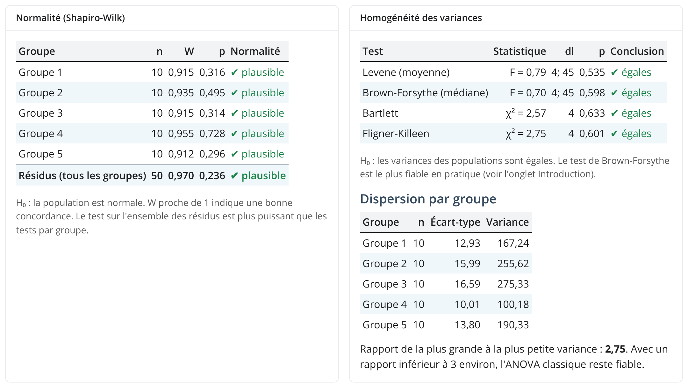
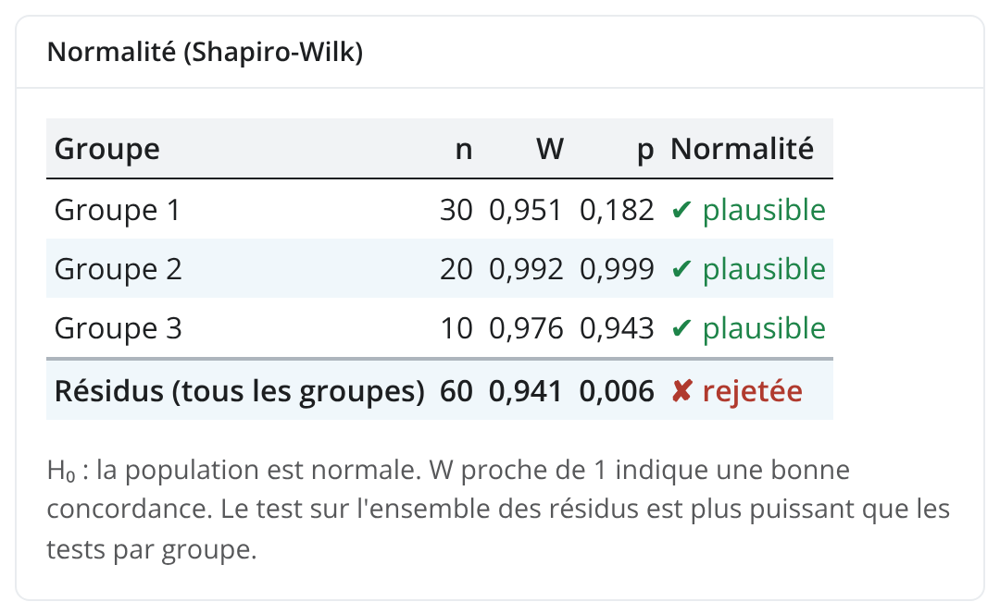
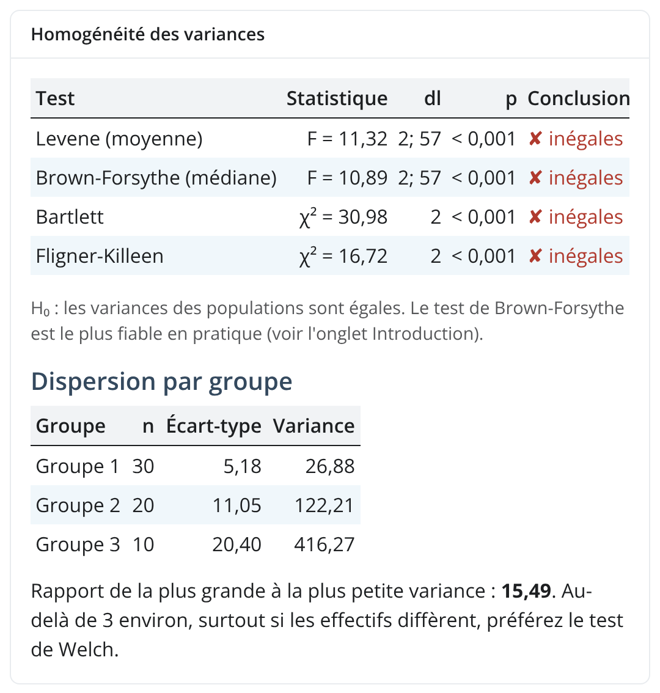
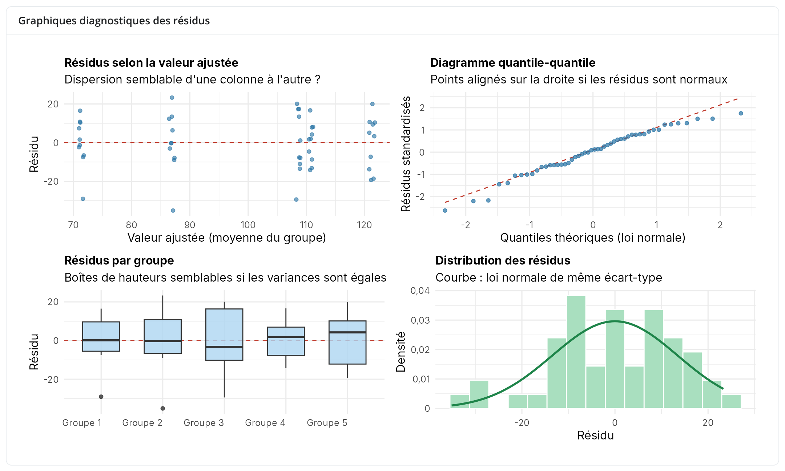
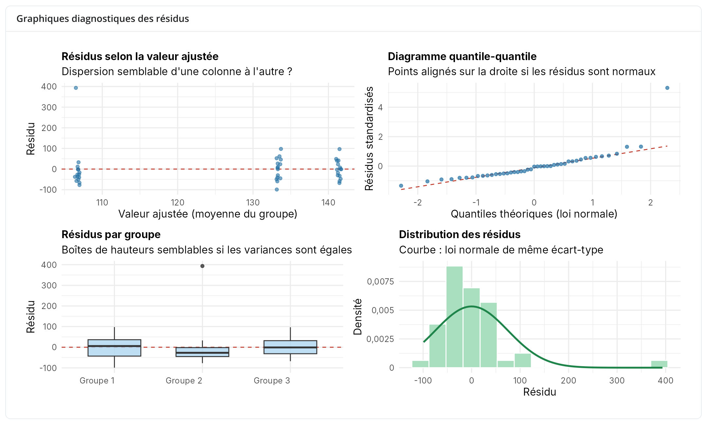
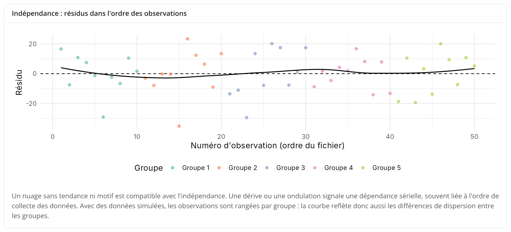
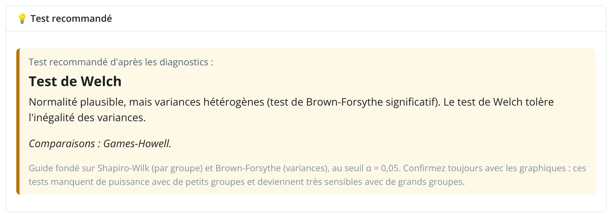

# Vérifier les conditions {#sec-diagnostics}

```{r}
#| label: setup
#| include: false
#| cache: false
source("_common.R")
```

::: {.callout-tip title="Objectifs d'apprentissage"}
À la fin de ce chapitre, vous serez en mesure de :

- énoncer les trois conditions de l'ANOVA classique et expliquer pourquoi elles portent sur les erreurs, donc sur les résidus;
- lire les tests de Shapiro-Wilk par groupe et sur l'ensemble des résidus, et les confronter au diagramme quantile-quantile;
- distinguer les quatre tests d'homogénéité des variances proposés et choisir le plus fiable;
- reconnaître une non-normalité, une hétéroscédasticité ou une dépendance sérielle sur les graphiques des résidus;
- justifier, à partir des diagnostics, le choix entre l'ANOVA classique, le test de Welch et une approche non paramétrique.
:::

::: {.callout-important title="Idée centrale"}
Un test de condition ne dit pas si une condition est « respectée » : il dit si l'échantillon permet de détecter un écart. Avec de petits groupes, il laisse passer des écarts réels; avec de grands groupes, il signale des écarts sans conséquence. Les tests orientent, les graphiques confirment, et la décision tient compte de ce qui menace vraiment le test choisi : surtout l'inégalité des variances combinée à des effectifs inégaux.
:::

::: {.callout-warning title="Pièges classiques"}
- **Conclure à la normalité parce que Shapiro-Wilk n'est pas significatif.** Avec 10 observations, le test détecte rarement un écart, même marqué.
- **Rejeter l'ANOVA dès que Shapiro-Wilk est significatif sur un grand échantillon.** L'ANOVA tolère bien des écarts modérés à la normalité quand les groupes sont grands et de même taille.
- **Prendre une hétéroscédasticité pour une non-normalité.** Des groupes normaux mais de variances différentes donnent des résidus qui, mis en commun, paraissent non normaux.
- **Confondre les deux tests de Brown-Forsythe.** Celui de l'onglet **Diagnostics** porte sur les variances; celui de l'onglet **ANOVA**, sur les moyennes.
- **Oublier l'indépendance.** Aucun test ne la garantit : elle dépend du plan de collecte.
:::

Toute la validité de l'ANOVA classique repose sur trois conditions. Les négliger, c'est risquer de bâtir une conclusion sur un test qui, dans ces données, ne contrôle plus son risque d'erreur. L'onglet **Diagnostics** rassemble les outils pour les vérifier et propose, en tête, le test qui convient.

## Les trois conditions

Le modèle de l'ANOVA, $y_{ij} = \mu + \tau_i + \varepsilon_{ij}$ (@sec-intro), suppose que les erreurs $\varepsilon_{ij}$ sont :

1. **indépendantes** : chaque mesure n'est influencée par aucune autre;
2. **normales** : dans chaque groupe, elles suivent une loi normale;
3. **de même variance** dans tous les groupes (homoscédasticité).

Les erreurs sont inconnues, mais on les estime par les **résidus** : l'écart de chaque observation à la moyenne de son groupe, $e_{ij} = y_{ij} - \bar{y}_i$. C'est pourquoi tous les diagnostics portent sur les résidus, ou sur les données groupe par groupe, et jamais sur l'ensemble des données brutes : mises ensemble, des données de groupes aux moyennes différentes forment une distribution étalée, voire à plusieurs bosses, même si chaque groupe est parfaitement normal.

Les trois conditions n'ont pas la même importance pratique. L'**indépendance** est la plus critique : sa violation fausse gravement les valeurs $p$, et aucun test ne la corrige. L'**égalité des variances** compte beaucoup quand les effectifs diffèrent (@sec-variantes). La **normalité** est la moins exigeante : avec des groupes de taille moyenne ou grande et de même effectif, l'ANOVA contrôle bien son risque d'erreur même loin de la normalité; le @sec-experimenter le montre par simulation. Une forte asymétrie ou des valeurs extrêmes réduisent toutefois sa puissance.

## La normalité

La carte **Normalité (Shapiro-Wilk)** affiche un test de **Shapiro-Wilk** [@shapiro1965] pour chaque groupe, puis pour l'ensemble des résidus (@fig-tests, à gauche). L'hypothèse nulle est la normalité de la population. La statistique $W$, comprise entre 0 et 1, est d'autant plus proche de 1 que les données s'alignent sur ce qu'on attend d'une loi normale. Une valeur $p$ élevée ne permet pas de rejeter la normalité; une valeur $p$ faible signale un écart.

{#fig-tests fig-align="center" width="100%"}

Deux précautions s'imposent. Sur de **petits** échantillons, le test manque de puissance et laisse passer des écarts réels : avec 10 observations, un $p$ de 0,30 n'est pas une preuve de normalité. Sur de **grands** échantillons, il devient si sensible qu'il rejette la normalité pour des écarts sans conséquence pratique. Le test ne remplace donc jamais le **diagramme quantile-quantile**, présenté plus bas.

Les deux niveaux de lecture, par groupe et sur l'ensemble des résidus, se complètent. Le test sur les résidus réunit toutes les observations : il est plus puissant. Mais il est aussi trompeur quand les variances diffèrent : des résidus de groupes de dispersions différentes, mis en commun, forment une distribution aux queues trop lourdes, même si chaque groupe est parfaitement normal. L'hétéroscédasticité se déguise alors en non-normalité. La @fig-hetero en donne un exemple : trois groupes normaux d'écarts-types 5, 12 et 25 passent chacun le test sans difficulté, mais l'ensemble des résidus est rejeté ($p = 0{,}006$). La bonne lecture n'est pas « non-normalité », mais « variances inégales », comme le confirme la carte voisine.

::: {#fig-hetero layout-ncol="2"}
{#fig-hetero-norm}

{#fig-hetero-homog}

Diagnostics pour des données normales, mais de variances très inégales (σ = 5, 12 et 25; n = 30, 20 et 10; graine 51).
:::

C'est pourquoi la recommandation automatique, présentée plus bas, juge la normalité **groupe par groupe**.

::: {.callout-note title="Labo 6.1 — Tester et voir la normalité"}
**Objectif.** Confronter le verdict d'un test de normalité au diagramme quantile-quantile, et mesurer l'influence de la taille des groupes.

**Manipulation.**

1. Avec l'exemple de référence, ouvrez **Diagnostics**. Lisez les tests de Shapiro-Wilk et examinez le diagramme quantile-quantile.
2. Simulez 3 groupes de **10** observations de forme **Asymétrique (log-normale)**, de moyennes `60; 100; 140` et σ = 40. Videz la graine et générez quelques échantillons : combien de groupes sont déclarés non normaux ?
3. Recommencez avec **50** observations par groupe.

**Observez.** Avec des données normales, les points du diagramme suivent la droite et les tests ne rejettent rien. Avec des données log-normales, la courbure du diagramme est visible, mais avec 10 observations le test laisse souvent passer l'écart; avec 50, il le détecte presque toujours.

**Question.** Sur un échantillon de 8 observations, un test de Shapiro-Wilk non significatif prouve-t-il la normalité ? Que peut-on affirmer, au juste ?
:::

## L'homogénéité des variances

La carte **Homogénéité des variances** présente quatre tests de l'hypothèse nulle « les variances des populations sont égales », puis un tableau des écarts-types et des variances par groupe :

- le test de **Levene** [@levene1960] fait une ANOVA sur les écarts absolus de chaque observation à la **moyenne** de son groupe : des groupes plus dispersés ont des écarts plus grands;
- le test de **Brown-Forsythe** [@brown1974var] fait la même chose avec les écarts à la **médiane** du groupe; il résiste mieux aux distributions asymétriques et aux valeurs extrêmes, et c'est le plus fiable en pratique;
- le test de **Bartlett** [@bartlett1937] compare directement les variances; il est le plus puissant si les données sont normales, mais très sensible à la non-normalité, qu'il confond avec une inégalité des variances;
- le test de **Fligner-Killeen** [@fligner1976] travaille sur les rangs des écarts à la médiane; non paramétrique, il est le plus robuste des quatre.

Une valeur $p$ faible indique des variances inégales et oriente vers le test de Welch (@sec-variantes). Sous le tableau des variances, l'application donne le **rapport de la plus grande à la plus petite variance**. Une règle pratique : en dessous de 3 environ, l'ANOVA classique reste fiable, surtout avec des effectifs égaux; au-delà, et à plus forte raison si les effectifs diffèrent, on préfère le test de Welch. Dans la @fig-hetero, ce rapport vaut 15,5, et les quatre tests rejettent l'égalité des variances.

::: {.callout-note title="Labo 6.2 — Débusquer l'hétéroscédasticité"}
**Objectif.** Détecter des variances inégales et comprendre ce qu'elles impliquent.

**Manipulation.**

1. Simulez 3 groupes de même moyenne (100), avec **n différent selon le groupe** (30, 20, 10) et **Écart-type différent selon le groupe** (5, 12, 25), graine 51. Vous devriez retrouver la @fig-hetero.
2. Comparez les quatre tests d'homogénéité, puis le rapport des variances.
3. Comparez ces verdicts au graphique des boîtes à moustaches (@sec-decrire) et au graphique **Résidus par groupe** plus bas.
4. Reprenez le jeu asymétrique du Labo 4.2 (graine 174) et comparez Bartlett aux trois autres tests.

**Observez.** Avec des données normales, les quatre tests concordent. Avec les données log-normales, Bartlett réagit beaucoup plus fort que Brown-Forsythe : il confond la valeur extrême et l'asymétrie avec une inégalité des variances.

**Question.** Pourquoi préférer Brown-Forsythe ou Fligner-Killeen à Bartlett quand la normalité est elle-même incertaine ?
:::

## Lire les graphiques diagnostiques

Au-delà des tests, la carte **Graphiques diagnostiques des résidus** réunit quatre graphiques (@fig-graphiques), qui disent souvent d'un coup d'œil ce que plusieurs tests formalisent.

{#fig-graphiques fig-align="center" width="100%"}

- **Résidus selon la valeur ajustée** : en ANOVA, la valeur ajustée est la moyenne du groupe, si bien que les points forment une colonne par groupe. Les colonnes devraient avoir des étendues semblables; une colonne beaucoup plus haute qu'une autre, ou une étendue qui grandit avec la moyenne (en entonnoir), signale une hétéroscédasticité.
- **Diagramme quantile-quantile** : chaque résidu standardisé est placé en face de la valeur que donnerait une loi normale au même rang. Si les points s'alignent sur la droite, la normalité est plausible. Une courbe en arc signale une asymétrie; des extrémités qui s'écartent en S, des queues trop lourdes; un point isolé loin de la droite, une valeur extrême.
- **Résidus par groupe** : des boîtes de hauteurs semblables indiquent des variances comparables.
- **Distribution des résidus** : l'histogramme, comparé à une loi normale de même écart-type.

Le diagramme quantile-quantile demande un peu d'entraînement. La @fig-qq-formes montre les quatre allures typiques, sur de grands échantillons tirés des quatre formes de distribution que l'application sait simuler. Retenez la logique : les points suivent la droite là où les données ressemblent à une loi normale, et s'en écartent là où elles en diffèrent. Une queue trop longue étire les extrémités loin de la droite; une queue trop courte les ramène vers le centre.

```{r}
#| label: fig-qq-formes
#| fig-cap: "Diagrammes quantile-quantile typiques (200 observations par panneau, valeurs standardisées). Normale : les points suivent la droite. Asymétrique à droite : un arc, les grandes valeurs montent au-dessus de la droite. Queues lourdes : un S couché, les deux extrémités s'éloignent de la droite. Queues légères : un S inversé, les extrémités restent en deçà."
#| fig-alt: "Quatre panneaux de points et une droite. Normale : alignement. Log-normale : courbe convexe qui part au-dessus de la droite à droite. Student : points du bas sous la droite et points du haut au-dessus. Uniforme : points aplatis aux deux bouts."
#| fig-height: 4.6
set.seed(21)
lois <- c("Normale", "Asymétrique (log-normale)", "Queues lourdes (Student, 3 dl)", "Queues légères (uniforme)")
z <- list(rnorm(200), rlnorm(200, 0, 0.6), rt(200, 3), runif(200))
qq <- do.call(rbind, lapply(1:4, function(i) {
  v <- sort((z[[i]] - mean(z[[i]])) / sd(z[[i]]))
  data.frame(th = qnorm(ppoints(200)), ob = v, loi = lois[i])
}))
qq$loi <- factor(qq$loi, levels = lois)
ggplot(qq, aes(th, ob)) +
  geom_abline(colour = pal$rouge, linetype = "dashed") +
  geom_point(colour = pal$bleu, alpha = 0.6, size = 1.2) +
  facet_wrap(~loi, nrow = 2) +
  scale_x_continuous(labels = axe_fr) + scale_y_continuous(labels = axe_fr) +
  labs(x = "Quantiles théoriques (loi normale)", y = "Valeurs standardisées")
```

Sur de petits échantillons, ces allures sont brouillées : même des données parfaitement normales s'écartent un peu de la droite aux extrémités, où chaque point est seul à représenter sa portion de la distribution. On cherche donc une tendance d'ensemble, non la perfection.

La @fig-graphiques-asym montre les mêmes graphiques pour le jeu asymétrique du @sec-variantes. La valeur extrême du groupe 2 domine tout : elle forme un point isolé très haut dans le premier graphique, le dernier point du diagramme quantile-quantile s'écarte nettement de la droite, et l'histogramme a une longue queue vers la droite.

{#fig-graphiques-asym fig-align="center" width="100%"}

## L'indépendance : les résidus dans l'ordre

L'indépendance des observations est la condition la plus difficile à vérifier après coup, car elle dépend de la façon dont les données ont été recueillies. Des mesures répétées sur les mêmes personnes, des élèves d'une même classe, des membres d'une même famille ne sont pas indépendants : ils se ressemblent plus que des individus pris au hasard. Aucun graphique ne peut le révéler; seul le plan de l'étude le dit.

Un indice existe pourtant pour un type particulier de dépendance : la dépendance liée à l'**ordre de collecte**. La carte **Indépendance : résidus dans l'ordre des observations** porte chaque résidu en fonction de son rang dans le fichier, avec une courbe de lissage (@fig-ordre). Si les observations sont indépendantes, le nuage ne montre aucune structure : les résidus se dispersent au hasard autour de zéro. Une **dérive** (les résidus montent ou descendent lentement) ou une **ondulation** trahit au contraire une dépendance sérielle : des mesures voisines dans le temps se ressemblent, souvent parce qu'un facteur non contrôlé a évolué pendant la collecte (fatigue de l'expérimentateur, dérive d'un instrument, apprentissage progressif des participants).

{#fig-ordre fig-align="center" width="100%"}

Ce diagnostic a ses limites : il suppose que l'ordre du fichier reflète l'ordre de collecte, et il ne repère que ce type de dépendance. Avec des données simulées, les observations sont rangées par groupe; la courbe reflète donc aussi les différences de dispersion entre les groupes. Il ne remplace pas un plan de collecte soigné, mais quand une structure saute aux yeux, le signal est sérieux.

::: {.callout-note title="Labo 6.3 — Chercher une dérive"}
**Objectif.** Reconnaître l'aspect d'un nuage de résidus sans structure.

**Manipulation.**

1. Avec l'exemple de référence, examinez le graphique **Résidus dans l'ordre des observations** (@fig-ordre). Les points se répartissent-ils sans motif autour de zéro ? La courbe de lissage reste-t-elle proche de zéro ?
2. Videz la graine et générez plusieurs échantillons pour vous familiariser avec l'aspect d'un nuage « sain » : la courbe ondule toujours un peu, au gré du hasard.
3. Reprenez les données de la @fig-hetero (graine 51) et observez comment la dispersion change d'un bloc d'observations à l'autre.

**Observez.** Sur des données indépendantes, aucune tendance nette ne se dégage. Avec des variances inégales, les blocs correspondant aux groupes ont des étendues différentes : c'est l'hétéroscédasticité, non une dépendance.

**Question.** Citez une situation de collecte concrète où l'ordre des observations pourrait créer une dépendance entre mesures voisines.
:::

## La recommandation automatique

En tête de l'onglet, la carte **Test recommandé** synthétise les diagnostics (@fig-recommandation). Sa logique reprend celle de ce chapitre, au seuil $\alpha$ choisi dans les réglages communs :

| Normalité par groupe (Shapiro-Wilk) | Variances (Brown-Forsythe) | Test recommandé | Comparaisons |
|:------------------------------------|:---------------------------|:----------------|:-------------|
| plausible dans tous les groupes | homogènes | ANOVA classique | Tukey HSD |
| plausible dans tous les groupes | hétérogènes | test de Welch | Games-Howell |
| rejetée dans au moins un groupe | — | Kruskal-Wallis (ou bootstrap) | Dunn |
| groupes trop petits pour le test | — | jugement sur les graphiques | — |

: La logique de la carte **Test recommandé**. {#tbl-recommandation}

{#fig-recommandation fig-align="center" width="85%"}

C'est un guide, non un verdict. La carte le rappelle : les tests manquent de puissance avec de petits groupes et deviennent très sensibles avec de grands groupes. Avec des groupes d'une trentaine d'observations ou plus, un léger écart à la normalité ne justifie pas d'abandonner l'ANOVA; une transformation de la mesure (@sec-variantes) est aussi une option.

::: {.callout-note title="Labo 6.4 — Des diagnostics au choix du test"}
**Objectif.** Faire le lien entre l'état des conditions et le test approprié.

**Manipulation.**

1. Avec l'exemple de référence, lisez la carte **Test recommandé** : elle devrait indiquer l'ANOVA classique.
2. Simulez les données de la @fig-hetero (graine 51) : la recommandation bascule-t-elle vers Welch ?
3. Simulez le jeu asymétrique (graine 174, comme au Labo 4.2) : vers quel test la carte oriente-t-elle ? Appliquez ensuite la transformation **Logarithme naturel ln(Y)** : que devient la recommandation ?

**Observez.** La recommandation suit les diagnostics : ANOVA classique, puis Welch, puis Kruskal-Wallis. Après la transformation logarithmique, la normalité redevient plausible et la carte revient à l'ANOVA classique, appliquée cette fois à $\ln(Y)$.

**Question.** La carte n'est qu'un guide : dans quel cas passeriez-vous outre sa recommandation, et sur quelle base ?
:::

Les conditions vérifiées, le test choisi, l'effet localisé : il reste à *éprouver* tout cela. Le dernier chapitre fait du lecteur un expérimentateur. Par simulation, il va voir comment les tests se comportent quand on malmène leurs conditions.

## Ce qu'il faut retenir

- Les conditions portent sur les erreurs, estimées par les résidus : on les vérifie groupe par groupe ou sur les résidus, jamais sur les données brutes réunies.
- L'indépendance dépend du plan de collecte; le graphique des résidus dans l'ordre ne repère qu'une dépendance liée à l'ordre.
- Shapiro-Wilk manque de puissance sur de petits groupes et devient hypersensible sur de grands; le diagramme quantile-quantile reste indispensable.
- Brown-Forsythe est le test d'homogénéité le plus fiable; Bartlett confond non-normalité et variances inégales. Un rapport des variances supérieur à 3 environ, surtout avec des effectifs inégaux, oriente vers Welch.
- Des résidus mis en commun peuvent paraître non normaux simplement parce que les variances diffèrent.

## Erreurs fréquentes

| Erreur | Pourquoi c'est problématique | Bonne pratique |
|:-------|:-----------------------------|:---------------|
| Tester la normalité sur l'ensemble des données brutes | Des groupes de moyennes différentes forment une distribution étalée, même si chaque groupe est normal | Tester par groupe ou sur les résidus |
| Conclure « la normalité est respectée » parce que $p > 0{,}05$ | Avec de petits groupes, le test détecte rarement un écart | Dire « aucun écart détecté » et examiner le diagramme quantile-quantile |
| Se fier au test de Bartlett avec des données asymétriques | Il signale des variances inégales alors que le problème est la forme | Utiliser Brown-Forsythe ou Fligner-Killeen |
| Conclure à une non-normalité sur des résidus mis en commun alors que les variances diffèrent | L'hétéroscédasticité se déguise en non-normalité | Lire les tests par groupe et la carte d'homogénéité ensemble |
| Croire que le graphique des résidus dans l'ordre prouve l'indépendance | Il ne détecte qu'une dépendance liée à l'ordre de collecte | Examiner le plan d'étude : mesures répétées, grappes, familles… |
| Suivre la recommandation automatique sans regarder les graphiques | Les tests sont peu fiables aux deux extrêmes de taille d'échantillon | Confirmer par les graphiques et tenir compte de la taille des groupes |

## Quiz

::: {.callout-note title="Question 1 — lecture"}
**Énoncé.** Dans une étude à 4 groupes de 50 observations, Shapiro-Wilk rejette la normalité dans un groupe ($p = 0{,}03$), mais le diagramme quantile-quantile montre des points presque parfaitement alignés. Les variances sont homogènes. Que faites-vous ?

::: {.callout-tip title="Réponse" collapse="true"}
Avec 50 observations par groupe, le test détecte de petits écarts sans conséquence pratique, et l'ANOVA est robuste à une légère non-normalité quand les groupes sont grands et de même taille. Le diagramme ne montre pas d'écart important : l'ANOVA classique reste appropriée. On peut le vérifier avec Kruskal-Wallis ou le bootstrap : si la conclusion est la même, on rapporte l'ANOVA en mentionnant la vérification.
:::
:::

::: {.callout-note title="Question 2 — vrai ou faux"}
**Énoncé.** Si les quatre tests d'homogénéité des variances sont non significatifs, les variances des populations sont égales.

::: {.callout-tip title="Réponse" collapse="true"}
Faux. Un test non significatif signifie seulement que les données ne permettent pas de détecter une différence de variances. Avec de petits groupes, des variances qui diffèrent du simple au double passent souvent inaperçues. Le rapport des variances observées et le graphique des résidus par groupe complètent l'information.
:::
:::

::: {.callout-note title="Question 3 — situation"}
**Énoncé.** Une chercheuse compare le stress de trois services hospitaliers. Elle mesure les infirmières d'un même service le même jour, l'une après l'autre. Quel problème cela peut-il poser, et le graphique des résidus dans l'ordre suffit-il à le détecter ?

::: {.callout-tip title="Réponse" collapse="true"}
Les mesures d'un même service, prises le même jour, partagent les mêmes circonstances (charge de travail, événements de la journée) : elles ne sont pas indépendantes. Le graphique des résidus dans l'ordre peut montrer des blocs ou une dérive, mais il ne suffit pas : la dépendance tient ici au plan de collecte, où le service et le jour sont confondus. Il faudrait étaler les mesures sur plusieurs jours, ou recourir à un modèle qui tient compte de cette structure.
:::
:::
