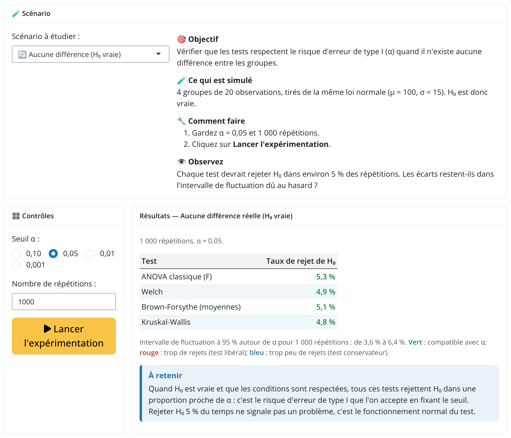
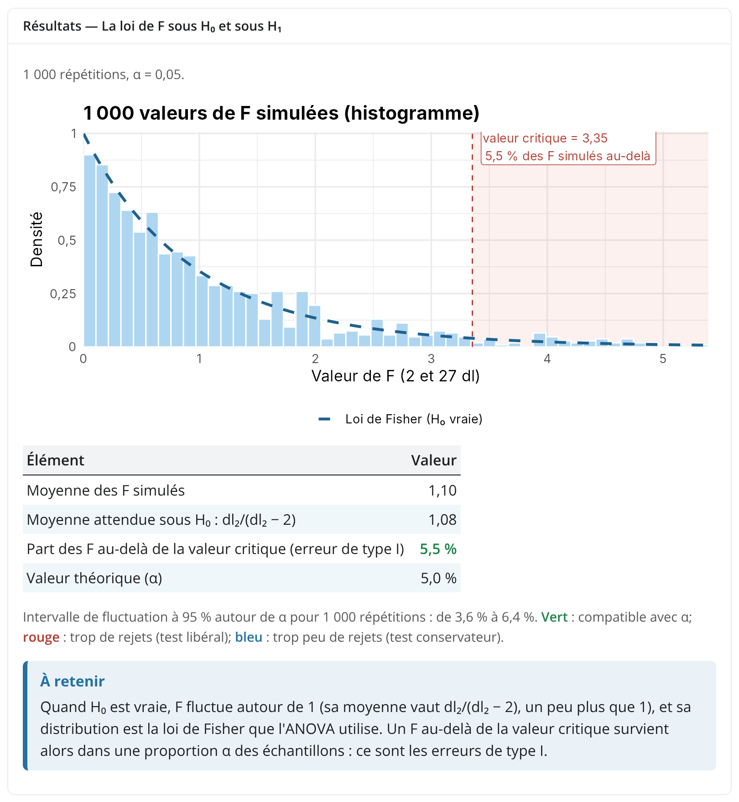
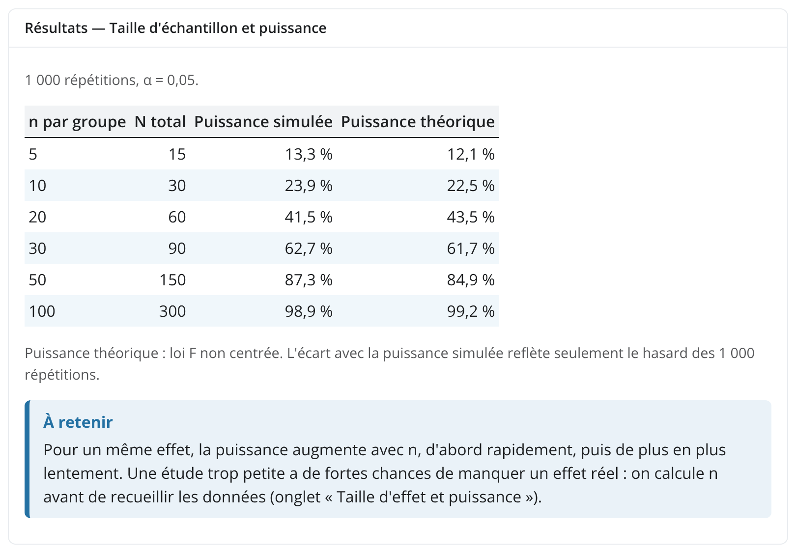
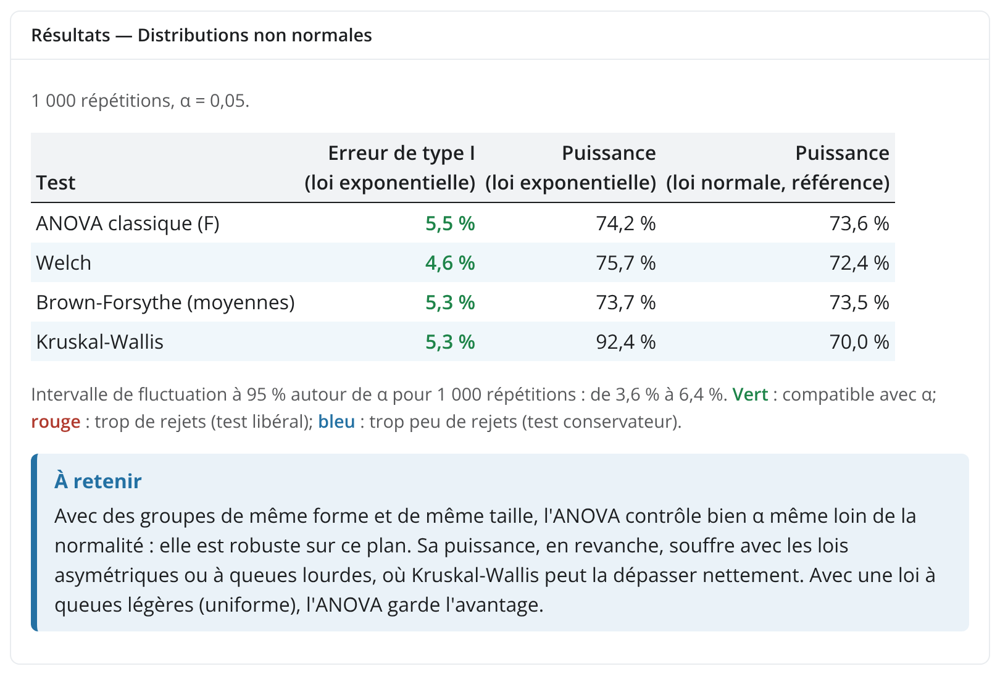
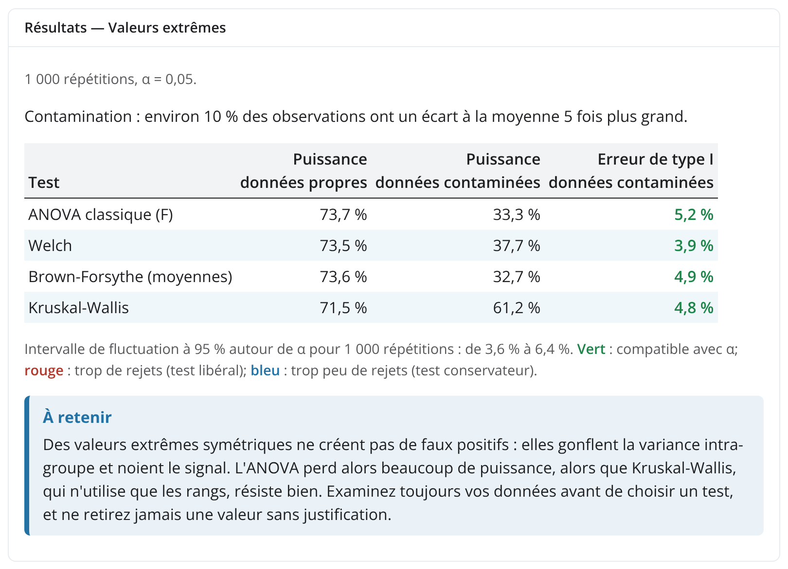
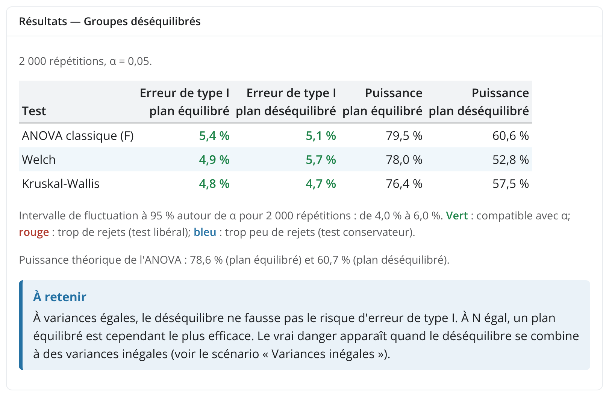

# Expérimenter {#sec-experimenter}

```{r}
#| label: setup
#| include: false
#| cache: false
source("_common.R")
```

::: {.callout-tip title="Objectifs d'apprentissage"}
À la fin de ce chapitre, vous serez en mesure de :

- expliquer comment une simulation Monte-Carlo estime le taux d'erreur de type I et la puissance d'un test;
- reconnaître, sur des $F$ simulés, la loi de Fisher sous $H_0$ et la loi non centrée sous $H_1$;
- juger si un taux de rejet simulé est compatible avec $\alpha$, à l'aide de l'intervalle de fluctuation;
- décrire l'effet de la taille d'échantillon et de la taille d'effet sur la puissance;
- distinguer un test **libéral**, un test **conservateur** et un test qui **perd de la puissance**;
- résumer, pour chaque condition violée, ce qui arrive à l'ANOVA classique et quel test la remplace avantageusement.
:::

::: {.callout-important title="Idée centrale"}
Un test se juge sur son comportement à long terme, pas sur un seul échantillon. En fabriquant des milliers d'échantillons dont on connaît la vérité, la simulation mesure deux choses : la proportion de faux positifs quand $H_0$ est vraie (qui doit rester proche de $\alpha$) et la proportion de détections quand $H_1$ est vraie (la puissance). Les propriétés énoncées dans les chapitres précédents deviennent des faits observés.
:::

::: {.callout-warning title="Pièges classiques"}
- **Interpréter un taux de 5,8 % au lieu de 5 % comme un défaut du test.** Avec un nombre fini de répétitions, le taux simulé fluctue autour de sa vraie valeur.
- **Confondre robustesse du risque d'erreur et robustesse de la puissance.** Un test peut garder son $\alpha$ et perdre beaucoup de puissance.
- **Conclure qu'un test est supérieur en général à partir d'un seul scénario.** Chaque scénario ne fait varier qu'une condition; les conclusions valent pour ces conditions.
- **Lancer une simulation avec trop peu de répétitions.** Avec 100 répétitions, l'intervalle de fluctuation autour de 5 % va de 0,7 % à 9,3 % : on ne peut presque rien conclure.
- **Oublier que les résultats changent d'un lancement à l'autre.** Les chiffres cités dans ce chapitre sont des ordres de grandeur; les vôtres différeront un peu.
:::

Les chapitres précédents énonçaient des propriétés : « le test classique devient libéral quand les variances diffèrent », « la puissance croît avec l'effectif », « Kruskal-Wallis résiste aux valeurs extrêmes ». L'onglet **Expérimentation** permet de les *vérifier soi-même*, par simulation. C'est le laboratoire au sens plein : on fixe la vérité, on répète l'expérience des centaines de fois, et l'on observe ce que les tests en font.

## L'idée de la simulation Monte-Carlo

Un test statistique est une règle de décision : à partir d'un échantillon, il tranche entre $H_0$ et $H_1$. Sa qualité ne se juge pas sur un échantillon, mais sur son comportement à long terme. La simulation Monte-Carlo exploite cette idée : puisque nous *fabriquons* les données, nous connaissons la vérité, et nous pouvons répéter l'expérience autant de fois qu'il le faut.

À chaque répétition, l'application tire un nouvel échantillon selon le scénario, applique les tests, et note s'ils rejettent $H_0$ au seuil $\alpha$. Après $R$ répétitions, la proportion de rejets estime :

- **sous $H_0$ vraie** (aucune différence réelle), le **taux d'erreur de type I**. Un test bien calibré le maintient proche de $\alpha$. S'il le dépasse, le test est **libéral** : il « découvre » des effets inexistants. S'il reste en dessous, il est **conservateur** : il est trop prudent, ce qui lui coûte de la puissance;
- **sous $H_1$ vraie** (une différence existe), la **puissance**,

$$
\text{puissance} = P(\text{rejeter } H_0 \mid H_1 \text{ vraie}),
$$

c'est-à-dire la capacité à détecter ce qui est réellement là. Un bon test contrôle la première tout en maximisant la seconde.

### Combien de répétitions ?

Un taux simulé est lui-même une estimation : il fluctue d'une simulation à l'autre. Si le vrai taux d'un test est exactement $\alpha$, le taux observé sur $R$ répétitions tombe, dans 95 % des simulations, dans l'**intervalle de fluctuation**

$$
\alpha \pm 1{,}96 \sqrt{\frac{\alpha(1 - \alpha)}{R}} .
$$

Pour $\alpha = 0{,}05$ et $R = 1\,000$, cet intervalle va de 3,6 % à 6,4 %. Il se resserre quand $R$ augmente, mais lentement : il faut quadrupler $R$ pour le diviser par deux (@fig-fluctuation). L'application colore chaque taux de rejet observé sous $H_0$ selon sa position par rapport à cet intervalle : **vert** s'il est compatible avec $\alpha$, **rouge** s'il le dépasse (test libéral), **bleu** s'il reste en dessous (test conservateur).

```{r}
#| label: fig-fluctuation
#| fig-cap: "Intervalle de fluctuation à 95 % d'un taux de rejet simulé quand le vrai taux vaut $\\alpha = 5\\,\\%$, selon le nombre de répétitions. Avec 100 répétitions, un test parfaitement calibré peut afficher n'importe quel taux entre 0,7 % et 9,3 %; avec 5 000, entre 4,4 % et 5,6 %."
#| fig-alt: "Bande grise en entonnoir autour d'une ligne horizontale à 5 %, très large à gauche (100 répétitions) et étroite à droite (5 000 répétitions)."
#| fig-height: 3.3
R <- seq(100, 5000, by = 50)
d <- data.frame(R = R, bas = 0.05 - 1.96 * sqrt(0.05 * 0.95 / R),
                haut = 0.05 + 1.96 * sqrt(0.05 * 0.95 / R))
pts <- data.frame(R = c(100, 500, 1000, 5000))
pts$haut <- 0.05 + 1.96 * sqrt(0.05 * 0.95 / pts$R)
ggplot(d, aes(R)) +
  geom_ribbon(aes(ymin = bas, ymax = haut), fill = "grey80") +
  geom_hline(yintercept = 0.05, colour = pal$vert, linewidth = 1) +
  geom_point(data = pts, aes(y = haut), colour = pal$gris) +
  geom_text(data = pts, aes(y = haut, label = paste0(fr(100 * haut, 1), " %")),
            vjust = -0.8, size = 3.3) +
  scale_x_continuous(labels = axe_fr, breaks = c(100, 1000, 2000, 3000, 4000, 5000)) +
  scale_y_continuous(labels = function(x) paste0(axe_fr(100 * x), " %"), limits = c(0, 0.105)) +
  labs(x = "Nombre de répétitions R", y = "Taux de rejet observé")
```

Un principe en découle : **mille répétitions suffisent pour juger de la plupart des écarts**; pour un écart subtil, ou pour des conclusions fines, montez à 5 000. Gardez aussi en tête qu'avec quatre tests et plusieurs plans, il arrive qu'une case sur vingt sorte de l'intervalle par pur hasard. Un écart isolé se vérifie en relançant la simulation; un écart qui se répète est réel.

## L'interface en trois cartes

L'onglet s'organise sur un seul écran (@fig-interface-exp). La carte **Scénario** réunit le menu **Scénario à étudier** et un guide en quatre rubriques : l'objectif, ce qui est simulé, comment faire et ce qu'il faut observer. La carte **Contrôles** rassemble les réglages propres au scénario (tailles, effets, rapport de variances, forme de distribution, proportion de valeurs extrêmes), le **seuil α**, le **nombre de répétitions** et le bouton **Lancer l'expérimentation**. La carte **Résultats** affiche les taux de rejet et un encadré **À retenir**.

{#fig-interface-exp fig-align="center" width="100%"}

Les simulations sont indépendantes des données de l'onglet **Introduction** : chaque scénario fabrique ses propres échantillons. Les résultats changent un peu d'un lancement à l'autre; les valeurs citées dans ce chapitre sont donc des ordres de grandeur.

## La loi de $F$, vue de près

Les chapitres 1 et 3 ont décrit deux lois : la loi de Fisher, celle de $F$ quand $H_0$ est vraie, et la loi $F$ non centrée, celle de $F$ quand un effet existe. Le scénario **La loi de F sous H₀ et sous H₁** les fait apparaître à partir d'échantillons. À chaque répétition, il simule $k$ groupes normaux de $n$ observations, calcule $F$ et l'ajoute à un histogramme; la courbe théorique est superposée.

{#fig-loi-f-h0 fig-align="center" width="75%"}

Quand $H_0$ est vraie (@fig-loi-f-h0), l'histogramme épouse la courbe de Fisher. La plupart des $F$ sont petits, sous 1 ou un peu au-dessus; leur moyenne est proche de $\text{dl}_2/(\text{dl}_2 - 2)$, soit 1,08 pour 27 dl. Une petite part, environ 5 %, dépasse la valeur critique : ce sont les erreurs de type I que le seuil $\alpha$ autorise.

{#fig-loi-f-h1 fig-align="center" width="75%"}

Avec un effet (@fig-loi-f-h1), toute la distribution glisse vers la droite. La courbe de Fisher (pointillé) ne décrit plus les données; c'est la loi non centrée (trait plein) qui le fait. La valeur critique, elle, ne dépend pas de l'effet : elle est fixée par la loi sous $H_0$ (3,10 pour 2 et 87 dl). La part des $F$ qui la dépassent est la **puissance**, environ 54 % ici. C'est la @fig-puissance-loi du @sec-anova, reconstruite à partir d'échantillons.

::: {.callout-note title="Labo 7.1 — Voir la loi de F se déplacer"}
**Objectif.** Relier la loi de $F$ sous $H_0$ et sous $H_1$ à l'erreur de type I et à la puissance.

**Manipulation.**

1. Choisissez le scénario **La loi de F sous H₀ et sous H₁**, avec **Aucune différence (H₀ vraie)**, $k = 3$ et $n = 10$. Lancez avec 1 000 répétitions.
2. Passez à **Effet moyen (f = 0,25)** en gardant $n = 10$, puis portez $n$ à **30**.
3. Choisissez enfin **Grand effet (f = 0,40)** avec $n = 30$.

**Observez.** Sous $H_0$, la part des $F$ au-delà de la valeur critique reste près de 5 %, quel que soit $n$. Avec un effet, cette part (la puissance) augmente avec $n$ et avec $f$, parce que $\lambda = f^2 N$ augmente : environ 20 % pour $f = 0{,}25$ et $n = 10$, environ 54 % avec $n = 30$, et plus de 90 % pour $f = 0{,}40$ et $n = 30$.

**Question.** Pourquoi la valeur critique ne dépend-elle pas de l'effet simulé, alors que la puissance en dépend ?
:::

## Le taux d'erreur : les tests tiennent-ils leur promesse ?

Le scénario le plus simple, **Aucune différence (H₀ vraie)**, tire quatre groupes de 20 observations d'une même loi normale. $H_0$ est vraie et toutes les conditions sont remplies : les quatre tests (ANOVA classique, Welch, Brown-Forsythe et Kruskal-Wallis) devraient rejeter $H_0$ dans environ 5 % des répétitions. C'est ce que montre la @fig-interface-exp : tous les taux sont verts.

::: {.callout-note title="Labo 7.2 — Chacun respecte-t-il le seuil ?"}
**Objectif.** Estimer le taux d'erreur de type I de quatre tests quand $H_0$ est vraie.

**Manipulation.**

1. Choisissez le scénario **Aucune différence (H₀ vraie)** et lisez le guide.
2. Laissez $\alpha = 0{,}05$ et 1 000 répétitions. Cliquez sur **Lancer l'expérimentation**.
3. Relancez deux ou trois fois, puis refaites l'essai avec **100** répétitions et avec $\alpha = 0{,}10$.

**Observez.** Les quatre taux avoisinent 5 % et restent dans l'intervalle de fluctuation. Avec 100 répétitions, ils varient beaucoup d'un lancement à l'autre; avec $\alpha = 0{,}10$, ils avoisinent 10 %. Un test bien calibré ne « trouve » une différence inexistante qu'avec la fréquence $\alpha$ qu'on a choisie.

**Question.** Si un test rejetait 12 % du temps sous $H_0$, quelle en serait la conséquence pratique pour vos conclusions ?
:::

## La puissance : détecter ce qui existe

Trois scénarios explorent la puissance, chacun en faisant varier un seul levier. Ils comparent la puissance simulée de l'ANOVA à sa **puissance théorique**, calculée avec la loi $F$ non centrée (@sec-puissance) : les deux concordent, à la fluctuation près.

### La taille d'échantillon

Le scénario **Taille d'échantillon et puissance** tire trois groupes de moyennes 95, 100 et 105 ($\sigma = 15$), un effet moyen ($f \approx 0{,}27$), avec différentes tailles $n$ par groupe (@fig-taille).

{#fig-taille fig-align="center" width="75%"}

La puissance croît avec $n$, d'abord vite, puis de plus en plus lentement. Avec 20 observations par groupe, cet effet moyen n'est détecté que dans 40 % des cas environ; il faut environ 45 observations par groupe pour atteindre 80 %.

::: {.callout-note title="Labo 7.3 — La puissance monte avec l'effectif"}
**Objectif.** Mesurer l'effet de l'effectif sur la capacité de détection.

**Manipulation.**

1. Choisissez le scénario **Taille d'échantillon et puissance** et cochez toutes les tailles proposées.
2. Lancez avec 1 000 répétitions.
3. Comparez, ligne par ligne, la puissance simulée et la puissance théorique.

**Observez.** Une même différence réelle, détectée une fois sur huit avec 5 observations par groupe, l'est presque toujours avec 100. Passer de 10 à 20 observations fait gagner plus de puissance que passer de 50 à 100.

**Question.** À partir de quelle taille la puissance dépasse-t-elle 80 % ? Retrouvez ce résultat dans l'onglet **Taille d'effet et puissance** (3 groupes, $f = 0{,}27$).
:::

### La taille de l'effet

Le scénario **Taille d'effet et puissance** fixe $n = 20$ par groupe et fait varier l'écart entre les groupes. Cet écart est exprimé par le $d$ de Cohen, la différence entre le premier et le dernier groupe en écarts-types; le groupe du milieu est à mi-chemin. Le tableau traduit chaque $d$ en $f$.

::: {.callout-note title="Labo 7.4 — La puissance monte avec l'effet"}
**Objectif.** Relier l'ampleur de l'effet à la puissance.

**Manipulation.**

1. Choisissez le scénario **Taille d'effet et puissance** et cochez $d = 0{,}1$, 0,2, 0,5, 0,8 et 1,2.
2. Lancez avec 1 000 répétitions.

**Observez.** À effectif fixé, un grand effet se détecte presque toujours, un effet minime presque jamais. À $d = 0{,}1$, la puissance avoisine 5 % : on rejette $H_0$ à peine plus souvent que si elle était vraie.

**Question.** Avec 20 observations par groupe, quel effet faut-il pour atteindre 80 % de puissance ? Que proposeriez-vous à une chercheuse qui s'attend à un effet de $d = 0{,}3$ ?
:::

### Les différences minimes

Le scénario **Différences minimes** pose le problème inverse : trois groupes de moyennes 100, 101 et 102 ($\sigma = 15$), un effet négligeable ($f \approx 0{,}05$), avec 10, 100 et 1 000 observations par groupe. Avec 10 observations, l'effet est invisible; avec 1 000, il est détecté environ trois fois sur quatre.

::: {.callout-note title="Labo 7.5 — Significatif ne veut pas dire important"}
**Objectif.** Voir un effet négligeable devenir significatif avec un très grand échantillon.

**Manipulation.**

1. Choisissez le scénario **Différences minimes**, lancez avec 1 000 répétitions.
2. Comparez la puissance pour 10, 100 et 1 000 observations par groupe.

**Observez.** Avec 1 000 observations par groupe, une différence de 2 points sur un écart-type de 15 devient presque toujours significative.

**Question.** Une telle différence est-elle importante ? Quelle information faut-il ajouter à la valeur $p$ pour en juger ?
:::

## Éprouver la robustesse

Vient le plus instructif : malmener les conditions et regarder qui tient. Quatre scénarios violent chacun une condition.

### Variances inégales

Le scénario **Variances inégales** rend $H_0$ vraie (trois groupes de moyenne 100), mais fait croître les variances du groupe 1 au groupe 3, selon le rapport choisi. Il compare trois plans : **A**, des effectifs égaux (20, 20, 20); **B**, la plus grande variance dans le plus *petit* groupe (30, 20, 10); **C**, la plus grande variance dans le plus *grand* groupe (10, 20, 30).

{#fig-variances fig-align="center" width="75%"}

La @fig-variances confirme, chiffres à l'appui, le message du @sec-variantes. Avec des effectifs égaux, l'ANOVA classique résiste assez bien à des variances inégales. Avec des effectifs inégaux, elle se trompe : **libérale** quand le groupe le plus dispersé est le plus petit (son bruit pèse trop peu dans le $CM_{\text{intra}}$, qui sous-estime alors la dispersion), **conservatrice** dans le cas inverse. Kruskal-Wallis, qui suppose des distributions de même forme, est lui aussi perturbé. Welch et Brown-Forsythe restent fiables dans les trois plans.

::: {.callout-note title="Labo 7.6 — Quand le test classique déraille"}
**Objectif.** Voir, par simulation, l'ANOVA classique perdre le contrôle de son taux d'erreur.

**Manipulation.**

1. Choisissez le scénario **Variances inégales**, le rapport **Modéré (2 pour 1)**, et lancez avec 1 000 répétitions.
2. Recommencez avec **Élevé (5 pour 1)**, puis **Extrême (10 pour 1)**.
3. Pour chaque rapport, comparez les plans A, B et C pour l'ANOVA classique et pour Welch.

**Observez.** Plus le rapport des variances est grand, plus l'ANOVA classique s'éloigne de 5 % dans les plans B et C. Welch reste proche du seuil dans tous les cas.

**Question.** Un test qui rejette 15 % du temps sous $H_0$ « découvre » des effets inexistants. Pourquoi est-ce plus grave qu'un simple manque de puissance ?
:::

### Distributions non normales

Le scénario **Distributions non normales** tire trois groupes de 20 observations de même forme, choisie dans les contrôles : uniforme (queues légères), exponentielle (très asymétrique) ou Student à 3 dl (queues lourdes). Il estime le taux d'erreur de type I (moyennes égales) et la puissance (moyennes 93, 100 et 107), et rappelle la puissance qu'on obtiendrait avec une loi normale.

{#fig-nonnormales fig-align="center" width="75%"}

Deux leçons ressortent (@fig-nonnormales). D'abord, avec des groupes de même forme et de même taille, l'ANOVA **garde son taux d'erreur** même loin de la normalité : elle est robuste sur ce plan. Ensuite, sa **puissance** dépend de la forme. Avec une loi exponentielle, Kruskal-Wallis détecte l'effet dans plus de 90 % des cas, contre environ 75 % pour l'ANOVA. Avec une loi uniforme, l'ANOVA reprend l'avantage.

::: {.callout-note title="Labo 7.7 — La forme des distributions"}
**Objectif.** Distinguer l'effet de la non-normalité sur le taux d'erreur et sur la puissance.

**Manipulation.**

1. Choisissez le scénario **Distributions non normales** et la forme **Exponentielle**. Lancez avec 1 000 répétitions.
2. Recommencez avec **Student à 3 dl**, puis **Uniforme**.
3. Pour chaque forme, comparez les colonnes « Erreur de type I » et « Puissance » de l'ANOVA et de Kruskal-Wallis.

**Observez.** Les taux d'erreur restent verts dans tous les cas. Le classement en puissance, lui, s'inverse selon la forme : Kruskal-Wallis l'emporte nettement avec des queues lourdes ou une forte asymétrie, l'ANOVA avec des queues légères.

**Question.** Après ces simulations, quelle règle proposeriez-vous pour choisir entre l'ANOVA et Kruskal-Wallis ?
:::

### Valeurs extrêmes

Le scénario **Valeurs extrêmes** tire trois groupes de 25 observations, de moyennes 100, 100 et 106 ($\sigma = 8$), puis « contamine » une proportion des observations, choisie dans les contrôles : leur écart à la moyenne est multiplié par 5, vers le haut ou vers le bas.

{#fig-extremes fig-align="center" width="75%"}

La @fig-extremes corrige une idée reçue : des valeurs extrêmes **symétriques** ne créent pas de faux positifs; le taux d'erreur reste proche de 5 %. Elles gonflent en revanche la variance intra-groupe et noient le signal. Avec 10 % de contamination, la puissance de l'ANOVA tombe d'environ 74 % à environ 33 %; celle de Kruskal-Wallis, qui n'utilise que les rangs, ne descend qu'à environ 60 %.

::: {.callout-note title="Labo 7.8 — Des valeurs extrêmes qui noient le signal"}
**Objectif.** Mesurer l'effet des valeurs extrêmes sur la puissance.

**Manipulation.**

1. Choisissez le scénario **Valeurs extrêmes**, 5 % d'observations contaminées, et lancez avec 1 000 répétitions.
2. Recommencez avec 10 %, puis 20 %.

**Observez.** Plus la contamination augmente, plus l'écart de puissance entre l'ANOVA et Kruskal-Wallis se creuse, sans que le taux d'erreur de type I ne bouge beaucoup.

**Question.** Face à quelques valeurs extrêmes, pourquoi est-il préférable de choisir un test robuste plutôt que de supprimer ces valeurs ?
:::

### Groupes déséquilibrés

Le scénario **Groupes déséquilibrés** compare, à effectif total égal ($N = 80$), un plan équilibré (20 par groupe) et un plan déséquilibré (5, 15, 25 et 35), avec des variances égales. Les moyennes valent 100 sous $H_0$, et 90, 95, 100 et 105 sous $H_1$.

{#fig-desequilibre fig-align="center" width="75%"}

À variances égales, le déséquilibre ne fausse pas le taux d'erreur de type I (@fig-desequilibre). Il réduit en revanche la puissance : à $N$ égal, la puissance théorique de l'ANOVA passe d'environ 79 % à 61 %, parce que le plus petit groupe ($n = 5$) est estimé avec peu de précision et que c'est justement lui qui s'écarte le plus de la moyenne générale. Le vrai danger apparaît quand le déséquilibre se combine à des variances inégales (Labo 7.6).

::: {.callout-note title="Labo 7.9 — Le prix du déséquilibre"}
**Objectif.** Séparer l'effet du déséquilibre sur la validité et sur la puissance.

**Manipulation.**

1. Choisissez le scénario **Groupes déséquilibrés** et lancez avec 2 000 répétitions.
2. Comparez les colonnes d'erreur de type I, puis les colonnes de puissance, et la puissance théorique indiquée sous le tableau.

**Observez.** Les taux d'erreur restent compatibles avec $\alpha$ dans les deux plans; la puissance chute nettement dans le plan déséquilibré, pour les trois tests.

**Question.** Pourquoi un plan équilibré est-il le plus efficace, à nombre total de participants égal ?
:::

## Synthèse

Un dernier scénario, **Comparaisons multiples : le risque global**, a été présenté au @sec-comparaisons (@fig-risque-global) : il mesure le risque de déclarer au moins une fausse différence quand on compare toutes les paires, avec ou sans correction.

Le @tbl-synthese rassemble ce que les simulations ont montré. C'est, en somme, la justification expérimentale des recommandations des chapitres 4, 5 et 6.

| Condition violée | Effet sur l'ANOVA classique | Meilleure solution |
|:-----------------|:----------------------------|:-------------------|
| Variances inégales, effectifs égaux | Taux d'erreur peu touché | ANOVA acceptable; Welch sans risque |
| Variances inégales, effectifs inégaux | **Libérale** (grande variance dans le petit groupe) ou **conservatrice** (dans le grand groupe) | **Welch** ou Brown-Forsythe |
| Forme non normale, groupes de même forme et de même taille | Taux d'erreur conservé; puissance réduite avec asymétrie ou queues lourdes | **Kruskal-Wallis**, ou transformation |
| Valeurs extrêmes symétriques | Taux d'erreur conservé; **forte perte de puissance** | **Kruskal-Wallis** |
| Effectifs inégaux, variances égales | Taux d'erreur conservé; perte de puissance | Plan équilibré quand c'est possible |
| Effet minime, très grand échantillon | Résultat significatif sans importance pratique | Rapporter une taille d'effet |
| Toutes les paires comparées sans correction | Risque global de 20 à 60 % selon le nombre de groupes | **Tukey** (ou Games-Howell); Bonferroni pour quelques comparaisons |

: Ce que les simulations ont montré. {#tbl-synthese}

## De l'expérimentation à la pratique

Les propriétés énoncées dans les chapitres précédents (contrôle de l'erreur, puissance, robustesse) ne sont plus des affirmations à croire, mais des faits observés en manipulant. C'est tout l'esprit de ce laboratoire : *comprendre l'ANOVA en la mettant à l'épreuve*. Il reste à mettre ces réflexes au service de vraies données, dont on ignore la vérité : c'est l'objet du dernier chapitre.

## Ce qu'il faut retenir

- La loi de Fisher décrit les $F$ simulés sous $H_0$; sous $H_1$, ils suivent une loi non centrée, décalée vers la droite.
- Sous $H_0$, la proportion de rejets estime le taux d'erreur de type I; sous $H_1$, la puissance. Un taux simulé fluctue : on le compare à l'intervalle de fluctuation, qui se resserre quand le nombre de répétitions augmente.
- La puissance croît avec l'effectif et la taille de l'effet; la théorie (loi $F$ non centrée) la prédit bien.
- L'ANOVA classique devient libérale ou conservatrice quand des variances inégales se combinent à des effectifs inégaux; le test de Welch règle ce problème.
- Face à la non-normalité ou aux valeurs extrêmes, l'ANOVA garde son taux d'erreur mais peut perdre beaucoup de puissance; Kruskal-Wallis est alors souvent préférable.
- Un plan équilibré est le plus efficace et le plus robuste.

## Erreurs fréquentes

| Erreur | Pourquoi c'est problématique | Bonne pratique |
|:-------|:-----------------------------|:---------------|
| Juger un test sur un seul échantillon | Une décision isolée ne dit rien du comportement à long terme | Répéter l'expérience : c'est l'objet de la simulation |
| Conclure à un défaut dès qu'un taux s'écarte un peu de 5 % | Le taux simulé fluctue; une case sur vingt peut sortir de l'intervalle par hasard | Comparer à l'intervalle de fluctuation et relancer en cas de doute |
| Utiliser trop peu de répétitions | L'intervalle de fluctuation est alors si large qu'on ne peut rien conclure | 1 000 répétitions au moins, 5 000 pour un écart subtil |
| Croire qu'un test « robuste » est toujours meilleur | La robustesse du taux d'erreur n'implique pas la puissance; l'ANOVA reste la plus puissante quand ses conditions tiennent | Choisir selon les conditions observées |
| Généraliser un scénario à toutes les situations | Chaque scénario ne fait varier qu'une condition | Préciser les conditions dans lesquelles une conclusion a été observée |

## Quiz

::: {.callout-note title="Question 1 — calcul"}
**Énoncé.** Une simulation de 400 répétitions sous $H_0$ donne un taux de rejet de 7 % pour un test au seuil de 5 %. Ce test est-il libéral ?

::: {.callout-tip title="Réponse" collapse="true"}
L'intervalle de fluctuation vaut $0{,}05 \pm 1{,}96\sqrt{0{,}05 \times 0{,}95 / 400} = 0{,}05 \pm 0{,}021$, soit de 2,9 % à 7,1 %. Un taux de 7 % reste dans l'intervalle : on ne peut pas conclure que le test est libéral. Il faudrait relancer avec davantage de répétitions pour trancher.
:::
:::

::: {.callout-note title="Question 2 — vrai ou faux"}
**Énoncé.** Puisque l'ANOVA garde son taux d'erreur de type I avec des données exponentielles, elle est le meilleur choix pour ce type de données.

::: {.callout-tip title="Réponse" collapse="true"}
Faux. Elle reste *valide* (son taux d'erreur est contrôlé), mais elle n'est pas la plus *puissante* : avec une loi exponentielle, Kruskal-Wallis détecte bien plus souvent un effet réel (@fig-nonnormales). Un test valide mais peu puissant manque des effets qui existent.
:::
:::

::: {.callout-note title="Question 3 — situation"}
**Énoncé.** Dans une étude, le groupe témoin compte 60 participants et chacun des deux groupes traités en compte 15. Les écarts-types observés sont de 8 dans le groupe témoin et de 20 dans les groupes traités. Quel test choisir, et pourquoi ?

::: {.callout-tip title="Réponse" collapse="true"}
Les plus grandes variances sont dans les plus petits groupes : c'est la configuration du plan B, où l'ANOVA classique est libérale. Il faut utiliser le test de Welch (ou de Brown-Forsythe pour les moyennes), puis des comparaisons de Games-Howell. Le rapport des variances, $(20/8)^2 \approx 6{,}3$, dépasse d'ailleurs largement la règle pratique de 3.
:::
:::
