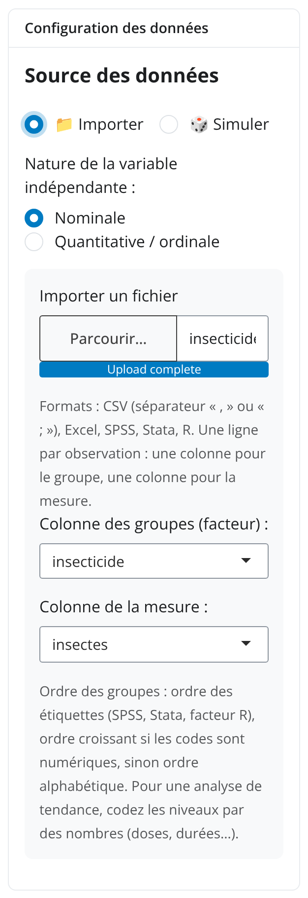
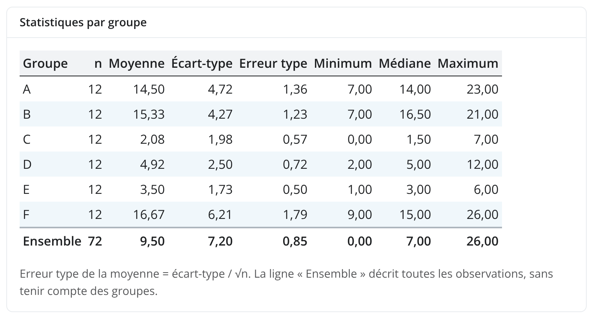
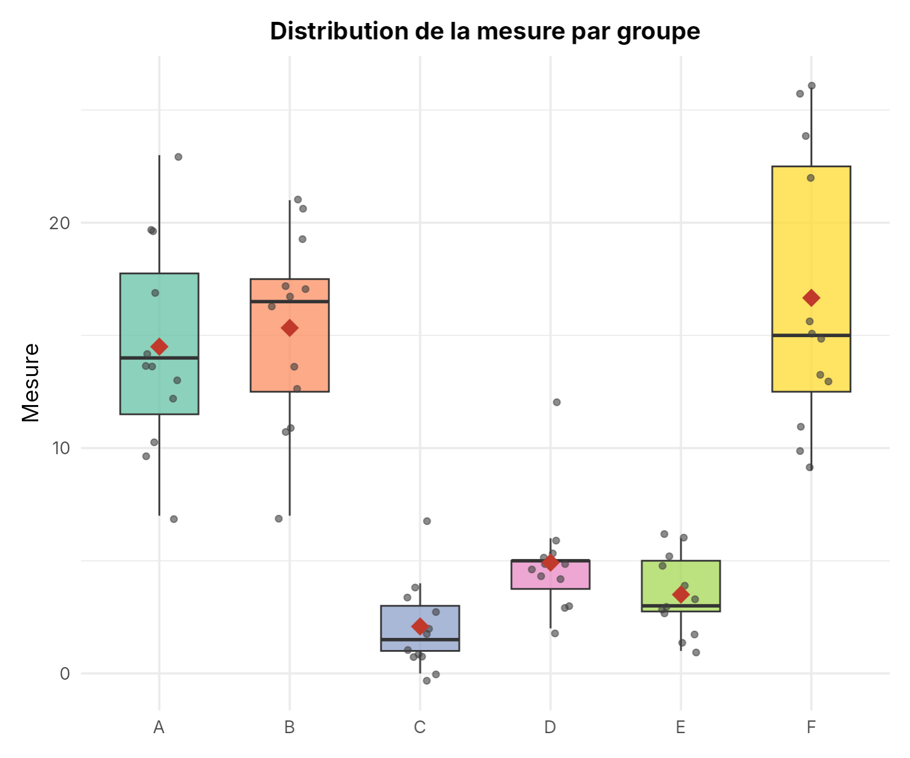
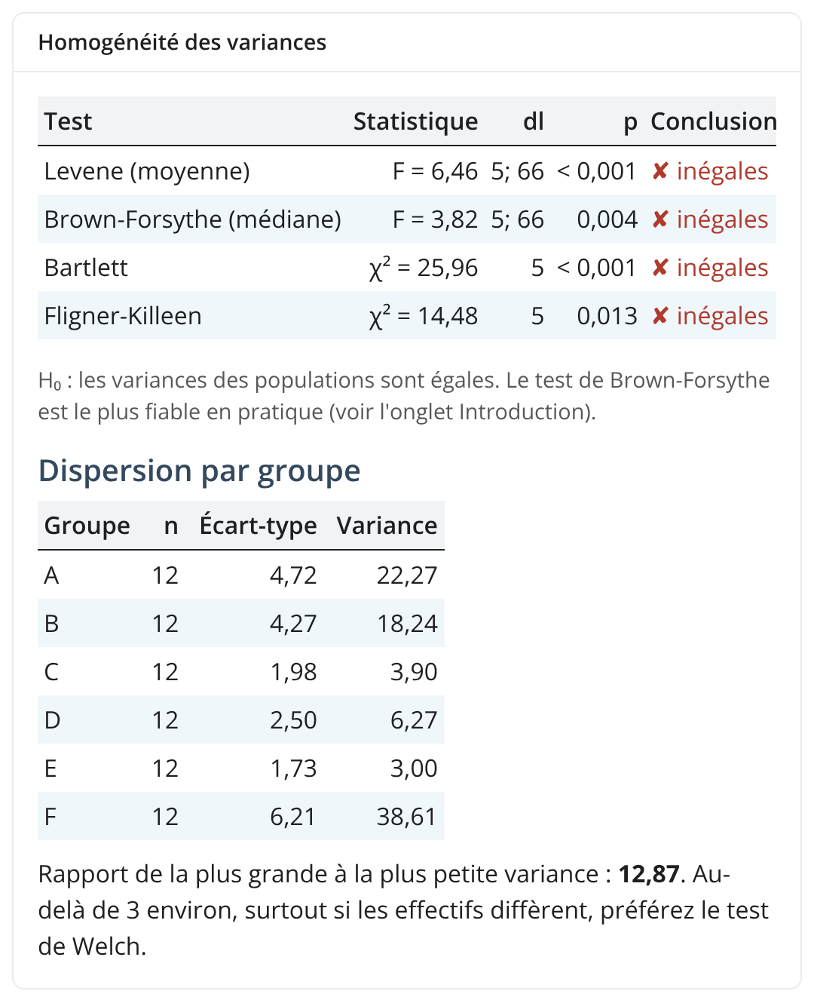
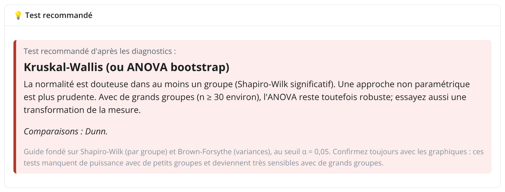
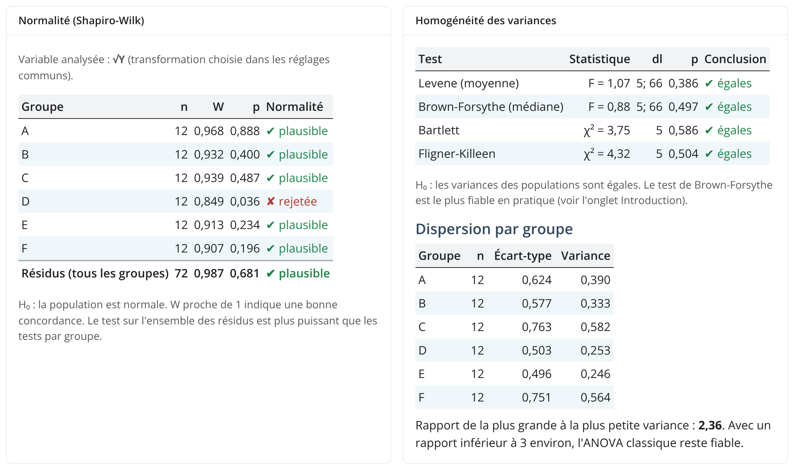
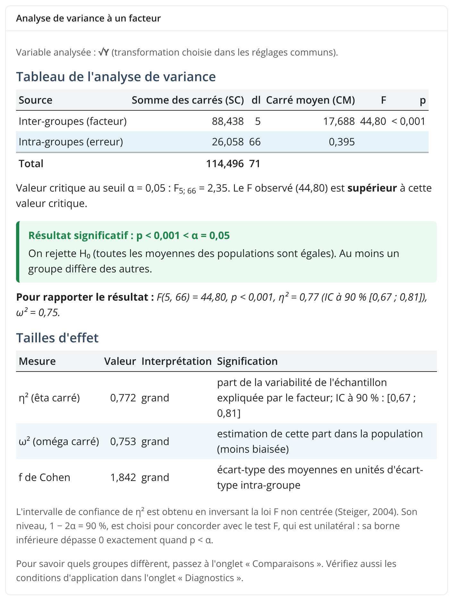
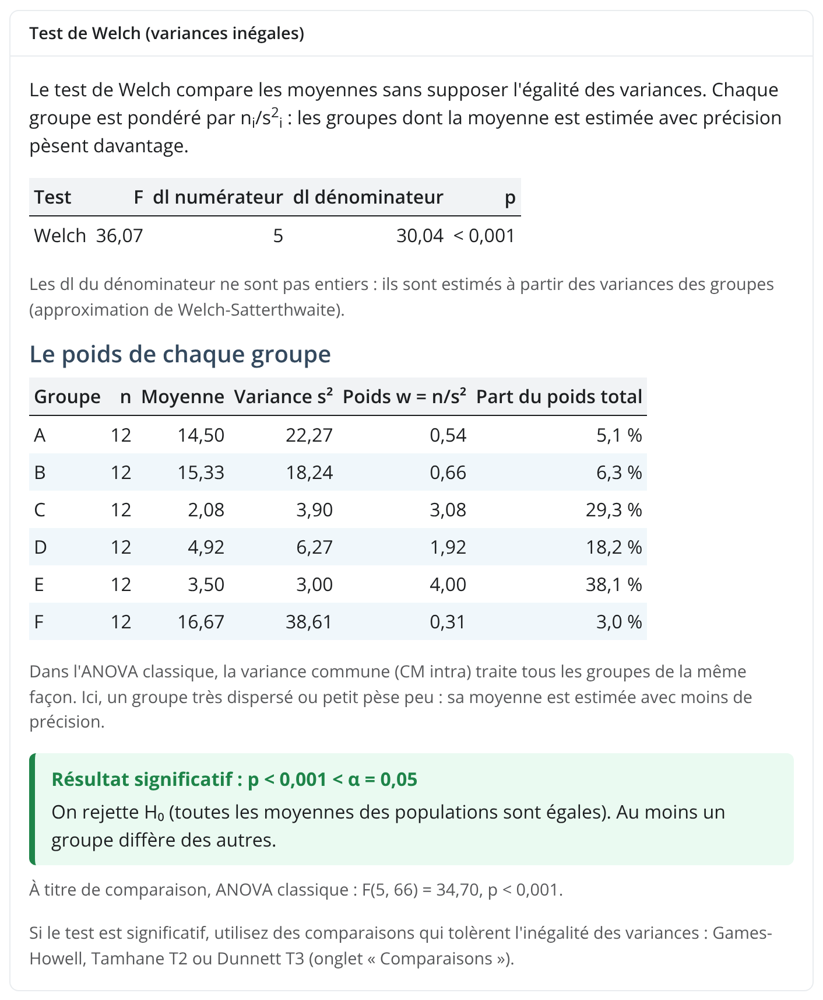
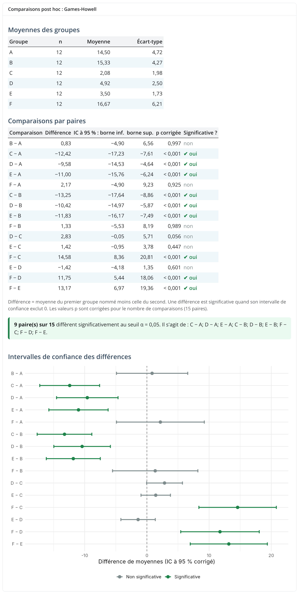

# Un exemple guidé : des données réelles {#sec-exemple}

```{r}
#| label: setup
#| include: false
#| cache: false
source("_common.R")
y <- insectes$insectes; g <- insectes$insecticide
ins_s <- stats_groupes(y, g); ins_r <- stats_groupes(sqrt(y), g)
ins_a <- anova_1f(y, g); ins_ar <- anova_1f(sqrt(y), g)
ins_w <- welch_1f(y, g); ins_kw <- kw_1f(y, g)
ins_e <- tailles_effet(ins_ar); ins_ic <- ic_eta2(ins_ar$F, ins_ar$dl1, ins_ar$dl2, 0.90)
bf_brut <- car::leveneTest(y ~ g, center = median)[1, 3]
bf_rac <- car::leveneTest(sqrt(y) ~ g, center = median)[1, 3]
tk_r <- comparaisons_multiples(sqrt(y), g, "tukey")
gh <- comparaisons_multiples(y, g, "gameshowell")
cap_fig_moy_var <- paste0("Variance selon la moyenne, pour les six insecticides. Les points s'alignent à peu près le long d'une droite qui passe près de l'origine (pointillé : variance = moyenne, la relation de la loi de Poisson) : la variance croît avec la moyenne. Corrélation entre moyennes et variances : ", fr(cor(ins_s$moy, ins_s$var), 2), ".")
```

::: {.callout-tip title="Objectifs d'apprentissage"}
À la fin de ce chapitre, vous serez en mesure de :

- importer un fichier de données réelles dans l'application et vérifier qu'il a été bien lu;
- mener une analyse complète dans l'ordre : décrire, diagnostiquer, choisir, tester, localiser, mesurer;
- justifier une transformation par la nature des données, et vérifier que les conclusions résistent à d'autres choix raisonnables;
- rédiger le compte rendu complet d'une ANOVA.
:::

::: {.callout-important title="Idée centrale"}
Avec des données réelles, on ne connaît pas la vérité : la qualité d'une conclusion tient à la démarche qui y mène. Le test se choisit d'après ce que les données sont (ici, des comptages) et d'après les diagnostics, avant de regarder les valeurs $p$. Une conclusion solide est celle qui ne dépend pas d'un choix discutable : on la vérifie avec une ou deux routes de rechange, et l'on dit honnêtement ce qui en dépend.
:::

::: {.callout-warning title="Pièges classiques"}
- **Suivre la carte Test recommandé sans réfléchir.** Elle applique une règle simple; la nature des données peut suggérer une meilleure route.
- **Essayer tous les tests et garder celui qui plaît.** C'est une pêche aux résultats.
- **Taire une conclusion qui dépend de l'échelle ou du test.** Le lecteur doit savoir quelles conclusions sont robustes.
:::

Les chapitres précédents travaillaient sur des données simulées, dont on connaissait la vérité. Ce chapitre fait l'inverse : il part d'un jeu de données réel et suit, étape par étape, la démarche d'une analyse complète. À chaque étape, une question vous est posée; essayez d'y répondre dans l'application avant d'ouvrir la réponse.

## La question et les données

Le jeu de données vient d'une expérience agricole classique, publiée par Beall [-@beall1942] et devenue un exemple de manuel. Six insecticides, notés A à F, ont été appliqués chacun sur 12 parcelles; on a ensuite **compté les insectes** survivants sur chaque parcelle. La question : *les insecticides diffèrent-ils dans leur efficacité, et lesquels sont les plus efficaces ?* Un insecticide efficace laisse peu d'insectes.

Le fichier [insecticides.csv](donnees/insecticides.csv) contient 72 lignes, une par parcelle, et deux colonnes : `insecticide` (A à F) et `insectes` (le nombre compté).

## Étape 1 — Importer et vérifier

Dans l'onglet **Introduction**, choisissez la source **Importer**, puis le fichier. L'application lit les en-têtes et propose une colonne pour les groupes et une pour la mesure (@fig-import). Ici, les choix proposés sont les bons : `insecticide` pour les groupes, `insectes` pour la mesure. Laissez la variable indépendante **Nominale** : les six insecticides n'ont pas d'ordre.

{#fig-import fig-align="center" width="34%"}

::: {.callout-note title="Étape 1 — Votre tâche"}
Ouvrez **Description des données ▸ Statistiques descriptives** et vérifiez, dans la carte **Informations sur les données**, que l'importation est correcte.

::: {.callout-tip title="Réponse" collapse="true"}
La carte doit indiquer 6 groupes (A, B, C, D, E, F, dans l'ordre alphabétique) et 72 observations, sans ligne retirée. Vérifier ce point d'abord évite d'analyser un fichier mal lu : une colonne prise pour une autre, un séparateur mal reconnu ou des valeurs manquantes inattendues se repèrent ici.
:::
:::

## Étape 2 — Décrire

Le tableau des statistiques par groupe (@fig-stats-ins) et les boîtes à moustaches (@fig-boites-ins) suffisent à dégager l'essentiel.

{#fig-stats-ins fig-align="center" width="80%"}

{#fig-boites-ins fig-align="center" width="80%"}

::: {.callout-note title="Étape 2 — Votre tâche"}
Décrivez en deux phrases ce que montrent le tableau et le graphique : les moyennes d'abord, les dispersions ensuite.

::: {.callout-tip title="Réponse" collapse="true"}
Les insecticides forment deux blocs : A, B et F laissent en moyenne 14 à 17 insectes; C, D et E, seulement 2 à 5. Les dispersions suivent les moyennes : les écarts-types vont de `r fr(min(ins_s$et))` (E) à `r fr(max(ins_s$et))` (F), et les groupes aux moyennes élevées sont aussi les plus dispersés. Le rapport de la plus grande à la plus petite variance atteint `r fr(max(ins_s$var) / min(ins_s$var), 1)`.
:::
:::

Le lien entre moyenne et dispersion n'est pas un hasard : c'est la signature des **comptages**. Quand on compte des événements rares et indépendants, la variance tend à croître comme la moyenne (c'est la propriété de la loi de Poisson, où les deux sont égales). La @fig-moy-var le montre pour nos six insecticides : la variance de chaque groupe est presque proportionnelle à sa moyenne.

```{r}
#| label: fig-moy-var
#| fig-cap: !expr cap_fig_moy_var
#| fig-alt: "Six points étiquetés A à F. C, E et D sont en bas à gauche (moyennes 2 à 5, variances 3 à 6); A, B et F sont en haut à droite (moyennes 14 à 17, variances 18 à 39). Une droite pointillée y = x passe parmi eux."
#| fig-height: 3.5
#| fig-width: 6
ggplot(ins_s, aes(moy, var)) +
  geom_abline(slope = 1, intercept = 0, linetype = "dashed", colour = "grey40") +
  geom_point(size = 3, colour = pal$bleu) +
  geom_text(aes(label = Groupe), nudge_x = 0.6, size = 4, fontface = "bold") +
  scale_x_continuous(labels = axe_fr, limits = c(0, 18)) + scale_y_continuous(labels = axe_fr, limits = c(0, 40)) +
  labs(x = "Moyenne du groupe (insectes par parcelle)", y = "Variance du groupe")
```

## Étape 3 — Diagnostiquer

L'onglet **Diagnostics** confirme l'impression laissée par la description (@fig-homog-ins). Les quatre tests d'homogénéité rejettent l'égalité des variances (Brown-Forsythe : $p = `r fr(bf_brut, 3)`$). La normalité est rejetée dans deux groupes, C et D, ceux dont les comptes sont les plus faibles : avec des valeurs entières entre 0 et 7, collées contre zéro, une distribution ne peut guère être normale.

{#fig-homog-ins fig-align="center" width="55%"}

La carte **Test recommandé** propose Kruskal-Wallis (@fig-reco-ins) : sa règle donne la priorité à la normalité, rejetée dans au moins un groupe.

{#fig-reco-ins fig-align="center" width="85%"}

::: {.callout-note title="Étape 3 — Votre tâche"}
La carte recommande Kruskal-Wallis. Est-ce la meilleure route pour ces données ? Quelle autre option le @tbl-routes suggère-t-il ?

::: {.callout-tip title="Réponse" collapse="true"}
Kruskal-Wallis est une route défendable, mais pas la plus naturelle. Le problème principal n'est pas une forme bizarre des distributions : c'est une **variance qui croît avec la moyenne**, typique des comptages. Le @tbl-routes associe cette situation à une **transformation** : la racine carrée, précisément conçue pour stabiliser la variance des comptages. La carte ne connaît pas la nature des données; vous, si. C'est d'ailleurs l'objet même de l'article d'origine, consacré à la transformation des données de ce type d'expérience pour rendre l'ANOVA applicable.
:::
:::

## Étape 4 — Choisir, avant de tester

On choisit la route **avant** de regarder les valeurs $p$. Ici, trois routes sont raisonnables :

1. **la racine carrée, puis l'ANOVA classique** : justifiée par la nature des données (des comptages);
2. **le test de Welch, puis Games-Howell**, sur l'échelle d'origine : justifié par l'inégalité des variances;
3. **Kruskal-Wallis, puis Dunn** : justifié par la non-normalité des petits comptages.

Nous retenons la première comme analyse principale, parce qu'elle s'attaque à la cause du problème plutôt qu'à ses symptômes, et nous utiliserons les deux autres comme **vérifications**. Si les trois routes s'accordent, la conclusion ne dépend pas de notre choix.

La @fig-deux-echelles montre l'effet de la racine carrée. Les grandes valeurs sont comprimées davantage que les petites : les boîtes des groupes A, B et F rétrécissent, celles de C, D et E s'étirent, et les dispersions deviennent comparables.

```{r}
#| label: fig-deux-echelles
#| fig-cap: "Les données d'insecticides sur l'échelle d'origine (à gauche) et après transformation par la racine carrée (à droite). Sur l'échelle d'origine, la hauteur des boîtes suit le niveau des moyennes; après transformation, elle est à peu près la même partout."
#| fig-alt: "Deux panneaux de boîtes à moustaches pour six groupes. À gauche, les boîtes A, B, F sont hautes et situées vers 10 à 20; C, D, E sont basses, vers 1 à 5. À droite, les six boîtes ont des hauteurs semblables."
#| fig-height: 3.6
de <- rbind(data.frame(g = g, v = y, ech = "Nombre d'insectes"),
            data.frame(g = g, v = sqrt(y), ech = "Racine carrée du nombre"))
de$ech <- factor(de$ech, levels = c("Nombre d'insectes", "Racine carrée du nombre"))
set.seed(4)
ggplot(de, aes(g, v)) +
  geom_boxplot(fill = "#aed6f1", outlier.shape = NA, width = 0.55) +
  geom_jitter(width = 0.12, height = 0, alpha = 0.5, size = 1.2, colour = "grey25") +
  facet_wrap(~ech, scales = "free_y") +
  scale_y_continuous(labels = axe_fr) +
  labs(x = "Insecticide", y = NULL)
```

::: {.callout-note title="Étape 4 — Votre tâche"}
Dans les réglages communs, choisissez **Racine carrée √Y**, puis revenez à l'onglet **Diagnostics**. Que deviennent les tests d'homogénéité et de normalité ?

::: {.callout-tip title="Réponse" collapse="true"}
Après transformation (@fig-racine-diag), le rapport des variances tombe de `r fr(max(ins_s$var) / min(ins_s$var), 1)` à `r fr(max(ins_r$var) / min(ins_r$var), 2)`, et les quatre tests d'homogénéité cessent de rejeter (Brown-Forsythe : $p = `r fr(bf_rac, 2)`$). La normalité devient plausible dans cinq groupes sur six et sur l'ensemble des résidus; seul D reste juste sous le seuil ($p = 0{,}036$), ce qui, avec 12 valeurs entières, est sans gravité. Les conditions de l'ANOVA classique sont maintenant raisonnablement remplies.
:::
:::

{#fig-racine-diag fig-align="center" width="100%"}

## Étape 5 — Tester

Sur la racine carrée des comptes, l'ANOVA classique est sans appel (@fig-racine-anova) : $F(`r ins_ar$dl1`, `r ins_ar$dl2`) = `r fr(ins_ar$F)`$, $p < 0{,}001$, $\eta^2 = `r fr(ins_e$eta2, 2)`$ (IC à 90 % [`r fr(ins_ic[1], 2)` ; `r fr(ins_ic[2], 2)`]). Le type d'insecticide explique plus des trois quarts de la variabilité des comptes transformés : un effet très grand, et précisément estimé.

{#fig-racine-anova fig-align="center" width="70%"}

::: {.callout-note title="Étape 5 — Votre tâche"}
Vérifiez la conclusion par les deux autres routes : le test de Welch et Kruskal-Wallis sur l'échelle d'origine (remettez la transformation à **Aucune**). Les trois routes s'accordent-elles ?

::: {.callout-tip title="Réponse" collapse="true"}
Oui. Le test de Welch donne $F(5;\ `r fr(ins_w$dl2, 2)`) = `r fr(ins_w$F)`$, $p < 0{,}001$ (@fig-welch-ins), et Kruskal-Wallis, $H = `r fr(ins_kw$H)`$ à 5 dl, $p < 0{,}001$. Les trois routes concluent sans ambiguïté que les insecticides diffèrent : le résultat global ne dépend pas du choix du test. (L'ANOVA classique sur l'échelle d'origine, déconseillée ici, donnerait aussi $p < 0{,}001$ : l'effet est si fort qu'aucune méthode ne le manque.)
:::
:::

{#fig-welch-ins fig-align="center" width="70%"}

## Étape 6 — Localiser les différences

Le test global dit qu'au moins un insecticide diffère. Lesquels ? Sur l'échelle transformée, les conditions de Tukey sont remplies; sur l'échelle d'origine, Games-Howell tient compte des variances inégales (@fig-gh-ins).

{#fig-gh-ins fig-align="center" width="70%"}

::: {.callout-note title="Étape 6 — Votre tâche"}
Comparez les paires significatives selon Games-Howell (échelle d'origine) et selon Tukey (racine carrée). Les deux méthodes donnent-elles les mêmes blocs ? Y a-t-il une paire sur laquelle elles divergent ?

::: {.callout-tip title="Réponse" collapse="true"}
Les deux méthodes dessinent les mêmes deux blocs. Les neuf paires qui opposent un insecticide de {A, B, F} à un insecticide de {C, D, E} sont significatives ($p < 0{,}001$); aucune paire à l'intérieur de {A, B, F} ne l'est. Une seule paire diverge : **D − C**. Games-Howell, sur l'échelle d'origine, ne la déclare pas significative ($p = `r fr(gh$p[gh$Comparaison == "D − C"], 3)`$, intervalle de −0,05 à 5,71 insectes); Tukey, sur la racine carrée, la déclare significative ($p = `r fr(tk_r$p[tk_r$Comparaison == "D − C"], 3)`$). Sur cette paire, la conclusion dépend de l'échelle : D laisse un peu plus d'insectes que C, mais la preuve est fragile.
:::
:::

## Étape 7 — Mesurer et rapporter

Il reste à traduire les résultats dans l'échelle qui intéresse le lecteur. Sur la racine carrée, les moyennes des deux blocs valent environ 3,9 et 1,7; élevées au carré, elles correspondent à environ 15 et 3 insectes par parcelle. En moyenne, les insecticides C, D et E laissent donc cinq fois moins d'insectes que A, B et F.

::: {.callout-note title="Étape 7 — Votre tâche"}
Rédigez le compte rendu de l'analyse, en suivant le modèle de la section *Rapporter le résultat* du @sec-anova.

::: {.callout-tip title="Réponse" collapse="true"}
Une rédaction possible :

> Le nombre d'insectes survivants a été compté sur 12 parcelles pour chacun de six insecticides (A à F). Les moyennes allaient de `r fr(min(ins_s$moy), 1)` (C) à `r fr(max(ins_s$moy), 1)` (F) insectes par parcelle. Comme il s'agit de comptages dont la variance croissait avec la moyenne (rapport des variances extrêmes : `r fr(max(ins_s$var) / min(ins_s$var), 1)`; test de Brown-Forsythe : $p = `r fr(bf_brut, 3)`$), l'analyse a porté sur la racine carrée des comptes, qui égalise les variances (Brown-Forsythe : $p = `r fr(bf_rac, 2)`$). Une ANOVA à un facteur montre que les insecticides diffèrent, $F(5, 66) = `r fr(ins_ar$F)`$, $p < 0{,}001$, $\eta^2 = `r fr(ins_e$eta2, 2)`$, IC à 90 % [`r fr(ins_ic[1], 2)` ; `r fr(ins_ic[2], 2)`]. Les comparaisons de Tukey distinguent deux blocs : les insecticides C, D et E laissent nettement moins d'insectes que A, B et F (toutes les comparaisons entre blocs : $p < 0{,}001$), sans différence à l'intérieur du bloc {A, B, F}. Dans le bloc le plus efficace, D laisse un peu plus d'insectes que C ($p = `r fr(tk_r$p[tk_r$Comparaison == "D − C"], 3)`$), mais cette différence n'est pas significative sur l'échelle d'origine (Games-Howell : $p = `r fr(gh$p[gh$Comparaison == "D − C"], 3)`$). Le test de Welch et le test de Kruskal-Wallis sur les comptes bruts mènent à la même conclusion globale (tous deux : $p < 0{,}001$).
:::
:::

## La démarche en résumé

La @fig-demarche résume le chemin suivi. Elle n'est pas un algorithme à appliquer aveuglément : chaque flèche demande un jugement, éclairé par la nature des données et par les graphiques autant que par les tests.

```{mermaid}
%%| label: fig-demarche
%%| fig-cap: "La démarche d'une analyse de variance à un facteur, telle qu'elle a été suivie dans ce chapitre."
%%| fig-width: 6.5
flowchart TD
  A["<b>Décrire</b><br/>moyennes, écarts-types, graphiques"] --> B["<b>Diagnostiquer</b><br/>normalité par groupe, variances"]
  B --> C{"Conditions<br/>plausibles ?"}
  C -- "oui" --> D["ANOVA classique<br/>puis Tukey"]
  C -- "variance liée<br/>à la moyenne" --> E["Transformer<br/>puis rediagnostiquer"]
  E --> B
  C -- "variances<br/>inégales" --> F["Welch<br/>puis Games-Howell"]
  C -- "forte asymétrie,<br/>valeurs extrêmes" --> G["Kruskal-Wallis<br/>puis Dunn"]
  D --> H["<b>Mesurer</b><br/>η², ω² et leur précision"]
  F --> H
  G --> H
  H --> I["<b>Vérifier</b><br/>une autre route mène-t-elle<br/>à la même conclusion ?"]
  I --> J["<b>Rapporter</b><br/>descriptives, test, effet,<br/>comparaisons, choix faits"]
```

## À vous : les plantes

Le fichier [plantes.csv](donnees/plantes.csv) reprend une autre expérience classique [@dobson1983]. On a mesuré le poids sec (en grammes) de 30 plants, répartis en trois groupes de 10 : un groupe **témoin** et deux traitements de croissance (**traitement 1** et **traitement 2**). Avant l'expérience, les chercheurs se posaient deux questions précises : *les traitements, dans l'ensemble, font-ils mieux que le témoin ?* et *les deux traitements diffèrent-ils entre eux ?*

::: {.callout-note title="Exercice 8.1 — Analyse complète"}
1. Importez le fichier et décrivez les trois groupes.
2. Vérifiez les conditions de l'ANOVA classique.
3. Faites le test global et relevez la taille d'effet avec son intervalle de confiance.
4. Les deux questions de recherche ont été posées **avant** l'expérience. Traduisez-les en deux contrastes planifiés, vérifiez qu'ils sont orthogonaux et testez-les (**Comparaisons ▸ Contrastes planifiés ▸ Contrastes personnalisés**).
5. Comparez avec les comparaisons de Tukey.
6. Rédigez le compte rendu.

Les réponses sont dans le solutionnaire (@sec-solutionnaire).
:::

## Le mot de la fin

Ce manuel a suivi un fil : comprendre ce que compare l'ANOVA (le signal et le bruit), mesurer ce qu'elle trouve (l'effet et sa précision), savoir quand s'en méfier (les conditions) et quoi faire alors (les variantes), localiser les différences sans se laisser piéger par la multiplicité des tests, et éprouver tout cela par simulation. L'exemple des insecticides montre que ces outils prennent leur sens ensemble. Aucun test n'y est « le bon » à lui seul; c'est la cohérence de la démarche, et l'honnêteté sur ce qui dépend des choix faits, qui rend une conclusion digne de confiance.

## Ce qu'il faut retenir

- Une analyse suit un ordre : décrire, diagnostiquer, choisir, tester, localiser, mesurer, rapporter.
- La nature des données (des comptages, des durées, des proportions) guide le choix, autant que les tests de conditions.
- On choisit la route avant de regarder les valeurs $p$, puis on vérifie la conclusion avec une ou deux routes de rechange.
- Le compte rendu dit ce qui a été fait, pourquoi, et quelles conclusions dépendent des choix faits.

## Erreurs fréquentes

| Erreur | Pourquoi c'est problématique | Bonne pratique |
|:-------|:-----------------------------|:---------------|
| Ne pas vérifier l'importation | Une colonne mal choisie ou un séparateur mal lu faussent toute l'analyse | Contrôler le nombre de groupes, d'observations et de lignes retirées |
| Appliquer la recommandation automatique sans examen | La règle ignore la nature des données | Croiser la carte avec la description et le @tbl-routes |
| Tester sur une échelle et rapporter sur une autre sans le dire | Le lecteur ne sait pas à quoi s'appliquent les chiffres | Préciser l'échelle analysée et retraduire les résultats |
| Ne rapporter que la route qui « marche » | Le lecteur ignore que la conclusion est fragile | Mentionner les vérifications et les divergences |

## Quiz

::: {.callout-note title="Question 1 — raisonnement"}
**Énoncé.** Pourquoi la racine carrée convient-elle particulièrement aux comptages ?

::: {.callout-tip title="Réponse" collapse="true"}
Parce que la variance d'un comptage tend à croître comme sa moyenne (loi de Poisson : variance = moyenne). La racine carrée a la propriété de rendre cette variance à peu près constante : sur l'échelle $\sqrt{Y}$, la variance d'un comptage de Poisson vaut environ 1/4, quelle que soit la moyenne. Elle stabilise donc la variance, ce qui rétablit la condition d'homogénéité de l'ANOVA.
:::
:::

::: {.callout-note title="Question 2 — vrai ou faux"}
**Énoncé.** Puisque la paire D − C est significative avec Tukey sur la racine carrée, on peut affirmer sans réserve que l'insecticide C est plus efficace que D.

::: {.callout-tip title="Réponse" collapse="true"}
Faux. La différence est significative sur une échelle (racine carrée, Tukey) et non sur l'autre (comptes bruts, Games-Howell, $p = 0{,}056$). La preuve est donc fragile, et le compte rendu doit le dire. Il est honnête d'écrire que C semble un peu plus efficace que D, sans en faire une conclusion ferme.
:::
:::

::: {.callout-note title="Question 3 — démarche"}
**Énoncé.** Une collègue analyse les mêmes données avec l'ANOVA classique sur les comptes bruts, obtient $p < 0{,}001$ et conclut que son analyse est valide « puisque le résultat est très significatif ». Que lui répondez-vous ?

::: {.callout-tip title="Réponse" collapse="true"}
Que la validité d'un test ne se juge pas à son résultat. Avec des variances qui varient du simple au treize, l'ANOVA classique ne contrôle plus son risque d'erreur, et surtout ses comparaisons de Tukey utiliseraient une variance commune fausse pour chaque paire. Ici, le résultat global est si net que toutes les routes s'accordent; mais pour localiser les différences, et pour d'autres données moins tranchées, le choix compte. Il faut le justifier par les diagnostics.
:::
:::
