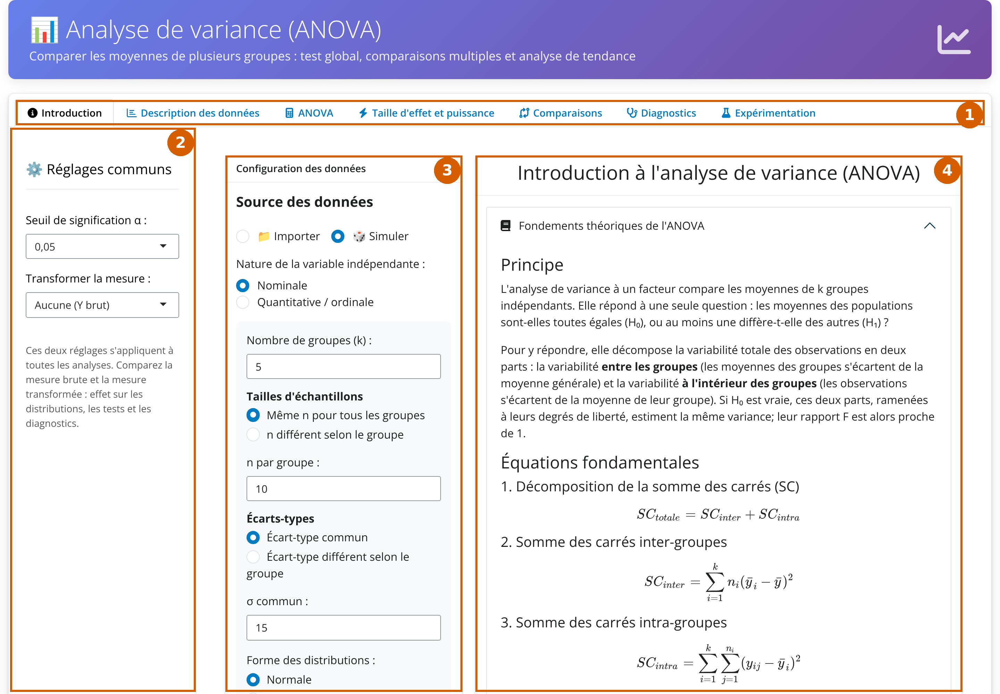

# Préface {.unnumbered}

Ce manuel accompagne l'application **[ANOVA](https://shiny.dcstats.org/ANOVA){target="_blank"}**, un laboratoire interactif consacré à l'analyse de variance à un facteur. Il ne s'adresse pas au lecteur pressé qui cherche une formule à appliquer, mais à l'étudiant qui veut *comprendre*. Pourquoi compare-t-on des variances pour conclure sur des moyennes ? Que se passe-t-il quand les conditions du test ne sont pas réunies ? Comment décide-t-on qu'une différence est réelle plutôt que due au hasard de l'échantillonnage ?

L'application est volontairement interactive : on y fabrique des données, on modifie un réglage, on observe aussitôt la conséquence. Le manuel fournit ce que l'écran ne peut pas donner : les définitions, le raisonnement qui relie les résultats entre eux et les mises en garde qui évitent les conclusions hâtives. Les deux se complètent. La théorie explique *pourquoi* l'écran affiche ce qu'il affiche; l'écran montre *ce que fait* la théorie sur des données concrètes.

## Objectifs du manuel

À la fin de ce parcours, vous devriez être en mesure de :

- expliquer pourquoi l'ANOVA décompose la variabilité des observations pour comparer des moyennes, et ce qu'estiment ses deux carrés moyens;
- lire un tableau d'analyse de variance (sommes des carrés, degrés de liberté, carrés moyens, statistique $F$, valeur $p$) et refaire le calcul à partir des moyennes et des variances des groupes;
- distinguer la significativité d'un résultat de l'ampleur de l'effet, entourer cette ampleur d'un intervalle de confiance et calculer la taille d'échantillon nécessaire à une étude;
- choisir, selon les données, entre l'ANOVA classique et ses variantes robustes (Welch, Brown-Forsythe, Kruskal-Wallis, test de la médiane, bootstrap, transformation);
- localiser une différence au moyen de contrastes planifiés, d'une analyse de tendance ou de comparaisons post hoc, en contrôlant le risque global d'erreur;
- vérifier les conditions d'application et justifier le choix du test;
- interpréter des simulations qui montrent le comportement des tests (loi de $F$, erreur de type I, puissance, robustesse);
- mener une analyse complète sur des données réelles et en rédiger le compte rendu.

## L'application en un coup d'œil

L'application est accessible en ligne, sans installation, à l'adresse <https://shiny.dcstats.org/ANOVA>.

L'écran de l'application comporte quatre zones (@fig-interface). Les **onglets** (1) correspondent aux étapes d'une analyse. Le panneau **Réglages communs** (2), toujours visible à gauche, contient deux choix qui s'appliquent à toutes les analyses : le seuil de signification $\alpha$ et une éventuelle transformation de la mesure. Dans l'onglet **Introduction**, la carte **Configuration des données** (3) sert à importer un fichier ou à simuler un échantillon; la carte de droite (4) résume la théorie.

{#fig-interface fig-align="center" width="100%"}

Le manuel est organisé en quatre parties, qui suivent la démarche d'une analyse :

| Partie | Chapitre | Onglets de l'application |
|:-------|:---------|:-------------------------|
| **Comprendre** | 1. L'ANOVA et l'application | **Introduction**, **ANOVA ▸ ANOVA classique** |
| | 2. Décrire les données | **Description des données** |
| **Tester** | 3. Le test $F$ : décision, ampleur et puissance | **ANOVA ▸ ANOVA classique**, **Taille d'effet et puissance** |
| | 4. Quand les conditions faiblissent | **ANOVA** (Welch, Brown-Forsythe, Kruskal-Wallis, médiane, bootstrap); transformation de la mesure |
| **Localiser et vérifier** | 5. Comparaisons multiples et contrastes | **Comparaisons** |
| | 6. Vérifier les conditions | **Diagnostics** |
| **Éprouver et pratiquer** | 7. Expérimenter | **Expérimentation** |
| | 8. Un exemple guidé : des données réelles | tous les onglets, sur un fichier importé |

: Les parties du manuel, leurs chapitres et les onglets correspondants. {#tbl-onglets}

Les diagnostics sont présentés au @sec-diagnostics pour que les tests soient connus avant qu'on discute de leurs conditions. Dans une analyse réelle, on les consulte toutefois **avant** de choisir le test : la carte **Test recommandé** de l'onglet **Diagnostics** sert précisément à ce choix, et l'exemple guidé du @sec-exemple suit cet ordre.

## L'exemple de référence

Au démarrage, l'application simule un échantillon avec ses réglages par défaut : **5 groupes de 10 observations**, des moyennes de population qui croissent de 80 à 120 par pas de 10, un écart-type commun de 15 et la **graine aléatoire 2026**. C'est l'**exemple de référence** du manuel : les captures d'écran et les valeurs citées dans le texte proviennent de cet échantillon, sauf mention contraire. Pour le retrouver après avoir modifié les données, inscrivez 2026 dans le champ **Graine aléatoire** et cliquez sur **Générer les données** en conservant les réglages par défaut.

Deux autres jeux simulés reviennent d'un chapitre à l'autre, parce qu'ils illustrent chacun une condition menacée :

- le **jeu hétérogène** : 3 groupes de moyennes toutes égales à 100 (aucune différence réelle), mais d'écarts-types 5, 12 et 25 et d'effectifs 30, 20 et 10, graine 51;
- le **jeu asymétrique** : 3 groupes de 15 observations tirées de lois log-normales, de moyennes 100, 100 et 130 et d'écart-type 60, graine 174.

Les données peuvent aussi être **importées**. Le chapitre 8 analyse ainsi un jeu de données réel, fourni avec le manuel : [insecticides.csv](donnees/insecticides.csv). Un second fichier, [plantes.csv](donnees/plantes.csv), sert d'exercice final. Le mode simulé reste toutefois l'outil central de ce manuel : il permet de fixer la vérité (les vraies moyennes, les vrais écarts-types) puis d'observer ce que les analyses en retrouvent.

## Comment lire ce manuel

Chaque chapitre s'ouvre sur ses **objectifs d'apprentissage**, son **idée centrale** et les **pièges classiques** à éviter. Le texte alterne explications et **laboratoires** : de courtes activités où l'on règle l'application, observe un résultat et répond à une question. Les réponses aux questions des laboratoires sont regroupées dans le **solutionnaire** (@sec-solutionnaire); cherchez d'abord par vous-même. Chaque chapitre se termine par un tableau des **erreurs fréquentes** et un court **quiz**, dont les réponses sont repliées.

Les figures qui ne sont pas des captures d'écran ont été calculées pour le manuel. Elles montrent ce que l'écran ne peut pas montrer d'un seul coup : une loi de probabilité entière, des milliers d'échantillons, une idée géométrique. Elles utilisent les mêmes calculs que l'application.

On peut lire les chapitres dans l'ordre ou ouvrir directement celui qui correspond à l'onglet exploré. Les deux premiers posent le vocabulaire (variabilité inter et intra, carré moyen, rapport $F$) que les suivants réutilisent. Gardez l'application ouverte à côté du texte : les laboratoires n'ont de sens que manipulés.

Le glossaire, en fin d'ouvrage, relie les termes et symboles du manuel aux libellés de l'écran.
